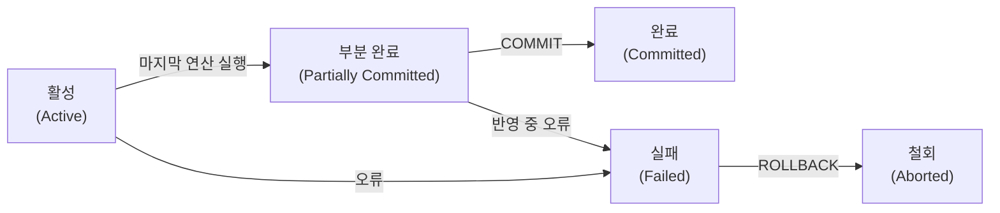

# 트랜잭션 (Transaction)

---

## I. 회복과 병행 제어의 단위, 트랜잭션의 개요

### 가. 정의

- 데이터베이스의 상태를 변화시키는 **하나 이상의 연산을 묶은 논리적 작업 단위**로, 전부 수행되거나 전혀 수행되지 않아야 하며 회복·병행 제어의 기준이 됨

### 나. 특징

| 구분 | 내용 |
| --- | --- |
| All or Nothing | 부분 실행 결과를 남기지 않음 |
| ACID | 원자성, 일관성, 고립성, 지속성 보장 |
| 제어 명령 | COMMIT, ROLLBACK, SAVEPOINT (TCL) |
| 필요성 | 다중 사용자 동시 접근과 장애 상황에서도 일관성 유지 |

---

## II. 상태 전이 및 ACID

### 가. 상태 전이

- 철회된 트랜잭션은 재시작하거나 폐기하며, 완료 후에는 장애가 나도 결과가 유지되어야 함

### 나. ACID와 보장 기법

| 구분 | 요소 | 설명 |
| --- | --- | --- |
| 원자성 (Atomicity) | All or Nothing | 실패 시 UNDO로 이전 상태 복구 ([[DB 회복기법]]) |
| 일관성 (Consistency) | 제약조건 | 수행 전후 무결성 제약을 만족하는 상태 유지 ([[데이터베이스 무결성]]) |
| 고립성 (Isolation) | 직렬 가능성 | 동시 수행 트랜잭션이 서로 간섭하지 않음 |
| | 병행 제어 | [[Locking]]·[[2PL]], [[타임스탬프 순서 기법]], [[MVCC(다중 버전 동시성 제어) 2가지 유형\|MVCC]], [[Isolation Level (격리 레벨고립성 수준)\|격리 수준]] |
| 지속성 (Durability) | 영구 반영 | 커밋 결과는 장애 후에도 유지, WAL과 REDO로 보장 |
| 제어 | TCL | COMMIT, ROLLBACK, SAVEPOINT |

---

## III. 비교 및 동향

### 가. 단일 DB vs 분산 DB vs MSA 트랜잭션

| 비교 항목 | 단일 DB | [[분산 데이터베이스]] | [[MSA (Micro Service Architecture)\|MSA]] |
| --- | --- | --- | --- |
| 범위 | 하나의 DB | 여러 DB 노드 | 여러 독립 서비스 |
| 제어 방식 | DBMS 로컬 트랜잭션 | 2PC (2-Phase Commit) | Saga (보상 트랜잭션) |
| 일관성 | 강한 일관성 | 강한 일관성 | 최종 일관성 |
| 약점 | 확장 한계 | 코디네이터 장애 시 블로킹 | 중간 상태 노출, 보상 로직 복잡 |

### 나. 동향

- **Saga·Outbox 패턴**: Database per Service 환경에서 이벤트 기반 로컬 트랜잭션 연쇄와 보상 처리
- **NewSQL 분산 트랜잭션**: Spanner, [[CockroachDB]]가 합의 알고리즘과 시계 동기화로 수평 확장과 ACID를 함께 제공 ([[New SQL|NewSQL]])

---

### 🔗 연관 토픽

- **소속 도메인**: [[00_데이터베이스_MOC|🗄️ 데이터베이스]]
- **세부 분류**: `2. 트랜잭션 & 동시성 제어 (Concurrency)`
- **핵심 연관 토픽**:
  - [[병행 제어]]
  - [[DB 회복기법]]
  - [[Isolation Level (격리 레벨고립성 수준)]]
  - [[2PL|2PL (Two-Phase Locking Protocol)]]
  - [[New SQL]]
