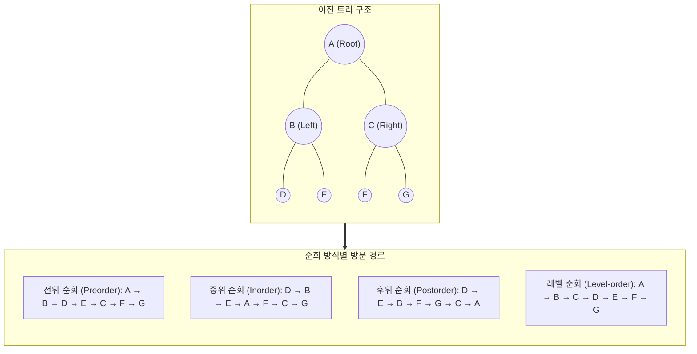

# 트리 순회 (Tree Traversal)

---

## I. 계층형 데이터의 선형 탐색 체계, 트리 순회의 개요

### 가. 정의

- 트리의 모든 노드를 중복이나 누락 없이 **체계적으로 정확히 한 번씩 방문하여 데이터를 검색·처리하는 순서화 알고리즘**

### 나. 특징 및 필요성

| 구분 | 내용 |
| --- | --- |
| 비선형의 선형화 | 2차원 계층 구조를 컴퓨터 메모리와 프로세서가 순차 처리할 수 있는 1차원 순서로 변환 |
| 루트 방문 시점 기준 | 루트(V)의 처리 시점에 따라 전위(VLR), 중위(LVR), 후위(LRV)로 분류 |
| 핵심 자료구조 활용 | 재귀 호출([[Stack]])을 통한 깊이 우선 탐색(DFS) 및 [[Queue]]를 통한 너비 우선 탐색(BFS) 결합 |
| 다양한 응용 | 수식 파싱(후위 표기), 이진 탐색 트리 정렬(중위 순회), 디렉터리 복사 및 삭제 |

---

## II. 개념도 및 핵심 구성요소

### 가. 개념도

- 루트 노드의 방문 순서(V)와 좌우 서브트리 순회 방향의 조합에 따라 각기 다른 선형 방문 순열을 도출

### 나. 핵심 순회 기법 및 특징

| 구분 | 순회 기법 | 방문 순서 | 설명 및 주 활용 |
| --- | --- | --- | --- |
| 깊이 우선 (DFS) | 전위 순회 (Preorder) | Root $\rightarrow$ Left $\rightarrow$ Right (VLR) | 자식 노드 방문 전 현재 노드 우선 처리. 트리 복제, 디렉터리 구조 계층 출력 |
| | 중위 순회 (Inorder) | Left $\rightarrow$ Root $\rightarrow$ Right (LVR) | 왼쪽 서브트리 처리 후 현재 노드 방문. [[이진 탐색 트리]]에서 오름차순 정렬 추출 |
| | 후위 순회 (Postorder) | Left $\rightarrow$ Right $\rightarrow$ Root (LRV) | 하위 자식 노드를 모두 처리한 후 부모 노드 방문. 하위 디렉터리 삭제, 수식 트리 계산 |
| 너비 우선 (BFS) | 레벨 순회 (Level-order) | 레벨 0부터 상 $\rightarrow$ 하, 좌 $\rightarrow$ 우 | 루트부터 레벨 단위로 순차 탐색. 큐([[Queue]])를 활용하여 최단 경로 및 너비 우선 탐색 |
| 구현 메커니즘 | 시스템 스택 (재귀) | 함수 콜스택 활용 | 전위, 중위, 후위 순회에서 백트래킹(Backtracking) 수행 |
| | 선입선출 큐 | Enqueue / Dequeue | 레벨 순회 시 방문 노드의 자식을 큐에 누적하여 [[FIFO]] 순서 보장 |

---

## III. 순회 기법 비교 및 동향

### 가. 3대 DFS 순회 방식 비교

| 비교 항목 | 전위 순회 (Preorder) | 중위 순회 (Inorder) | 후위 순회 (Postorder) |
| --- | --- | --- | --- |
| 방문 패턴 (VLR) | **V** $\rightarrow$ **L** $\rightarrow$ **R** | **L** $\rightarrow$ **V** $\rightarrow$ **R** | **L** $\rightarrow$ **R** $\rightarrow$ **V** |
| 수식 트리 표기 | 전위 표기법 (Prefix, 폴란드) | 중위 표기법 (Infix, 표준 산술식) | 후위 표기법 (Postfix, 역폴란드) |
| 수식 예시: $A+B$ | $+ A B$ | $A + B$ | $A B +$ |
| 대표적 활용 | 트리 복사 및 직렬화(Serialization) | BST 정렬 데이터 순차 추출 | 컴파일러 파싱, 스택 계산기, 트리 메모리 해제 |

### 나. 동향

- **컴파일러 AST(추상 구문 트리) 코드 생성**: 소스코드를 토큰화하여 구문 트리(AST)로 파싱한 후, 후위 순회를 통해 피연산자를 스택에 먼저 쌓고 연산자를 적용하는 바이트코드 생성 최적화
- **반복적(Iterative) 순회와 모리스(Morris) 순회**: 대규모 트리 탐색 시 재귀 콜스택 오버플로우($O(H)$ 메모리)를 회피하기 위해 스레드 이진 트리 기반으로 메모리 복잡도 $O(1)$을 달성하는 Morris 순회 알고리즘 활용
- **AI 게임 트리 탐색(MCTS)**: 바둑, 체스 등 인공지능 탐색에서 트리 순회 원리를 몬테카를로 트리 탐색(MCTS: 선택-확장-시뮬레이션-역전파)으로 발전시켜 최적 수 탐색

---

### 🔗 연관 토픽

- **소속 도메인**: [[00_컴퓨터구조_MOC|💻 컴퓨터구조]]
- **세부 분류**: `4. 기본 자료구조 (Data Structures)`
- **핵심 연관 토픽**:
  - [[이진 탐색 트리|이진 탐색 트리(Binary Search Tree)]]
  - [[Stack]]
  - [[Queue]]
  - [[AVL 트리]]
  - [[알고리즘]]
