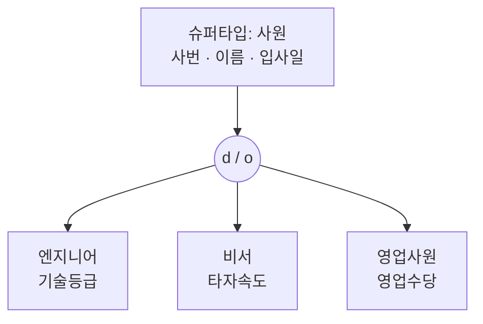

# 특수화 (Specialization)

---

## I. 상위 개체의 세분화, 특수화의 개요

### 가. 정의

- 상위 [[엔티티]](슈퍼타입)를 **고유 속성과 관계를 가진 하위 엔티티(서브타입)로 나누는 하향식 추상화 기법** (is-a 관계, 일반화의 역)

### 나. 특징

| 구분 | 내용 |
| --- | --- |
| 하향식 | 슈퍼타입에서 서브타입으로 구체화 |
| 상속 | 서브타입은 슈퍼타입의 식별자·속성·관계를 상속 |
| 차이 강조 | 서브타입만의 고유 속성·관계를 명시 |
| 활용 | EER 모델 슈퍼·서브타입, [[객체지향]] 클래스 상속 |

---

## II. 구조 및 제약조건

### 가. 슈퍼타입–서브타입 구조

- 구분자(예: 직종)로 서브타입이 결정되며, d(배타)·o(중첩)와 전체·부분 참여 제약을 함께 표기

### 나. 구성요소와 제약조건

| 구분 | 요소 | 설명 |
| --- | --- | --- |
| 구성 | 슈퍼타입 | 공통 속성·관계를 가진 상위 엔티티 |
| | 서브타입 | 상속 속성 외 고유 속성·관계를 가진 하위 엔티티 |
| | 구분자 (Discriminator) | 인스턴스가 속할 서브타입을 결정하는 속성 |
| 배타성 제약 | 배타 (Disjoint, d) | 하나의 인스턴스는 하나의 서브타입에만 속함 |
| | 중첩 (Overlapping, o) | 여러 서브타입에 동시에 속할 수 있음 |
| 완전성 제약 | 전체 (Total) | 모든 인스턴스가 반드시 서브타입에 속함 (이중선) |
| | 부분 (Partial) | 어떤 서브타입에도 속하지 않을 수 있음 (단일선) |
| 물리 변환 | 통합·분리 | 단일 테이블 통합(Roll-up), 서브타입별 테이블(Roll-down), 1:1 테이블(슈퍼+서브 각각) |

---

## III. 비교 및 동향

### 가. 특수화 vs 일반화

| 비교 항목 | 특수화 | 일반화 (Generalization) |
| --- | --- | --- |
| 방향 | 하향식 (Top-Down) | 상향식 (Bottom-Up) |
| 과정 | 상위 개체를 하위로 분할 | 하위 개체의 공통점을 상위로 통합 |
| 초점 | 차이점 | 공통점 |
| 관계 | is-a (같은 계층을 반대 방향에서 본 것) | is-a |

### 나. 동향

- **ORM 상속 매핑**: JPA의 SINGLE_TABLE·JOINED·TABLE_PER_CLASS 전략이 슈퍼·서브타입 물리 변환에 대응
- **NoSQL 다형 문서**: 하나의 컬렉션에 타입 필드로 서브타입을 구분해 저장 ([[NoSQL 데이터모델링 패턴]])

---

### 🔗 연관 토픽

- **소속 도메인**: [[00_데이터베이스_MOC|🗄️ 데이터베이스]]
- **세부 분류**: `1. 데이터 모델링 & 관계형 DB 설계`
- **핵심 연관 토픽**:
  - [[UML의 관계]]
  - [[관계성]]
  - [[엔티티|엔티티(Entity)]]
  - [[객체지향]]
  - [[클래스]]
