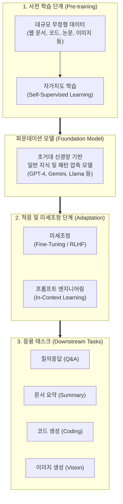

# 파운데이션 모델 (Foundation Model)

---

## I. 범용 인공지능 시대를 여는 초거대 AI의 근간, 파운데이션 모델의 개요

### 가. 파운데이션 모델(Foundation Model)의 정의
- 대규모 비라벨링 데이터(Unlabeled Data)를 자기지도 학습(Self-Supervised Learning) 방식으로 사전 학습하여, 번역·요약·추론 등 광범위한 하위 작업(Downstream Tasks)에 유연하게 적응(Adaptation)할 수 있는 범용 초거대 인공지능 모델이다.

### 나. 파운데이션 모델의 주요 특징 및 핵심 역할
| 특징 및 요소 | 상세 설명 |
| :--- | :--- |
| **창발성(Emergence)** | 모델 파라미터가 임계 규모를 초과하며 명시적 훈련 없이도 발현되는 복합 문제 해결 능력 |
| **균질화(Homogenization)** | 하나의 단일 기반 모델이 수많은 하위 도메인 및 애플리케이션의 공통 인프라로 수렴 |
| **적응성(Adaptability)** | 전면 재학습 없이 미세조정(Fine-Tuning), PEFT, 인컨텍스트 러닝(ICL)을 통해 태스크 적응 |
| **단일 실패점(SPOF) 리스크** | 기반 모델에 내재된 편향이나 환각(Hallucination)이 모든 종속 애플리케이션으로 전파될 위험 상존 |

---

## II. 파운데이션 모델의 개념도 및 핵심 기술 요소

### 가. 파운데이션 모델의 아키텍처 및 동작 원리

* 막대한 양의 범용 데이터를 사전 학습한 하나의 파운데이션 모델을 기반으로, 목적에 맞는 약간의 미세조정([[Fine-Tuning]])이나 프롬프팅만을 거쳐 다양한 애플리케이션을 파생시키는 구조임

### 나. 파운데이션 모델의 핵심 기술 및 구성 요소

| 구분 | 요소기술(키워드) | 세부 설명 |
| :--- | :--- | :--- |
| **핵심 아키텍처** | 트랜스포머 (Transformer) | 병렬 처리에 최적화된 Self-Attention 구조를 통해 대규모 데이터 학습을 가능하게 한 기본 신경망 구조 |
| **학습 메커니즘** | 자가지도 학습 (Self-Supervised) | 사람이 정답(Label)을 달아주지 않아도, 텍스트 내에서 다음 단어를 예측(Next-token Prediction)하거나 빈칸을 추론하며 스스로 학습 |
| **성능 확장성** | 스케일링 법칙 (Scaling Law) | 모델의 파라미터 크기, 학습 데이터 양, 투입되는 컴퓨팅 연산량(Compute)에 비례하여 모델의 성능이 예측 가능하게 향상된다는 법칙 |
| **적응 기술** | 파인튜닝 (Fine-Tuning) | 사전 학습된 범용 모델의 가중치를 특정 도메인(의료, 법률 등)의 소규모 데이터로 추가 학습시켜 최적화하는 기법 |
| **적응 기술** | RLHF (인간 피드백 기반 [[강화학습]]) | 인간의 가치관, 윤리 기준, 선호도를 모델의 출력에 반영하여 안전하고 유용한 답변을 하도록 정렬(Alignment)하는 학습법 |
| **적응 기술** | In-Context Learning (문맥 내 학습) | 모델의 파라미터 가중치를 수정하지 않고, 프롬프트(Prompt) 내에 몇 가지 예시(Few-shot)를 제시하여 새로운 작업을 수행하게 하는 기술 |
| **입출력 확장** | 멀티모달 (Multimodal) | 텍스트(언어)뿐만 아니라 이미지, 음성, 비디오 등 다양한 형태의 데이터 양식을 동시에 이해하고 생성하는 기술 |

---

## III. 특정 태스크 모델과의 비교 및 향후 전망

### 가. 태스크 특화 모델 (Task-Specific) vs 파운데이션 모델 (Foundation) 비교

| 비교 항목 | 태스크 특화 모델 (Task-Specific Model) | 파운데이션 모델 (Foundation Model) |
| :--- | :--- | :--- |
| **개발 패러다임** | 해결하려는 작업마다 별도의 모델 개발 | **하나의 초거대 모델로 수많은 작업을 커버** |
| **데이터 요구사항** | 고비용의 전문가 레이블링 데이터 (Supervised) | **웹 상의 방대한 무정형 데이터 (Self-Supervised)** |
| **확장성 및 범용성** | 낮음 (번역 모델은 번역만 수행 가능) | **매우 높음 (번역, 요약, 추론, 코딩 등 동시 수행)** |
| **컴퓨팅 및 비용** | 비교적 저렴한 초기 학습 비용 | **사전 학습(Pre-training)에 천문학적 컴퓨팅/비용 소요** |
| **주요 한계점** | 새로운 작업마다 데이터 수집/학습 [[프로세스]] 반복 | [[할루시네이션|환각 현상]](Hallucination), 편향성(Bias), 독점화 우려 |

### 나. 파운데이션 모델의 최신 기술 동향 및 향후 전망

- **SLM의 부상 및 엣지 AI 확산**: 천문학적 운영 비용과 프라이버시 한계를 극복하기 위해 양자화, 프루닝, [[지식 증류]]를 거친 소형 언어 모델(Llama-3 8B, Gemma 2 등)이 온디바이스 AI 생태계로 전면 확산됨.
- **[[에이전틱 AI]] (Agentic AI) 두뇌로의 진화**: 정적 텍스트 응답을 넘어 도구 호출(Tool-use), 자율 계획, 실시간 환경 피드백 루프를 통합 수행하는 자율형 에이전트 시스템의 핵심 인지 엔진으로 진화함.
- **AI 거버넌스 및 안전성 평가(Alignment) 의무화**: 단일 기반 모델의 취약점이 전 산업 생태계로 전이되는 균질화 리스크를 완화하기 위해 EU AI Act 등 글로벌 규제 준수와 레드티밍(Red Teaming) 검증 체계 구축이 필수화됨.

---

### 🔗 연관 토픽

- **소속 도메인**: [[00_인공지능_MOC|🤖 인공지능]]
- **세부 분류**: `4. 거대언어모델 (LLM) & 생성형 AI`
- **핵심 연관 토픽**:
  - [[Fine-Tuning]]
  - [[지식 증류|지식 증류 (Knowledge Distillation)]]
  - [[전이학습|전이학습 (Transfer Learning)]]
  - [[Downstream Task]]
