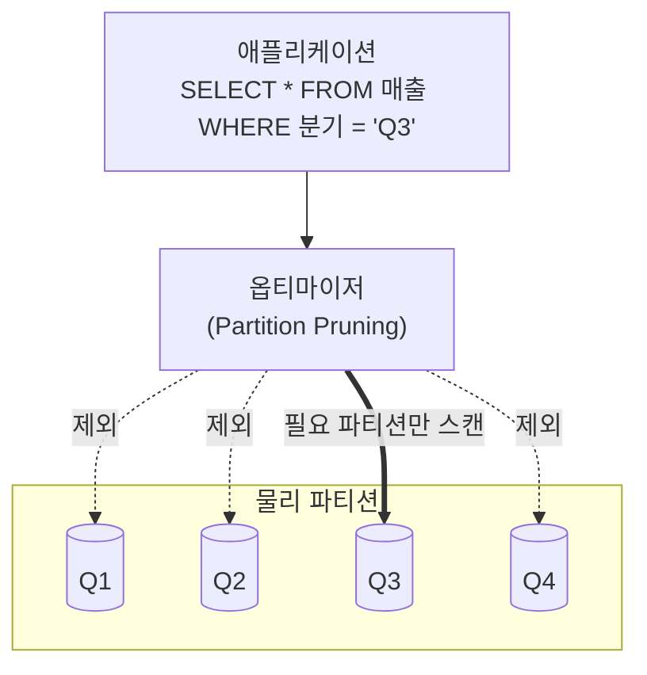

# 데이터베이스 파티셔닝 (Database Partitioning)

---

## I. 대용량 DB의 성능·관리 효율화, 파티셔닝의 개요

### 가. 정의

- 대용량 테이블·인덱스를 **논리적으로는 하나로 유지하면서 물리적으로는 여러 파티션으로 분할**하여 저장하는 [[데이터베이스]] 물리 설계 기법

### 나. 필요성 및 특징

| 구분 | 내용 |
| --- | --- |
| 필요성 | Full Scan 부담·I/O 병목 해소, 잠금 경합 감소, 백업·복구 단위 축소 |
| 투명성 | 애플리케이션은 하나의 테이블로 인식, SQL 수정 불필요 |
| 독립성 | 파티션별 DDL·백업·삭제(DROP) 가능 |
| [[HA(High Availability)\|가용성]] | 일부 파티션(테이블스페이스) 장애·점검 시에도 나머지 파티션 접근 가능 |

---

## II. 동작 원리 및 핵심 기술

### 가. 파티션 프루닝

- WHERE 절에 파티션 키가 있으면 [[OPTIMIZER|옵티마이저]]가 무관한 파티션을 탐색 대상에서 제외해 I/O를 크게 줄임

### 나. 핵심 기술 요소

| 구분 | 요소 | 설명 |
| --- | --- | --- |
| 분할 방향 | 수평 파티셔닝 | 행 단위 분할, 스키마 동일 (일반적인 파티셔닝) |
| | 수직 파티셔닝 | 열 단위 분할, 자주 쓰는 컬럼과 대용량 컬럼 분리 |
| 기준 | 파티션 키 | 날짜·코드·고객 ID 등 분할 기준 컬럼 |
| 최적화 | Partition Pruning | 조건과 무관한 파티션 스캔 제외 |
| | Partition-wise Join | 같은 키로 분할된 두 테이블을 파티션 쌍끼리 병렬 [[조인]] |
| 인덱스 | Local Index | 데이터 파티션과 1:1 대응, 파티션 관리가 독립적 |
| | Global Index | 테이블 전체 기준 인덱스, 파티션 작업 시 재구성 부담 |

---

## III. 기법 비교 및 동향

### 가. Range vs Hash vs List

| 비교 항목 | Range | Hash | List |
| --- | --- | --- | --- |
| 기준 | 연속된 값의 범위 (날짜, 숫자) | 해시 함수 결과 | 명시적 값 목록 (지역, 부서) |
| 장점 | 이력 데이터 관리·오래된 파티션 삭제 용이 | 데이터 균등 분산 | 업무 기준의 명확한 분류 |
| 단점 | 최신 파티션에 쓰기 집중 | 범위 조회 비효율, 위치 예측 불가 | 값 종류가 많거나 자주 바뀌면 부적합 |
| 예시 | 월별 매출 | 고객 원장 | 지역별 실적 |

- 두 기법을 결합한 **Composite 파티셔닝**(예: Range-Hash)으로 장점 결합

### 나. 파티셔닝 vs 샤딩

| 비교 항목 | 파티셔닝 | [[샤딩]] |
| --- | --- | --- |
| 분할 환경 | 단일 DBMS [[인스턴스]] 내부 | 여러 DB 노드에 분산 |
| 목적 | 관리 편의, I/O 분산 | 수평 확장(Scale-out) |
| 라우팅 | DBMS가 자동 처리 (투명) | 애플리케이션·미들웨어 |
| 장애 영향 | 인스턴스 장애 시 전체 중단 | 노드 단위 격리 |
| [[트랜잭션]] | 단일 노드 ACID | 분산 트랜잭션(2PC 등) 필요 |

### 다. 동향

- **자동 파티셔닝**: Snowflake·BigQuery 등 클라우드 DW가 적재 시 마이크로 파티션으로 자동 분할하고 메타데이터로 프루닝
- **ILM 연계**: Hot 데이터는 고성능 스토리지, Cold 데이터는 저비용 객체 스토리지로 자동 이관 ([[클라우드 네이티브]])
- 분산 환경에서는 [[분산 데이터베이스]]·[[NoSQL (CAP 이론 BASE 속성)|NoSQL]]의 샤딩으로 개념 확장

---

### 🔗 연관 토픽

- **소속 도메인**: [[00_데이터베이스_MOC|🗄️ 데이터베이스]]
- **세부 분류**: `4. 물리 저장 구조 & 인덱스 최적화`
- **핵심 연관 토픽**:
  - [[샤딩|샤딩 (Sharding)]]
  - [[RDBMS 인덱스(index)]]
  - [[OPTIMIZER]]
  - [[분산 데이터베이스|분산 데이터베이스 (Distributed Database)]]
  - [[DB 성능 개선 방안]]
