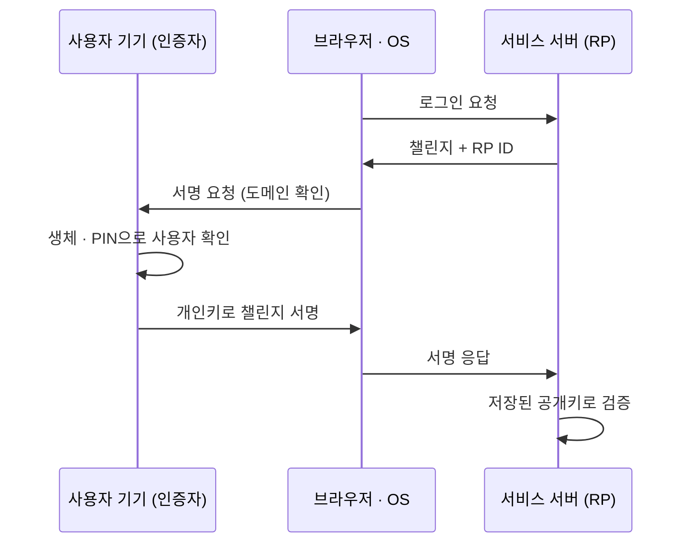

# 패스키 (Passkey)

---

## I. 비밀번호 없는 피싱 저항 인증, 패스키의 개요

### 가. 정의

- [[FIDO]] 얼라이언스·W3C WebAuthn 표준에 기반하여 **사이트별 공개키·개인키 쌍을 만들고, 기기 잠금 해제(생체·PIN)로 개인키 서명을 허가해 로그인**하는 패스워드리스 자격증명

### 나. 특징

| 구분 | 내용 |
| --- | --- |
| 피싱 저항 | 자격증명이 등록 도메인(RP ID)에 묶여 가짜 사이트에서 동작하지 않음 |
| 서버 유출 무력화 | 서버에는 공개키만 저장 |
| 생체정보 비전송 | 생체 확인은 기기 안에서만 수행 |
| 동기화 | 클라우드 키체인(iCloud, Google 비밀번호 관리자 등)으로 여러 기기에서 사용 |
| 유형 | 동기화 패스키 / 기기 고정 패스키(보안키 등) |

---

## II. 동작 구조 및 구성요소

### 가. 인증 흐름

- 서버는 챌린지를 보내고, 인증자는 사용자 확인 후 해당 도메인의 개인키로 서명하며, 서버는 공개키로 검증

### 나. 구성요소

| 구분 | 요소 | 설명 |
| --- | --- | --- |
| 표준 | WebAuthn | 브라우저·RP 간 공개키 인증 API (W3C) |
| | [[CTAP]] | 클라이언트와 인증자 간 프로토콜 (FIDO) |
| 암호 | 키 쌍 | 사이트·계정별 개인키(인증자)와 공개키(서버) |
| 사용자 확인 | 로컬 생체·PIN | 개인키 사용 허가, 생체 데이터는 기기 내 처리 |
| 저장 | 보안 하드웨어 | Secure Enclave·TPM·보안키에 키 보관 |
| | 클라우드 동기화 | 종단간 암호화된 키체인으로 기기 간 복제 |
| 교차 기기 | 하이브리드 전송 | QR 스캔 + 블루투스 근접 확인으로 다른 기기의 패스키 사용 |

---

## III. 비교 및 동향

### 가. 비밀번호 vs OTP vs 패스키

| 비교 항목 | 비밀번호 | OTP·SMS 2FA | 패스키 |
| --- | --- | --- | --- |
| 인증 요소 | 지식 | 지식 + 소유 | 소유(키) + 생체·PIN |
| 피싱 | 취약 | 실시간 중계 피싱에 취약 | 저항 |
| 서버 유출 | 크리덴셜 스터핑 위험 | 비밀번호 유출 위험 남음 | 공개키뿐이라 무의미 |
| 편의성 | 낮음 | 낮음 | 높음 (기기 잠금 해제 수준) |

### 나. 동향

- **플랫폼 확산**: Apple·Google·Microsoft OS와 비밀번호 관리자의 기본 지원, 주요 서비스의 기본 로그인 수단화
- **자격증명 이동**: FIDO의 자격증명 교환 규격(CXP·CXF)으로 관리자 간 패스키 이전 지원
- **기업 적용**: 피싱 저항 MFA 요건(미국 OMB M-22-09 등)과 [[제로 트러스트 보안모델|제로 트러스트]] 인증 수단, 고보안 환경은 기기 고정 패스키 선호

---

### 🔗 연관 토픽

- **소속 도메인**: [[00_보안_MOC|🛡️ 보안]]
- **세부 분류**: `2. 현대 암호학 & 키 관리 · 전자서명`
- **핵심 연관 토픽**:
  - [[FIDO]]
  - [[FIDO 2.0 (Fast IDentity Online 2.0)]]
  - [[CTAP]]
  - [[생체 인증|생체 인증(텔레바이오 인증)]]
  - [[IAM]]
