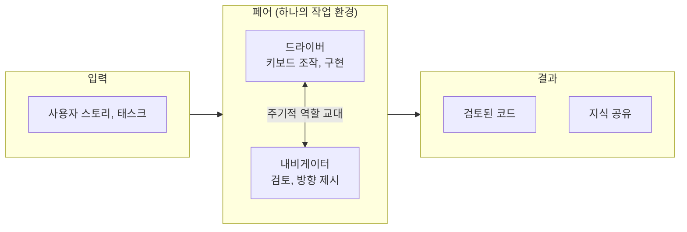

# 페어 프로그래밍 (Pair Programming)

---

## I. 두 사람이 한 화면에서, 페어 프로그래밍의 개요

### 가. 정의

- 두 개발자가 **한 작업 환경에서 드라이버·내비게이터 역할을 나눠** 함께 코드를 작성·검토하는 [[XP]]의 핵심 실천법

### 나. 필요성 및 특징

| 구분 | 내용 |
| --- | --- |
| 실시간 리뷰 | 작성 즉시 검토되어 결함을 조기에 발견 |
| 지식 공유 | 도메인·코드 지식을 팀에 전파, 특정인 의존(버스 팩터) 완화 |
| 집단 코드 소유 | 누구나 코드를 이해·수정할 수 있는 XP 철학 실현 |
| 비용 논란 | 인력 2배 투입처럼 보이나 결함·재작업 감소로 일부 상쇄 (예: 연구별로 공수 15~100% 증가, 결함 감소 보고) |

---

## II. 동작 원리와 구성요소

### 가. 개념도

- 드라이버는 구현 세부에, 내비게이터는 설계·예외·결함에 집중하며 주기적으로 역할을 바꿈

### 나. 구성요소

| 구분 | 요소 | 설명 |
| --- | --- | --- |
| 역할 | 드라이버 | 코드를 직접 입력, 문법·로직 등 당면 문제 해결 |
| | 내비게이터 | 실시간 검토, 오류·예외·설계 방향 점검 |
| 운영 | 역할 교대 | 수십 분 단위 교대로 피로 방지·동등 참여 |
| | 페어 순환 | 짝을 주기적으로 바꿔 지식 확산 |
| 방식 | 핑퐁 페어링 | 한 명이 테스트 작성, 다른 한 명이 통과 코드 작성 ([[TDD]]) |
| | 강한 스타일 페어링 | 아이디어는 반드시 상대의 손을 거쳐 코드로 구현 |
| 도구 | 원격 페어링 | VS Code Live Share, JetBrains Code With Me 등 동시 편집 |

---

## III. 비교 및 동향

### 가. 코드 리뷰 vs 페어 vs 몹 프로그래밍

| 비교 항목 | 코드 리뷰 (PR) | 페어 프로그래밍 | 몹 프로그래밍 |
| --- | --- | --- | --- |
| 인원 | 작성자 + 리뷰어 | 2명 | 3명 이상 (팀 전체) |
| 시점 | 작성 후 (비동기) | 작성 중 (실시간) | 작성 중 (실시간) |
| 지식 전파 | 느림 | 빠름 | 가장 빠름 |
| 비용 | 낮음 | 중간 | 높음 |
| 적합 상황 | 일반 변경 | 복잡한 로직, 신규 인력 온보딩 | 핵심 설계, 난제 해결 |

### 나. 동향

- **원격 페어링 정착**: 분산 팀에서 클라우드 개발 환경(GitHub Codespaces 등)과 동시 편집 도구 활용
- **AI 페어 프로그래머**: GitHub Copilot, Cursor 등 생성형 AI가 코드 제안을 맡고 사람은 검토·설계에 집중, 다만 AI 산출물 검증 책임은 사람에게 있음 ([[바이브코딩]])

---

### 🔗 연관 토픽

- **소속 도메인**: [[00_프로젝트관리_MOC|📋 프로젝트관리]]
- **세부 분류**: `3. 소프트웨어 원가 산정 & 성과 관리 (Cost & EVM)`
- **핵심 연관 토픽**:
  - [[XP|XP (eXtreme Programming)]]
  - [[TDD]]
  - [[Agile]]
  - [[바이브코딩]]
  - [[SCRUM]]
