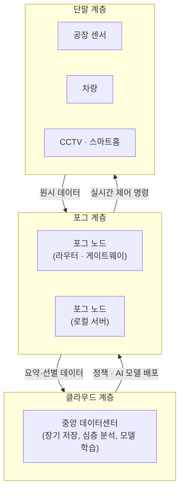

# 포그 컴퓨팅 (Fog Computing)

---

## I. 클라우드를 단말 가까이로, 포그 컴퓨팅의 개요

### 가. 정의

- 클라우드의 연산·저장·네트워킹 기능을 **단말([[EDGE|Edge]])과 중앙 클라우드 사이의 포그 노드(게이트웨이·로컬 서버)로 분산 배치**하는 계층형 컴퓨팅 구조 (2012년 Cisco 제안, IEEE 1934-2018 참조 아키텍처)

### 나. 특징

| 구분 | 내용 |
| --- | --- |
| 등장 배경 | IoT 기기 급증으로 중앙 클라우드의 대역폭·지연 한계, 실시간 제어 요구 ([[Smart Car(자율주행)\|자율주행]], 스마트 팩토리) |
| 저지연 | 근거리 노드에서 실시간 처리 |
| 트래픽 절감 | 원시 데이터를 걸러 요약 데이터만 클라우드로 전송 |
| 데이터 [[지역성]] | 민감 데이터를 현장에서 처리해 프라이버시 보호 |
| 위치 인지 | 지역·위치 기반 서비스 제공 |

---

## II. 구조 및 구성요소

### 가. 3계층 구조

- 단말 데이터를 포그 노드에서 1차 필터링·분석하고, 클라우드는 장기 저장과 대규모 학습을 담당

### 나. 구성요소

| 구분 | 요소 | 설명 |
| --- | --- | --- |
| 인프라 | 포그 노드 | [[게이트웨이]]·[[라우터]]·로컬 서버 등 연산·저장 능력을 갖춘 분산 노드 |
| 실행 환경 | 경량 [[컨테이너]] 플랫폼 | K3s, MicroK8s 등 자원 제약 노드용 경량 [[쿠버네티스]] |
| 네트워크 | [[SDN(Software Defined Network)\|SDN]] / [[NFV]] | 노드 간 유연한 연결, 네트워크 기능 가상화 |
| 데이터 처리 | 필터링 · 집계 | 무의미한 데이터 폐기, 이벤트 데이터만 상위 전송 ([[데이터 전처리]]) |
| 관리 | 포그 오케스트레이션 | 다수 노드의 상태 모니터링, 애플리케이션 배포·생명주기 관리 (KubeEdge) |
| 보안 | TEE | 물리 탈취 위험이 있는 노드에 하드웨어 보안 영역(TrustZone 등) 적용 |

---

## III. 비교 및 동향

### 가. 클라우드 vs 포그 vs 엣지

| 비교 항목 | [[클라우드 컴퓨팅\|클라우드]] | 포그 | 엣지 |
| --- | --- | --- | --- |
| 처리 위치 | 중앙 데이터센터 | 로컬 네트워크 (게이트웨이·라우터) | 단말·현장 장비 |
| 지연 | 높음 (수십~수백 ms) | 낮음 (수~수십 ms) | 매우 낮음 |
| 연산 능력 | 매우 큼 | 중간 | 제한적 |
| 범위 | 전역, 중앙집중 | 지역, 분산 | 개별 종단, 극단적 분산 |
| 주요 역할 | 장기 보관, AI 학습 | 전처리, 지역 분석 | 즉각 제어, 센싱 |

- 포그와 엣지는 엄격히 구분되지 않고 Edge-Cloud Continuum 개념으로 통합되는 추세

### 나. 동향

- **MEC 연계**: 5G 기지국·통신사 국사에 서버를 두는 [[Mobile Edge Computing|MEC]](ETSI Multi-access Edge Computing)와 결합
- **[[연합 학습]]**: 포그 노드에서 로컬 학습 후 가중치만 집계해 원시 데이터 이동 최소화
- **GitOps 기반 엣지 운영**: KubeEdge·Argo CD 등으로 다수 노드에 컨테이너 앱을 일괄 배포

---

### 🔗 연관 토픽

- **소속 도메인**: [[00_디지털서비스_MOC|🚀 디지털서비스]]
- **세부 분류**: `1. 클라우드 컴퓨팅 & 가상화 인프라`
- **핵심 연관 토픽**:
  - [[EDGE|엣지 컴퓨팅]]
  - [[Mobile Edge Computing|MEC]]
  - [[클라우드 컴퓨팅|클라우드 컴퓨팅 (Cloud Computing)]]
  - [[CPS]]
  - [[쿠버네티스|쿠버네티스(Kubernetes)]]
