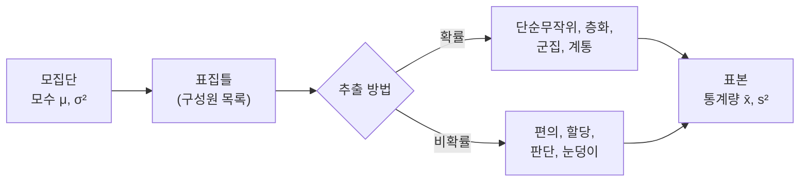

# 표본 추출 (Sampling)

---

## I. 모집단을 대표하는 일부를 고르는, 표본 추출의 개요

### 가. 정의

- 전수조사가 어려울 때 **모집단을 대표할 수 있는 일부(표본)를 정해진 절차로 선택**하는 통계 기법

### 나. 필요성 및 특징

| 구분 | 내용 |
| --- | --- |
| 필요성 | 시간·비용 절감, 파괴 검사처럼 전수조사가 불가능한 경우 |
| 대표성 | 표본이 모집단 특성을 반영해야 추론이 유효 |
| 무작위성 | 확률 추출로 선택 [[편향]]을 줄이고 표본 오차를 계산 가능 |
| ML 활용 | 학습·검증 데이터 분할, 대용량 데이터 다운샘플링, 미니배치 구성 |

---

## II. 절차 및 주요 기법

### 가. 표본 추출 절차

- 모집단 정의 → 표집틀 확정 → 추출 방법·표본 크기 결정 → 표본 수집 순으로 진행

### 나. 주요 기법

| 구분 | 요소 | 설명 |
| --- | --- | --- |
| 확률 추출 | 단순무작위 | 모든 구성원이 같은 확률로 선택 |
| | 층화 추출 | 서로 겹치지 않는 층(성별·지역 등)으로 나눈 뒤 층마다 무작위 추출, 층 내 동질·층 간 이질일 때 효율적 |
| | 군집 추출 | 군집(학교·지역)을 무작위로 골라 그 안을 조사, 군집 내 이질·군집 간 동질일 때 적합, 비용 절감 |
| | 계통 추출 | 첫 표본을 무작위로 정한 뒤 k번째마다 추출, 목록에 주기성이 있으면 편향 |
| 비확률 추출 | 편의 추출 | 접근하기 쉬운 대상 선택 |
| | 할당 추출 | 모집단 비율에 맞춰 할당량만큼 비무작위로 선택 |
| | 판단·눈덩이 추출 | 전문가 판단으로 선택, 응답자가 다음 응답자를 소개 |
| 오차 | 표본 오차·비표본 오차 | 표본 선택에서 오는 오차 / 측정·무응답·입력 실수 등 조사 과정의 오차 |

---

## III. 비교 및 동향

### 가. 확률 추출 vs 비확률 추출

| 비교 항목 | 확률 추출 | 비확률 추출 |
| --- | --- | --- |
| 선택 기준 | 무작위, 추출 확률을 알 수 있음 | 주관·편의, 추출 확률 모름 |
| 통계적 추론 | 표본 오차·신뢰구간 계산 가능 | 모집단 일반화 어려움 |
| 대표성 | 높음 | 선택 편향 위험 |
| 비용 | 상대적으로 큼 | 빠르고 저렴 |
| 활용 | 공식 통계, 학술 연구, 품질 관리 | 탐색 조사, 파일럿 테스트 |

### 나. 동향

- **층화 데이터 분할**: 분류 모델 학습 시 클래스 비율을 유지하는 층화 분할·층화 교차검증, 불균형 데이터는 리샘플링 병행 ([[클래스 불균형]])
- **스트리밍 샘플링**: 전체 크기를 모르는 스트림에서 고정 크기 표본을 균등 확률로 유지하는 저수지 샘플링(Reservoir Sampling)
- **대용량 분산 샘플링**: 페타바이트급 데이터에서 Spark 등으로 병렬 표본 추출 후 분석·모델 개발

---

### 🔗 연관 토픽

- **소속 도메인**: [[00_인공지능_MOC|🤖 인공지능]]
- **세부 분류**: `1. 수학 · 통계학 & 데이터 전처리`
- **핵심 연관 토픽**:
  - [[추론 통계|추론 통계(Inferential Statistics)]]
  - [[중심극한정리|중심극한정리 (Central Limit Theorem)]]
  - [[불편추정량|불편추정량 (Unbiased Estimator)]]
  - [[편향]]
  - [[클래스 불균형|클래스 불균형(Class Imbalance)]]
