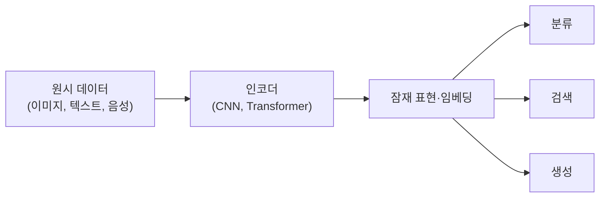

# 표현 학습 (Representation Learning)

---

## I. 특징을 스스로 배우는, 표현 학습의 개요

### 가. 정의

- 사람이 특징을 설계하지 않고 **모델이 원시 데이터에서 과업에 유용한 표현(임베딩)을 자동으로 학습**하는 기법

### 나. 등장 배경 및 특징

| 구분 | 내용 |
| --- | --- |
| 배경 | 이미지·텍스트·음성 등 비정형 데이터에서 수작업 특징 공학의 비용·한계 |
| 잠재 공간 | 의미가 비슷한 데이터가 가까이 놓이는 연속 벡터 공간 형성 |
| 재사용 | 한 번 학습한 표현을 분류·검색·생성 등 여러 다운스트림 태스크에 활용 |
| 좋은 표현 | 핵심 요인을 분리(Disentangled)하고, 불필요한 변화에는 불변, 적은 레이블로 전이 가능 |

---

## II. 구조 및 핵심 기법

### 가. 개념도

- 인코더가 원시 데이터를 밀집 벡터로 변환하고, 이 표현을 여러 하위 태스크의 입력으로 사용

### 나. 핵심 기법

| 구분 | 요소 | 설명 |
| --- | --- | --- |
| 재구성 기반 | 오토인코더 | 병목 층으로 압축 후 복원하며 특징 학습 ([[VAE]]는 확률적 잠재 공간) |
| 대조 학습 | SimCLR, MoCo | 같은 데이터의 증강 쌍은 가깝게, 다른 데이터는 멀게 |
| | CLIP | 이미지-텍스트 쌍을 같은 공간에 정렬하는 멀티모달 대조 학습 |
| 마스크 예측 | BERT, MAE | 입력 일부를 가리고 복원·예측하는 [[자기지도학습]] |
| 비대조 | BYOL, DINO, JEPA | 음성 쌍 없이 교사-학생 구조로 표현 학습, 잠재 공간에서 예측 |
| 표현 형태 | 임베딩 | 단어·문장·이미지를 실수 벡터로 표현 |
| 전통 기법 | [[차원 축소]] | [[PCA(Principal Component Analysis)\|PCA]], t-SNE, UMAP 등 선형·비선형 투영 |

---

## III. 비교 및 동향

### 가. 특징 공학 vs 표현 학습

| 비교 항목 | 수작업 특징 공학 | 표현 학습 |
| --- | --- | --- |
| 주체 | 도메인 전문가 | 모델 |
| 확장성 | 낮음 | 대규모 데이터로 확장 용이 |
| 도메인 의존 | 높음 | 상대적으로 낮음 (전이 가능) |
| 해석성 | 높음 | 낮음 |
| 대표 | SIFT, HOG, [[TF-IDF (Term Frequency - Inverse Document Frequency)\|TF-IDF]] | [[CNN]], [[트랜스포머]], 대조 학습 |

### 나. 동향

- **파운데이션 모델 = 범용 표현 학습기**: LLM·비전 모델의 임베딩이 [[RAG (Retrieval Augmented Generation) 검색 증강 생성 AI|RAG]]·추천·검색의 기반 ([[파운데이션 모델]])
- **멀티모달 공유 공간**: 텍스트·이미지·음성을 하나의 임베딩 공간에 정렬해 교차 검색·생성 ([[멀티모달 AI]])
- **효율적 임베딩**: 가변 차원(Matryoshka)·양자화 임베딩으로 저장·검색 비용 절감

---

### 🔗 연관 토픽

- **소속 도메인**: [[00_인공지능_MOC|🤖 인공지능]]
- **세부 분류**: `1. 수학 · 통계학 & 데이터 전처리`
- **핵심 연관 토픽**:
  - [[자기지도학습]]
  - [[차원 축소|차원 축소(Dimensionality Reduction)]]
  - [[전이학습|전이학습 (Transfer Learning)]]
  - [[파운데이션 모델|파운데이션 모델(Foundation Model)]]
  - [[딥러닝]]
