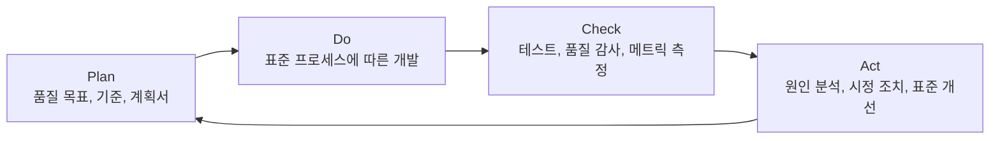

# 품질관리 (Quality Assurance & Control)

---

## I. 예방과 검증의 순환, 품질관리의 개요

### 가. 정의

- SW 제품·서비스가 **요구사항과 품질 기준을 충족**하도록 결함을 예방(QA)하고 검증(QC)하며 프로세스를 지속 개선하는 관리 활동

### 나. 등장 배경 및 특징

| 구분 | 내용 |
| --- | --- |
| 배경 | SW 규모·복잡도 증가, 품질 실패에 따른 사회적·경제적 손실 |
| QA·QC 조화 | 프로세스 중심 예방(QA)과 산출물 중심 검증(QC) 병행 |
| 지속 개선 | [[PDCA(Plan-Do-Check-Act, Deming Cycle)\|PDCA]] 사이클 |
| 표준·인증 | 제품 품질(ISO/IEC 25010, GS 인증), 프로세스 성숙도([[CMMI]], SP 인증) |

---

## II. 관리 체계와 구성요소

### 가. PDCA 기반 품질관리

- 일회성 검사가 아니라 계획-실행-점검-조치를 반복하며 품질 수준을 높이는 피드백 구조

### 나. 구성요소

| 구분 | 요소 | 설명 |
| --- | --- | --- |
| 관리 영역 | QA (Quality Assurance) | 프로세스 준수 감시, 결함 예방 |
| | QC (Quality Control) | 산출물 테스트·검토로 결함 발견·교정 |
| 비용 모델 | 품질비용 (CoQ) | 예방·평가 비용 투자로 실패 비용 감소 ([[SW 품질비용]]) |
| 제품 품질 표준 | [[ISO IEC 25010 2023\|ISO/IEC 25010:2023]] | 기능 적합성, 성능 효율성, 호환성, 상호작용 능력, 신뢰성, 보안성, 유지보수성, 유연성, 안전성 9개 특성 |
| 프로세스 성숙도 | CMMI, [[SP 인증]] | 조직의 개발·관리 프로세스 수준 평가·개선 |
| 통계 기법 | SPC, 6시그마 | 관리도·파레토 등으로 공정 변동 분석 ([[품질통제도구]]) |
| 산출물 관리 | [[형상 관리]] | 소스·문서 변경 이력 통제로 일관성 유지 |

---

## III. 비교 및 동향

### 가. QA vs QC

| 비교 항목 | QA | QC |
| --- | --- | --- |
| 초점 | 프로세스 (어떻게 만드는가) | 제품 (잘 만들어졌는가) |
| 목적 | 결함 예방 | 결함 발견·수정 |
| 시점 | 전 주기 상시 | 산출물 완성 시점, 테스트 단계 |
| 주체 | 독립 QA 조직 | 개발자, 테스터 |
| 활동 | 프로세스 감사, 표준 제정, 교육 | 테스트, 코드 리뷰, 결함 추적 |

### 나. 동향

- **지속적 품질**: [[DevSecOps]] 파이프라인에 [[SAST]]·[[DAST]]·자동 테스트를 넣어 매 빌드마다 품질 검증
- **AI 활용**: 결함 이력 기반 결함 예측, 생성형 AI 테스트 케이스 생성 보조
- **AI 시스템 품질**: ISO/IEC 25059 등 AI 시스템 품질 모델 등장

---

### 🔗 연관 토픽

- **소속 도메인**: [[00_프로젝트관리_MOC|📋 프로젝트관리]]
- **세부 분류**: `3. 소프트웨어 원가 산정 & 성과 관리 (Cost & EVM)`
- **핵심 연관 토픽**:
  - [[프로젝트 품질관리|프로젝트 품질관리 (Project Quality Management)]]
  - [[SW 품질비용]]
  - [[ISO IEC 25010 2023]]
  - [[품질통제도구|품질통제도구, QC 7]]
  - [[PDCA(Plan-Do-Check-Act, Deming Cycle)]]
