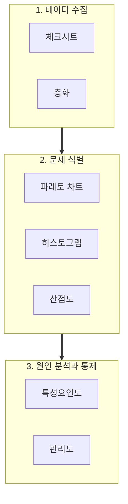

# 품질통제도구, QC 7 (Seven Basic Quality Tools)

---

## I. 데이터로 품질 문제를 푸는 기본 도구, QC 7의 개요

### 가. 정의

- 품질 문제를 **데이터로 수집·시각화하고 원인을 분석·통제**하는 7가지 기본 통계 도구 (이시카와 가오루 체계화)

### 나. 특징

| 구분 | 내용 |
| --- | --- |
| 사실 기반 | 경험·직관 대신 수치 데이터로 판단 |
| 쉬운 사용 | 고급 통계 지식 없이 현장 작업자도 활용 |
| 시각화 | 분포·빈도·상관을 그래프로 직관적 파악 |
| 구성 변형 | 층화 대신 그래프 또는 흐름도(Flowchart)를 넣는 목록도 있음 (PMBOK은 흐름도 포함) |

---

## II. 도구 연계와 구성요소

### 가. 개념도

- 체크시트·층화로 데이터를 모으고, 파레토·히스토그램·산점도로 핵심 문제와 관계를 찾은 뒤, 특성요인도로 원인을 규명하고 관리도로 공정을 지속 감시

### 나. 7가지 도구

| 구분 | 요소 | 설명 |
| --- | --- | --- |
| 수집 | 체크시트 | 항목을 미리 설계한 기록 양식, 결함 유형별 빈도 집계 |
| | 층화 | 데이터를 작업자·장비·로트 등 그룹으로 나눠 차이 파악 |
| 식별 | 파레토 차트 | 빈도 순 막대 + 누적 비율, 핵심 소수 원인(80/20) 식별 |
| | 히스토그램 | 도수분포 막대그래프, 중심·산포·규격 이탈 확인 |
| | 산점도 | 두 변수의 상관(양·음·무상관) 파악, 인과는 별도 검증 |
| 원인·통제 | 특성요인도 (Fishbone) | 결과에 영향을 주는 원인을 4M1E(사람·기계·재료·방법·환경) 등으로 분류 |
| | 관리도 | 관리 한계(UCL·LCL, 보통 ±3σ)로 우연 원인과 이상 원인 변동 구분 |

---

## III. 비교 및 동향

### 가. QC 7 vs 신 QC 7

| 비교 항목 | QC 7 | 신 QC 7 (N7) |
| --- | --- | --- |
| 데이터 | 수치 데이터 | 언어 데이터 |
| 목적 | 공정 통제, 원인 규명 | 문제 구조화, 기획·계획 수립 |
| 도구 | 체크시트, 층화, 파레토, 히스토그램, 산점도, 특성요인도, 관리도 | 친화도법, 연관도법, 계통도법, 매트릭스도법, 매트릭스 데이터 해석법, PDPC, 애로우 다이어그램 |
| 적용 단계 | 실행·통제 | 기획·요구 정의 |

### 나. 동향

- **실시간 SPC**: [[MES]], APM 도구와 연동해 관리도를 자동 생성하고 관리 한계 이탈 시 경보
- **ML 이상 탐지**: 다변량 데이터의 미세한 이상을 학습 기반으로 탐지 ([[이상 감지]])
- **SW 품질 적용**: 결함 유형 파레토 분석, 빌드 시간·결함 밀도 관리도로 개발 프로세스 통제

---

### 🔗 연관 토픽

- **소속 도메인**: [[00_프로젝트관리_MOC|📋 프로젝트관리]]
- **세부 분류**: `4. 품질 보증 · 위험 관리 & 정보시스템 감리`
- **핵심 연관 토픽**:
  - [[프로젝트 품질관리|프로젝트 품질관리 (Project Quality Management)]]
  - [[품질관리]]
  - [[PDCA(Plan-Do-Check-Act, Deming Cycle)]]
  - [[이상 감지]]
  - [[MES|MES (Manufacturing Execution System)]]
