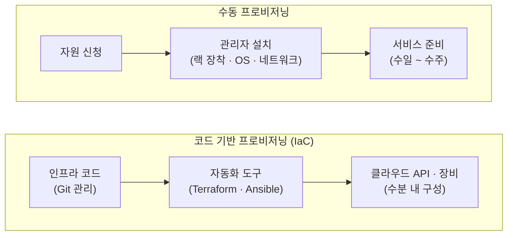

# 프로비저닝 (Provisioning)

---

## I. 쓸 수 있는 상태로 준비하는, 프로비저닝의 개요

### 가. 정의

- 사용자·서비스 요구에 맞춰 **서버·스토리지·네트워크·계정 등 IT 자원을 할당하고 설정해 즉시 사용 가능한 상태로 준비**하는 과정

### 나. 특징 및 필요성

| 구분 | 내용 |
| --- | --- |
| 등장 배경 | 수동 구매·설치의 긴 리드타임, 클라우드·[[가상화]]의 동적 자원 수요 |
| 자동화 | 템플릿·코드 기반으로 사람 개입 최소화 |
| 일관성 | 같은 정의로 개발·테스트·운영 환경을 동일하게 구성 |
| 탄력성 | 수요에 따라 자원 생성·회수 (오토스케일링) |
| 수명주기 | 생성뿐 아니라 변경·회수(De-provisioning)까지 관리 |

---

## II. 구조 및 유형

### 가. 수동 vs 코드 기반 프로비저닝 흐름

- 코드로 원하는 상태를 정의하면 도구가 API를 호출해 자원을 만들고 설정까지 적용

### 나. 유형 및 구성요소

| 구분 | 요소 | 설명 |
| --- | --- | --- |
| 대상 | 서버 | VM·물리 서버 생성, OS·미들웨어·런타임 설치 |
| | 네트워크 | [[라우터]]·[[스위치]]·[[방화벽]]·[[VPN]] 설정, 회선·대역 할당 |
| | 스토리지 | SAN·[[NAS]] 볼륨 할당, Thin Provisioning, [[RAID]] 구성 |
| | 사용자 ([[IAM]]) | 계정·권한 생성, 퇴사 시 회수 (SCIM 표준) |
| 방법론 | IaC | 인프라를 코드로 정의해 버전 관리·재현 |
| 도구 | Terraform | 선언형 자원 생성·변경 (Provisioning) |
| | Ansible | 생성된 자원의 OS·SW 설정 (Configuration) |
| 네트워크 | ZTP (Zero Touch Provisioning) | 장비가 전원 인가 시 설정을 자동 수신해 구성 |

---

## III. 비교 및 동향

### 가. 수동 vs IaC 기반 프로비저닝

| 비교 항목 | 수동 | IaC 기반 |
| --- | --- | --- |
| 소요 시간 | 수일~수주 | 수분 |
| 오류 | 설정 누락·실수 잦음 | 코드 리뷰·테스트로 감소 |
| 이력 관리 | 문서 의존, 추적 어려움 | Git으로 변경 추적·롤백 |
| 확장 | 급증 수요 대응 어려움 | 오토스케일링 연계 |
| 환경 일관성 | 환경 간 차이(Drift) 잦음 | 같은 코드로 재현, Drift 탐지 |

### 나. 동향

- **GitOps**: Git 저장소를 기준 상태로 두고 변경 병합 시 인프라에 자동 동기화 (Argo CD, Flux)
- **플랫폼 엔지니어링**: 내부 개발자 플랫폼에서 셀프서비스 템플릿으로 자원 요청
- **네트워크 자동화**: ZTP와 [[NFV]]·[[SDN(Software Defined Network)|SDN]] 오케스트레이션으로 지점·엣지 장비 무인 구성

---

### 🔗 연관 토픽

- **소속 도메인**: [[00_네트워크_MOC|🌐 네트워크]]
- **세부 분류**: `1. OSI 7계층 & 데이터링크 계층 (L1/L2)`
- **핵심 연관 토픽**:
  - [[가상화]]
  - [[IAM]]
  - [[NFV]]
  - [[SDN(Software Defined Network)]]
  - [[라우터]]
