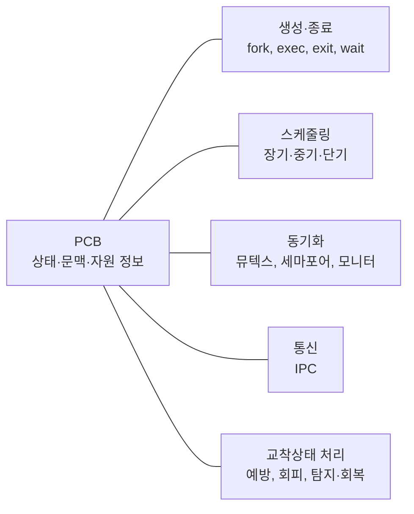

# 프로세스 관리 (Process Management)

---

## I. 생성부터 소멸까지, 프로세스 관리의 개요

### 가. 정의

- [[OS(운영체제)|운영체제]]가 [[프로세스]]의 **생성·스케줄링·동기화·통신·종료에 이르는 수명주기를 제어하고 자원을 배분**하는 기능

### 나. 목표

| 구분 | 내용 |
| --- | --- |
| 효율 | [[CPU]] 이용률·[[처리량]] 최대화 |
| 응답성 | 대기·[[응답시간]] 최소화 |
| 공정성 | [[기아\|기아(Starvation)]] 방지 |
| 보호 | 독립 주소 공간으로 프로세스 간 침범 방지 |
| 정확성 | 공유 자원 동기화, [[교착상태]] 처리 |

---

## II. 관리 구조 및 기능

### 가. 프로세스 관리 기능 구성

- 커널은 PCB를 중심으로 프로세스 상태를 추적하며 상태 전이마다 해당 큐로 이동시킴 ([[프로세스 상태 전이도]])

### 나. 기능별 구성요소

| 구분 | 요소 | 설명 |
| --- | --- | --- |
| 제어 구조 | [[PCB(Process Control Block)\|PCB]] | PID, 상태, PC, 레지스터, 메모리·파일 정보 |
| 생성·종료 | `fork()`·`exec()` | 부모 복제(COW) 후 새 프로그램 적재 |
| | `exit()`·`wait()` | 종료 후 부모가 회수, 미회수 시 좀비·부모 종료 시 고아 프로세스 |
| 스케줄링 | [[선점 스케줄링\|선점형]] | RR, SRT, MLFQ |
| | [[비선점방식 유형\|비선점형]] | FCFS, SJF, HRN |
| 실행 전환 | [[문맥 교환]] | 문맥 저장·복원, [[디스패치]] |
| 동기화 | 뮤텍스·[[세마포어]] | 임계 구역 상호배제, P(wait)·V(signal) 연산 |
| | [[모니터 동기화\|모니터]] | 언어 수준 상호배제와 조건 변수 |
| 통신 | [[프로세스간 통신\|IPC]] | 공유 메모리, 메시지 큐, 파이프, 소켓 |
| 교착상태 | 예방·회피·탐지 | 4가지 조건 차단, [[은행가 알고리즘]], 대기 그래프 |

---

## III. 비교 및 동향

### 가. 스케줄러 계층 비교

| 비교 항목 | 장기 스케줄러 | 중기 스케줄러 | 단기 스케줄러 |
| --- | --- | --- | --- |
| 역할 | 메모리에 적재할 작업 선택 | 메모리 부족 시 프로세스 Swap Out/In | 준비 큐에서 CPU 할당 대상 선택 |
| 조절 대상 | 다중 프로그래밍 정도 | 메모리 사용량, [[스레싱\|스레싱]] 완화 | CPU 할당 순서 |
| 호출 빈도 | 낮음 | 중간 | 매우 높음 (ms 단위) |
| 관련 상태 | New → Ready | Ready ↔ Suspended | Ready → Running |

### 나. 동향

- **경량 실행 단위**: Go 고루틴, Java 가상 스레드로 커널 스레드보다 가벼운 동시성 확대
- **[[컨테이너]] 격리**: namespace·cgroup으로 프로세스 그룹을 격리하고 [[쿠버네티스]]가 대규모로 오케스트레이션
- **pidfd**: Linux 5.x부터 PID 재사용 경쟁 없이 프로세스를 파일 디스크립터로 안전하게 지정·대기

---

### 🔗 연관 토픽

- **소속 도메인**: [[00_운영체제_MOC|⚙️ 운영체제]]
- **세부 분류**: `1. 프로세스 & 스레드 관리`
- **핵심 연관 토픽**:
  - [[프로세스]]
  - [[PCB(Process Control Block)]]
  - [[프로세스 상태 전이도]]
  - [[스케줄링]]
  - [[프로세스간 통신|프로세스간 통신(IPC, Inter Process Communication)]]
