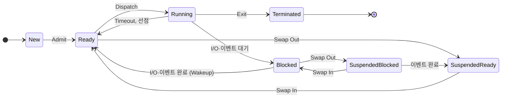

# 프로세스 상태 전이도 (Process State Transition Diagram)

---

## I. 프로세스의 일생, 상태 전이도의 개요

### 가. 정의

- 프로세스가 생성부터 종료까지 **자원 할당 상황과 이벤트에 따라 거치는 상태와 그 전이 조건을 나타낸 모델**

### 나. 특징

| 구분 | 내용 |
| --- | --- |
| 큐 기반 관리 | 상태마다 큐(준비 큐, 장치 대기 큐)를 두고 [[PCB(Process Control Block)\|PCB]]를 이동 |
| 스케줄러 연계 | 장기(New → Ready), 단기(Ready → Running), 중기(Swap) 스케줄러가 전이 담당 |
| 모델 확장 | 기본 5상태 모델 + 중단(Suspended) 상태를 더한 7상태 모델 |

---

## II. 상태 전이 모델 및 구성요소

### 가. 7상태 전이 모델

- 메모리가 부족하면 중기 스케줄러가 프로세스를 디스크로 내보내 중단 상태로 전환, Blocked → Running 직접 전이는 없음

### 나. 상태 및 전이

| 구분 | 요소 | 설명 |
| --- | --- | --- |
| 상태 | New | 생성 중, PCB 할당 |
| | Ready | 메모리에 적재되어 CPU 할당 대기 |
| | Running | CPU를 점유해 명령 실행 (코어당 하나) |
| | Blocked (Waiting) | I/O·이벤트 완료 대기 |
| | Suspended Ready·Blocked | 디스크(스왑 영역)로 내보내진 상태 |
| | Terminated | 실행 종료, 부모가 회수할 때까지 PCB 유지 (좀비) |
| 전이 | Dispatch | Ready → Running, 단기 스케줄러가 선택 ([[디스패치]]) |
| | Timeout | Running → Ready, 시간 할당량 만료·고우선순위 선점 ([[인터럽트]]) |
| | Block | Running → Blocked, I/O 요청 ([[입출력발생]]) |
| | Wakeup | Blocked → Ready, I/O 완료 인터럽트 |
| | Swap Out·In | 메모리 ↔ 스왑 영역 이동, 중기 스케줄러 |

---

## III. 비교 및 동향

### 가. 5상태 vs 7상태 모델

| 비교 항목 | 5상태 모델 | 7상태 모델 |
| --- | --- | --- |
| 관리 공간 | 주기억장치 | 주기억장치 + 스왑 영역 |
| 상태 | New, Ready, Running, Blocked, Terminated | 5상태 + Suspended Ready, Suspended Blocked |
| 관여 스케줄러 | 장기, 단기 | 장기, 단기, 중기 |
| 목적 | CPU 시분할 모델링 | 메모리 부족·[[스레싱\|스레싱]] 대응 |

### 나. 동향

- **Linux 상태 구현**: `TASK_RUNNING`(Ready와 Running 통합), `TASK_INTERRUPTIBLE`(시그널로 깨울 수 있는 대기), `TASK_UNINTERRUPTIBLE`(D 상태, 디스크 I/O 등), `TASK_STOPPED`, `EXIT_ZOMBIE`
- **OOM Killer**: 메모리·스왑이 모두 고갈되면 `oom_score`(메모리 사용량 + `oom_score_adj`)가 높은 프로세스를 강제 종료
- **cgroup freezer**: 컨테이너 단위로 프로세스 그룹을 일시 정지·재개, 체크포인트(CRIU)와 연계

---

### 🔗 연관 토픽

- **소속 도메인**: [[00_운영체제_MOC|⚙️ 운영체제]]
- **세부 분류**: `1. 프로세스 & 스레드 관리`
- **핵심 연관 토픽**:
  - [[프로세스]]
  - [[스케줄링]]
  - [[디스패치]]
  - [[PCB(Process Control Block)]]
  - [[입출력발생]]
