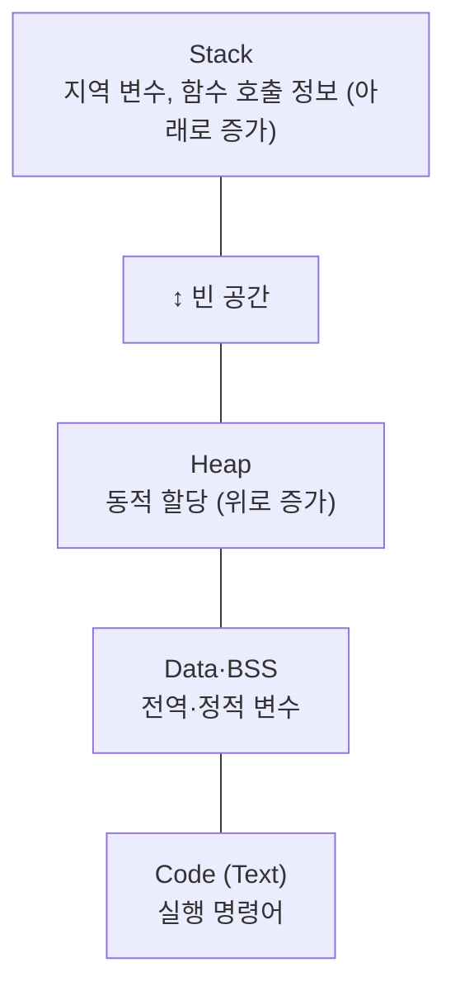

# 프로세스 (Process)

---

## I. 실행 중인 프로그램, 프로세스의 개요

### 가. 정의

- 보조기억장치의 정적 프로그램이 메모리에 적재되어 [[OS(운영체제)|운영체제]]로부터 [[CPU]]·메모리·파일 등 자원을 할당받아 **실행 중인 프로그램**, 자원 할당의 단위

### 나. 특징

| 구분 | 내용 |
| --- | --- |
| 독립 주소 공간 | Code·Data·Heap·Stack을 프로세스별로 보유, 다른 프로세스와 격리 |
| PCB로 관리 | 커널이 [[PCB(Process Control Block)\|PCB]]에 상태·문맥·자원 정보를 기록 |
| 동적 상태 | 생성 → 준비 → 실행 → 대기 → 종료로 상태 전이 |
| 동시성 | [[문맥 교환]]으로 여러 프로세스가 CPU를 번갈아 사용 |

---

## II. 구조 및 구성요소

### 가. 프로세스 주소 공간

- 높은 주소의 스택과 낮은 주소 쪽 힙이 서로를 향해 자라는 구조, 상태 전이는 [[프로세스 상태 전이도]] 참조

### 나. 구성요소

| 구분 | 요소 | 설명 |
| --- | --- | --- |
| 메모리 | Code (Text) | 실행할 기계어 명령, 읽기 전용 |
| | Data·BSS | 초기화된 전역 변수 / 초기화되지 않은 전역 변수 |
| | Heap | `malloc`·`new`로 실행 중 할당 |
| | [[Stack]] | 함수 매개변수, 지역 변수, 반환 주소 |
| 관리 | PCB | PID, 상태, PC, 레지스터, 메모리·파일 정보 |
| 실행 흐름 | [[쓰레드\|스레드]] | 프로세스 안의 실행 단위, 하나 이상 보유 |
| 통신 | [[프로세스간 통신\|IPC]] | 파이프, 메시지 큐, 공유 메모리, 소켓 |
| 생성·종료 | `fork()`·`exec()`·`exit()` | 부모가 자식 생성, 종료 후 부모가 `wait()`로 회수 (미회수 시 좀비) |

---

## III. 비교 및 동향

### 가. 프로그램 vs 프로세스

| 비교 항목 | 프로그램 | 프로세스 |
| --- | --- | --- |
| 상태 | 정적 (파일) | 동적 (실행 중) |
| 위치 | 보조기억장치 | 주기억장치 |
| 자원 | 없음 | CPU 시간, 메모리, 파일 등 할당 |
| 관계 | 하나의 프로그램이 여러 프로세스로 동시 실행 가능 | PCB로 개별 관리 |

### 나. 동향

- **[[컨테이너]]**: Linux namespace(격리)와 cgroup(자원 제한)으로 프로세스를 격리 실행, [[도커|Docker]]·Kubernetes의 기반
- **멀티 프로세스 격리 설계**: Chrome 사이트 격리처럼 보안·안정성을 위해 기능별 프로세스 분리
- **경량 동시성**: 프로세스 수를 늘리는 대신 가상 스레드·이벤트 루프로 한 프로세스 안에서 동시 처리 확대

---

### 🔗 연관 토픽

- **소속 도메인**: [[00_운영체제_MOC|⚙️ 운영체제]]
- **세부 분류**: `1. 프로세스 & 스레드 관리`
- **핵심 연관 토픽**:
  - [[PCB(Process Control Block)]]
  - [[프로세스 상태 전이도]]
  - [[프로세스와 스레드 비교|프로세스(Process)와 스레드(Thread) 비교]]
  - [[프로세스간 통신|프로세스간 통신(IPC, Inter Process Communication)]]
  - [[문맥 교환|문맥 교환 (Context Switching)]]
