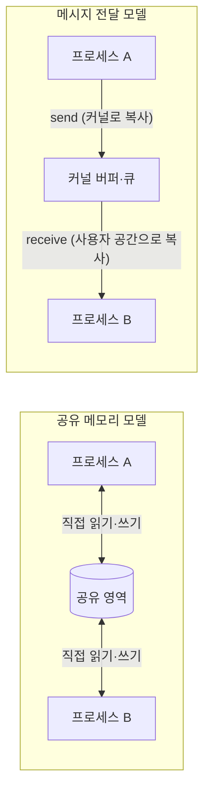

# 프로세스간 통신 (IPC, Inter-Process Communication)

---

## I. 격리된 주소 공간을 잇는, IPC의 개요

### 가. 정의

- 독립된 주소 공간을 가진 [[프로세스]]들이 **데이터를 주고받고 동작을 맞추도록 [[커널]]이 제공하는 통신·동기화 메커니즘**

### 나. 필요성

| 구분 | 내용 |
| --- | --- |
| 격리 극복 | [[MMU(Memory Management Unit)\|MMU]]로 분리된 주소 공간 사이 데이터 교환 |
| 협업 | 기능별 프로세스 분리(브라우저 렌더러, DB 백엔드)와 정보 공유 |
| 동기화 | 생산자·소비자 등 프로세스 간 실행 순서 조정 |
| 모델 | 공유 메모리 모델과 메시지 전달 모델 |

---

## II. 구조 및 구성요소

### 가. 두 가지 IPC 모델

- 공유 메모리는 매핑 후 커널 개입 없이 빠르지만 동기화는 응용 몫, 메시지 전달은 매번 시스템 콜·복사가 있지만 커널이 동기화

### 나. 구성요소

| 구분 | 요소 | 설명 |
| --- | --- | --- |
| 공유 메모리 | System V `shmget`, POSIX `shm_open`·`mmap` | 같은 물리 페이지를 두 주소 공간에 매핑, 가장 빠름 |
| | [[세마포어]]·뮤텍스 | 공유 영역 접근 동기화 |
| 파이프 | 익명 파이프 | 부모·자식 등 관련 프로세스 간 단방향 바이트 스트림 |
| | 이름 있는 파이프 (FIFO) | 파일 시스템 경로로 무관한 프로세스 간 통신 |
| 메시지 | 메시지 큐 | 메시지 단위 송수신, 유형·우선순위별 수신 (System V, POSIX) |
| 소켓 | UNIX 도메인 소켓 | 같은 호스트 내 양방향 통신, 네트워크 스택 생략 |
| | TCP/UDP 소켓 | 원격 호스트까지 통신 |
| 신호 | 시그널 | SIGINT, SIGKILL 등 비동기 이벤트 통지, 데이터 전달 능력 작음 |
| 기타 | RPC·D-Bus·Binder | 함수 호출 형태 또는 OS 서비스 버스 (Android Binder) |

---

## III. 비교 및 동향

### 가. 공유 메모리 vs 메시지 전달

| 비교 항목 | 공유 메모리 | 메시지 전달 |
| --- | --- | --- |
| 속도 | 빠름 (복사 없음) | 상대적으로 느림 (커널 경유 복사) |
| 커널 개입 | 설정 시에만 | 송수신마다 |
| 동기화 책임 | 응용 프로그램 | 커널 |
| 데이터 형태 | 임의 자료구조 | 메시지 단위 |
| 구현 난이도 | 높음 (경쟁 조건, [[교착상태]] 주의) | 낮음 |
| 적합 분야 | 대용량 영상·텐서 공유 | 소량 메시지, 분산 시스템 |

### 나. 동향

- **eBPF sockmap**: 같은 노드의 [[컨테이너]] 간 TCP 통신을 커널에서 소켓 간 직접 전달해 TCP/IP 처리 생략
- **무복사 공유 메모리**: `memfd_create`로 만든 익명 메모리를 파일 디스크립터로 전달, PyTorch 멀티프로세싱의 텐서 공유처럼 대용량 데이터를 복사 없이 교환
- **Android Binder**: 커널 드라이버로 1회 복사 IPC 제공, Linux 메인라인에 Rust 구현 병합

---

### 🔗 연관 토픽

- **소속 도메인**: [[00_운영체제_MOC|⚙️ 운영체제]]
- **세부 분류**: `1. 프로세스 & 스레드 관리`
- **핵심 연관 토픽**:
  - [[프로세스]]
  - [[프로세스와 스레드 비교|프로세스(Process)와 스레드(Thread) 비교]]
  - [[세마포어]]
  - [[경쟁조건 해결 방안]]
  - [[커널|커널(Kernel)]]
