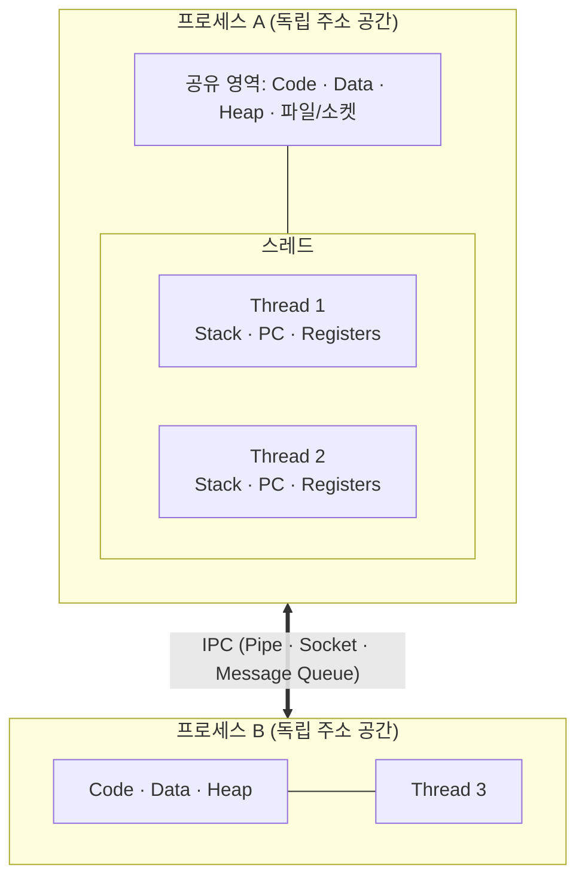

# 프로세스(Process)와 스레드(Thread) 비교

---

## I. 멀티태스킹의 실행 단위, 프로세스와 스레드의 개요

### 가. 정의

- **[[프로세스]]**: 운영체제로부터 **독립된 주소 공간과 자원을 할당받아 실행 중인 프로그램**, 자원 할당의 단위
- **[[쓰레드|스레드]]**: 프로세스 안에서 **자원을 공유하며 독립적인 실행 흐름을 갖는 단위**, [[CPU]] 스케줄링의 단위 (경량 프로세스, LWP)

### 나. 필요성

| 구분 | 내용 |
| --- | --- |
| 프로세스의 무거운 비용 | 생성·IPC·[[문맥 교환]] 시 TLB 플러시 등 오버헤드 |
| 경량 동시성 | 멀티코어에서 자원 낭비 없이 처리량·응답성 향상 |
| 전략적 선택 | 안정성(멀티 프로세스)과 효율성(멀티 스레드) 사이의 설계 결정 필요 |

---

## II. 메모리 구조 및 핵심 요소

### 가. 메모리 공유와 격리

- 스레드는 Code·Data·Heap과 OS 자원을 공유하고 **Stack과 레지스터(PC)만 독자 보유**
- 프로세스끼리는 주소 공간이 분리되어 커널을 거치는 IPC가 필요 ([[프로세스간 통신]])

### 나. 핵심 요소

| 구분 | 프로세스 | 스레드 |
| --- | --- | --- |
| 제어 블록 | [[PCB(Process Control Block)\|PCB]] (주소 공간·자원 정보) | TCB (레지스터·스택 포인터 중심) |
| 메모리 | Code·Data·Heap·[[Stack]] 모두 독립 | Stack만 독립, 나머지 공유 |
| 문맥 교환 | 페이지 테이블 전환, TLB 무효화로 비용 큼 | 레지스터만 교체, 비용 작음 |
| 통신 | IPC (커널 개입) | 공유 메모리 직접 접근 |
| 동기화 | 공유 메모리 사용 시 [[세마포어]] 등 | Mutex, Semaphore, Spinlock, [[모니터 동기화\|Monitor]] 필수 |
| 장애 영향 | 다른 프로세스와 격리 | 한 스레드 오류가 프로세스 전체 종료 |
| 생성 | `fork()`, `exec()` (무거움) | `pthread_create()`, `clone()` (가벼움) |
| 스레드 모델 | - | Many-to-One, One-to-One, Many-to-Many |

---

## III. 멀티 프로세스 vs 멀티 스레드 및 동향

### 가. 아키텍처 선택

| 비교 항목 | 멀티 프로세스 | 멀티 스레드 ([[멀티 쓰레드]]) |
| --- | --- | --- |
| 장점 | 독립성·안정성 (하나가 죽어도 나머지 유지) | 자원 효율, 빠른 문맥 교환, 응답성 |
| 단점 | 메모리 사용량 큼, IPC 비용 | 동기화 오류, [[교착상태]], 경쟁 조건 위험 |
| 예시 | Apache Prefork, 크롬 탭별 프로세스 | Apache Worker, 대부분의 WAS |
| 적합 환경 | 장애 격리가 중요한 작업 | 대규모 I/O·병렬 연산 |

### 나. 동향

- **가상 스레드·코루틴**: Java Virtual Thread(Project Loom), Go Goroutine 등 M:N 사용자 수준 스케줄링으로 수십만 동시성 처리
- **이벤트 루프 + 비동기 I/O**: Node.js, Netty처럼 단일 스레드 이벤트 루프로 동기화 복잡성 회피
- **안전한 동시성 언어**: Rust의 소유권 모델로 데이터 경쟁을 컴파일 시점에 차단
- **컨테이너 격리**: 프로세스 격리를 namespace·cgroup으로 확장한 [[컨테이너]] 기반 아키텍처 표준화

---

### 🔗 연관 토픽

- **소속 도메인**: [[00_운영체제_MOC|⚙️ 운영체제]]
- **세부 분류**: `1. 프로세스 & 스레드 관리`
- **핵심 연관 토픽**:
  - [[프로세스]]
  - [[쓰레드]]
  - [[PCB(Process Control Block)]]
  - [[문맥 교환|문맥 교환 (Context Switching)]]
  - [[프로세스간 통신]]
