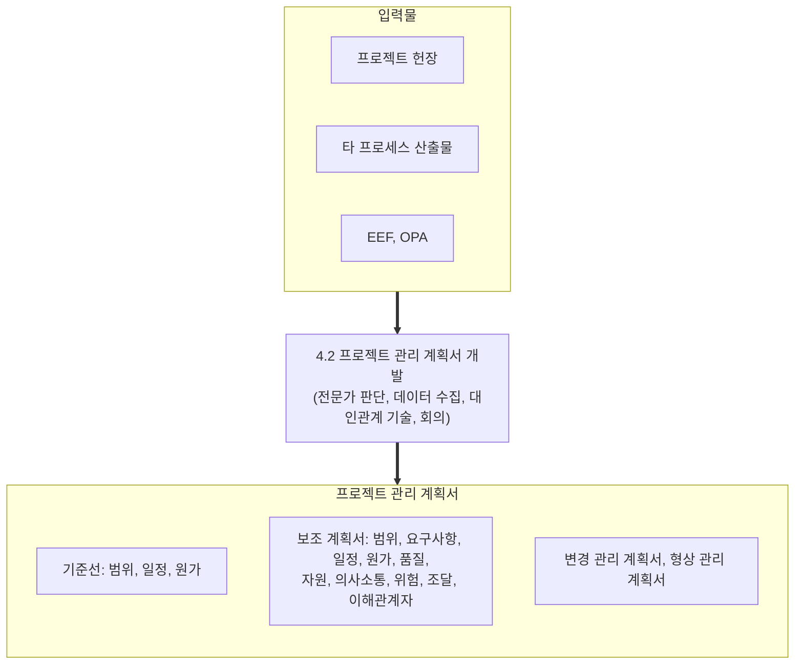

# 프로젝트 관리 계획서 (Project Management Plan)

---

## I. 실행·감시·종료의 기준, 프로젝트 관리 계획서의 개요

### 가. 정의

- 프로젝트를 어떻게 **실행·감시·통제·종료**할지 기술한 문서로, **보조 관리 계획서와 기준선(Baseline)** 을 통합한 통합관리의 핵심 산출물 (PMBOK 6판 4.2 프로젝트 관리 계획서 개발)

### 나. 필요성 및 특징

| 구분 | 내용 |
| --- | --- |
| 통합 기준 | 범위·일정·원가 등 상충 제약을 한 문서에서 조율 |
| 성과 측정 기준 | 승인된 기준선 대비 실적으로 편차 판단 |
| 변경 통제 | 승인 후에는 통합 변경 통제를 거쳐서만 수정 |
| 점진적 구체화 | 프로젝트 진행에 따라 보조 계획서를 갱신 |

---

## II. 수립 흐름과 구성요소

### 가. 개념도

- 헌장과 다른 계획 프로세스의 결과를 통합하고, 승인 후에는 변경통제위원회(CCB)를 통해서만 수정

### 나. 구성요소

| 구분 | 요소 | 설명 |
| --- | --- | --- |
| 기준선 | 범위 기준선 | 프로젝트 범위 기술서 + [[WBS]] + WBS 사전 |
| | 일정 기준선 | 승인된 일정 모델 (시작·종료일, 마일스톤) |
| | 원가 기준선 | 시간대별 승인 예산(S-Curve), 우발사태 예비비 포함·관리 예비비 제외 |
| | 성과 측정 기준선 (PMB) | 범위·일정·원가 기준선 통합, [[EVM(Earned Value Management, 획득 가치 관리)\|EVM]]의 기준 |
| 보조 계획서 | 범위·요구사항·일정·원가 관리 계획서 | 각 영역을 정의·산정·통제하는 방법 |
| | 품질·자원 관리 계획서 | 품질 기준과 QA/QC 방법, 인적·물적 자원 확보·배치 |
| | 의사소통·이해관계자 참여 계획서 | 정보 배포 주기·채널, 참여 수준 관리 전략 |
| | 위험·조달 관리 계획서 | 위험 관리 방법론·역할, 조달 방식·계약 유형 |
| 통제 기준 | 변경 관리 계획서 | 변경 요청 접수, 영향 분석, CCB 승인 절차 |
| | [[형상 관리]] 계획서 | 형상 항목 식별, 버전·변경 이력 관리 |
| 기타 | 생애주기, 개발 방식, 관리 검토 | 예측형·적응형 선택, 단계별 검토 시점 |

---

## III. 비교 및 동향

### 가. 예측형 vs 적응형 계획

| 비교 항목 | 예측형 (프로젝트 관리 계획서) | 적응형 (릴리스·이터레이션 계획) |
| --- | --- | --- |
| 계획 철학 | 초기 상세 계획 | 점진적 계획 ([[연동계획\|Rolling Wave]]) |
| 기준선 | 고정, 변경 시 CCB 승인 | 제품 백로그 우선순위로 조정 |
| 상세화 | 초기에 전체 범위 명세 | 로드맵 → 릴리스 → 스프린트 단위 상세화 |
| 변경 태도 | 통제 대상 ([[Scope Creep vs Gold-Plating\|Scope Creep]] 방지) | 가치 창출 기회로 수용 |
| 성과 지표 | EVM (CPI, SPI) | [[번다운차트\|번다운·번업 차트]], Velocity |

### 나. 동향

- **테일러링**: [[PMBOK 7판 (Project Management Body of Knowledge 7th Ed.)|PMBOK 7판]]은 고정 양식 대신 프로젝트 특성에 맞춘 계획 범위·형식 조정([[테일러링]])을 강조
- **하이브리드**: 계약·예산은 예측형 기준선으로, 구현은 [[SCRUM|스크럼]]·칸반으로 운영
- **PMIS 연계**: 계획서와 변경 이력을 협업 도구에서 버전 관리하고 일정 편차를 자동 분석

---

### 🔗 연관 토픽

- **소속 도메인**: [[00_프로젝트관리_MOC|📋 프로젝트관리]]
- **세부 분류**: `1. PMBOK 표준 & 프로젝트 거버넌스`
- **핵심 연관 토픽**:
  - [[PMBOK 프로세스 그룹 (5단계)]]
  - [[프로젝트 관리 지식 영역|프로젝트 관리 지식 영역 (Knowledge Area)]]
  - [[연동계획|연동계획 (Rolling Wave Planning)]]
  - [[EVM(Earned Value Management, 획득 가치 관리)]]
  - [[형상 관리]]
