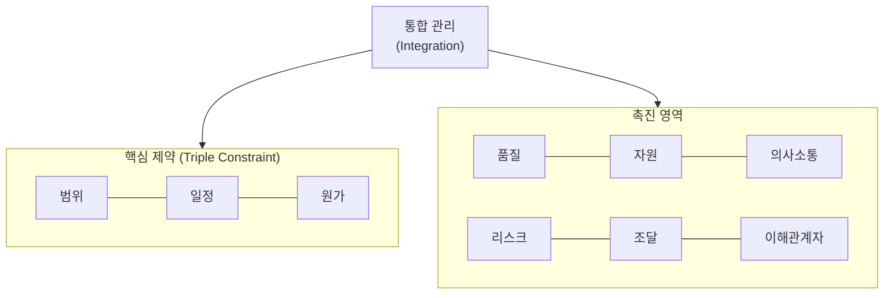

# 프로젝트 관리 지식 영역 (Knowledge Area)

---

## I. 프로젝트 관리의 전문 분야 체계, 지식 영역의 개요

### 가. 프로젝트 관리 지식 영역의 정의

- PMI의 PMBOK 6판에서 프로젝트 관리에 필요한 지식·프로세스·도구를 **관리 대상별로 묶은 10개 전문 분야**
- 각 지식 영역은 5개 프로세스 그룹(착수·기획·실행·감시통제·종료)과 교차하여 총 49개 프로세스를 구성

### 나. 지식 영역의 특징

| 구분 | 내용 |
| --- | --- |
| 매트릭스 구조 | 지식 영역(무엇을) × 프로세스 그룹(언제) 매트릭스로 프로세스를 배치 |
| 통합 중심 | 통합 관리가 나머지 9개 영역을 조정하고 연결 |
| ITTO 기반 | 프로세스마다 투입물(Input)·도구 및 기법(Tool & Technique)·산출물(Output)을 정의 |

---

## II. 프로젝트 관리 10대 지식 영역

### 가. 지식 영역 구성도

### 나. 지식 영역별 주요 내용

| 지식 영역 | 핵심 목적 | 주요 산출물 / 기법 |
| --- | --- | --- |
| 통합 관리 | 전체 프로세스 조정, 변경 통제 | 프로젝트 헌장, [[프로젝트 관리 계획서]], 통합 변경 통제 |
| [[범위관리\|범위 관리]] | 필요한 작업만 정의·통제 | 범위 기술서, [[WBS]] |
| [[프로젝트 일정관리\|일정 관리]] | 기한 내 완료 | [[CPM]], 일정 단축(공정 압축, 공정 중첩) |
| 원가 관리 | 승인된 예산 내 완료 | 원가 산정, [[EVM(Earned Value Management, 획득 가치 관리)\|EVM]] |
| [[프로젝트 품질관리\|품질 관리]] | 요구 품질 충족 | 품질 계획, 품질 보증, 품질 통제 도구 |
| 자원 관리 | 인적·물적 자원 확보 및 팀 개발 | [[RACI 매트릭스]], 팀 개발([[터크만 팀 개발 5단계\|터크만 모델]]) |
| 의사소통 관리 | 적시 정보 생성·배포 | 의사소통 관리 계획, 채널 수 n(n-1)/2 |
| [[프로젝트 위험관리\|리스크 관리]] | 위협 감소, 기회 극대화 | 리스크 등록부, 정성·정량 분석, [[위험 대응]] |
| 조달 관리 | 외부 자원 획득 | 계약 유형(FP, CR, T&M), 조달 작업 기술서 |
| 이해관계자 관리 | 이해관계자 참여 유도 | 이해관계자 등록부, 참여 평가 매트릭스 |

---

## III. 지식 영역 체계의 변화 및 시사점

### 가. PMBOK 6판과 7판 비교

| 비교 항목 | PMBOK 6판 | [[PMBOK 7판 (Project Management Body of Knowledge 7th Ed.)\|PMBOK 7판]] |
| --- | --- | --- |
| 구성 기준 | 10개 지식 영역 + 49개 프로세스 | 12개 원칙 + 8개 성과 영역 |
| 접근 방식 | 프로세스 중심 (예측형) | 가치·결과 중심 (예측형·애자일 통합) |
| 활용 | 계획 대비 통제, 공공 SI 사업 | 상황에 맞는 [[테일러링]] |

### 나. 시사점

- 7판에서 지식 영역이 사라진 것은 아니며, 성과 영역을 달성하기 위한 **실행 지식**으로 여전히 활용됨
- 공공 정보화 사업처럼 산출물·절차 준수가 중요한 환경에서는 지식 영역 기반 관리가 유효하고, 불확실성이 큰 사업은 [[Agile]] 방식과 결합하는 하이브리드 접근이 바람직

---

### 🔗 연관 토픽

- **소속 도메인**: [[00_프로젝트관리_MOC|📋 프로젝트관리]]
- **세부 분류**: `1. PMBOK 표준 & 프로젝트 거버넌스`
- **핵심 연관 토픽**:
  - [[PMBOK 프로세스 그룹 (5단계)]]
  - [[PMBOK 7판 (Project Management Body of Knowledge 7th Ed.)]]
  - [[PMBOK 8개 성과 영역 및 프로젝트 관리 12원칙(PMBOK 7판)]]
  - [[ISO 21500]]
  - [[WBS]]
