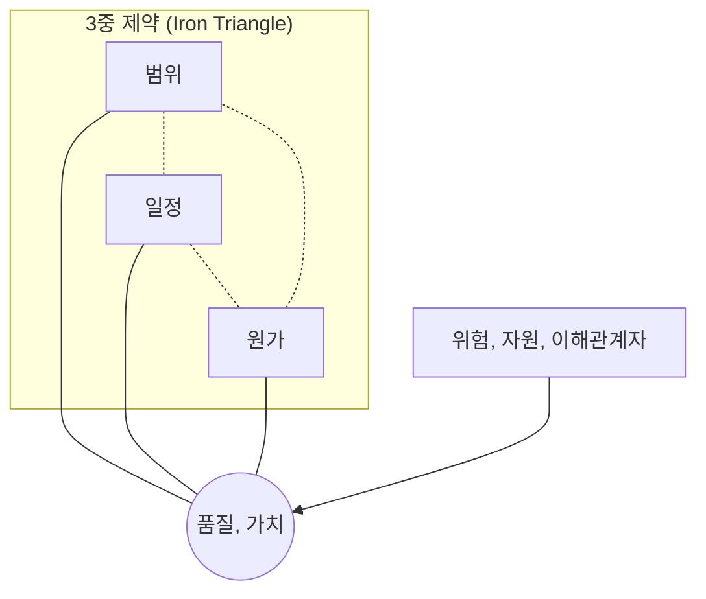

# 프로젝트 관리의 일반적 특징

---

## I. 한시적이고 유일한 노력, 프로젝트와 프로젝트 관리의 개요

### 가. 정의

- **프로젝트**: 고유한 제품·서비스·결과를 창출하기 위해 **한시적으로 수행하는 노력** (PMBOK)
- **프로젝트 관리**: 프로젝트 요구사항을 충족하기 위해 지식·기술·도구·기법을 활동에 적용하는 것

### 나. 프로젝트의 3대 속성

| 구분 | 내용 |
| --- | --- |
| 한시성 (Temporary) | 명확한 시작과 끝, 산출물은 오래 남을 수 있음 |
| 유일성 (Unique) | 반복 요소가 있어도 결과·환경 조합은 고유 |
| 점진적 구체화 (Progressive Elaboration) | 정보가 늘수록 계획·산출물 상세화 |

---

## II. 프로젝트 관리의 구조와 특징

### 가. 경쟁 제약 개념도

- 범위·일정·원가는 서로 영향을 주는 상호 의존 제약으로, 하나를 바꾸면 나머지나 품질이 영향을 받음. PMBOK은 품질·자원·위험까지 포함한 경쟁 제약으로 확장

### 나. 핵심 특징

| 구분 | 요소 | 설명 |
| --- | --- | --- |
| 프로젝트 속성 | 한시성 | 시작·종료가 정해진 일시적 노력, 팀도 한시적 구성 |
| | 유일성 | 이전과 다른 고유한 산출물 |
| | 점진적 구체화 | 초기에 개략적, 진행할수록 구체화 ([[연동계획]]) |
| 관리 특징 | 제약 균형 | 범위·일정·원가·품질·자원·위험의 트레이드오프 |
| | 통합 | 프로세스 그룹과 지식 영역을 하나로 조율 ([[프로젝트 관리 지식 영역]]) |
| | 불확실성 | 고유성에서 오는 위험의 식별·대응 ([[프로젝트 위험관리]]) |
| | 이해관계자 중심 | 다양한 기대를 식별·조정 |
| | [[테일러링\|테일러링]] | 규모·복잡도·조직 문화에 맞춘 방법 조정 |

---

## III. 비교 및 동향

### 가. 프로젝트 vs 운영

| 비교 항목 | 프로젝트 | 운영 (Operation) |
| --- | --- | --- |
| 목적 | 고유한 목표 달성, 변화 창출 | 기존 비즈니스 지속 |
| 기간 | 한시적 | 지속적 |
| 산출물 | 고유 | 반복·표준화 |
| 관리 초점 | 변화·위험 관리, 인도물 완성 | 효율성, 안정성 |
| 종료 | 목표 달성 또는 달성 불가 판단 시 | 사업 지속 중 계속 |

### 나. 동향

- **가치 인도 중심**: PMBOK 7판은 산출물 완성보다 성과·가치 인도를 강조 ([[PMBOK 7판 (Project Management Body of Knowledge 7th Ed.)|PMBOK 7판]])
- **프로젝트에서 제품으로**: 한시 프로젝트 대신 장기 제품 팀이 지속 개발하는 제품 중심 운영 확산
- **하이브리드**: 예측형과 [[Agile]] 방식을 사업 특성에 맞게 결합

---

### 🔗 연관 토픽

- **소속 도메인**: [[00_프로젝트관리_MOC|📋 프로젝트관리]]
- **세부 분류**: `5. 애자일 프로젝트 관리 & 개발 운영 (Agile PM)`
- **핵심 연관 토픽**:
  - [[프로젝트 관리 지식 영역|프로젝트 관리 지식 영역 (Knowledge Area)]]
  - [[PMBOK 프로세스 그룹 (5단계)]]
  - [[테일러링|테일러링 (Tailoring)]]
  - [[PMO|(E)PMO]]
  - [[Agile]]
