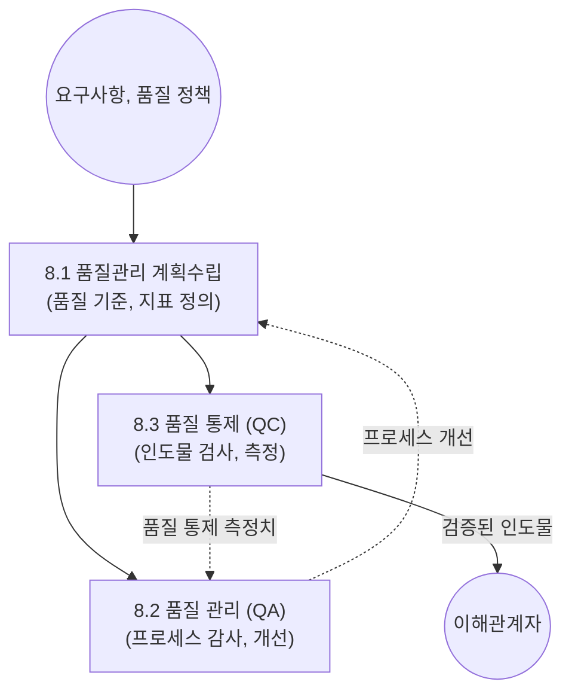

# 프로젝트 품질관리 (Project Quality Management)

---

## I. 검사보다 예방, 프로젝트 품질관리의 개요

### 가. 정의

- 프로젝트와 인도물이 **이해관계자 요구사항을 충족**하도록 조직의 품질 정책을 반영해 **품질 계획·관리(보증)·통제**를 수행하는 지식 영역 (PMBOK 6판 8장)

### 나. 특징

| 구분 | 내용 |
| --- | --- |
| 품질의 의미 | 요구사항 적합성(Conformance, 크로스비)과 사용 적합성(Fitness for Use, 주란) |
| 예방 중심 | 검사로 결함을 찾는 것보다 예방하는 비용이 작음 |
| 품질비용 (CoQ) | 적합 비용(예방·평가)과 부적합 비용(내부·외부 실패)의 균형 |
| 경영진 책임 | 품질 문제 대부분(데밍의 85:15 법칙)은 시스템·관리 책임, TQM 강조 |
| 지속적 개선 | [[PDCA(Plan-Do-Check-Act, Deming Cycle)\|PDCA]], 6시그마, 린 기법 적용 |

---

## II. 프로세스와 핵심 도구

### 가. 개념도

- QA(품질 관리)는 프로세스가 올바른지 점검해 결함을 예방하고, QC(품질 통제)는 인도물을 측정해 결함을 찾아 시정

### 나. 핵심 요소

| 구분 | 요소 | 설명 |
| --- | --- | --- |
| 계획 | 품질비용 (CoQ) | 예방·평가·내부 실패·외부 실패 비용 분석 |
| | 벤치마킹, 비용-편익 분석 | 품질 기준 설정과 품질 활동의 경제성 판단 |
| 관리 (QA) | 품질 감사 | 활동이 조직의 정책·프로세스를 준수하는지 독립적으로 검토 |
| | DfX (Design for X) | 신뢰성·제조 용이성 등 특정 속성을 설계 단계에서 최적화 |
| | 근본 원인 분석 | 문제의 근본 원인 식별 후 재발 방지 |
| 통제 (QC) | 관리도 | 프로세스가 관리 한계(UCL·LCL) 안에서 안정적인지 감시 |
| | 파레토 차트 | 80/20 법칙, 빈도가 큰 결함 원인부터 개선 |
| | 특성요인도 (Fishbone) | 결과에 영향을 주는 원인을 범주별로 추적 |
| | 산점도, 히스토그램, 체크시트 | 변수 간 상관, 분포, 발생 빈도 파악 ([[품질통제도구]]) |
| | 검사·테스트 | 인도물이 요구사항을 충족하는지 확인 |

---

## III. 비교 및 동향

### 가. QA vs QC

| 비교 항목 | QA (Manage Quality) | QC (Control Quality) |
| --- | --- | --- |
| 목적 | 결함 예방 | 결함 발견·시정 |
| 대상 | 프로세스 | 인도물 |
| 시점 | 수명주기 전반 | 인도물 완성 시점, 단계 말 |
| 기법 | 품질 감사, DfX, 프로세스 분석 | 검사, 테스트, QC 7가지 도구 |
| 주체 | 품질보증 조직, PM | 작업자, 테스터, QC 담당 |

### 나. 동향

- **Shift-Left**: [[DevSecOps]] 파이프라인에서 정적 분석·자동 테스트를 초기에 수행해 외부 실패 비용 감소
- **AI 보조 품질관리**: 커밋 이력·결함 이력으로 결함 가능성이 높은 모듈 예측, 테스트 케이스 생성 보조
- **애자일 품질**: 완료 정의(DoD), [[TDD]], 지속적 통합으로 품질을 반복 주기 안에 내재화

---

### 🔗 연관 토픽

- **소속 도메인**: [[00_프로젝트관리_MOC|📋 프로젝트관리]]
- **세부 분류**: `1. PMBOK 표준 & 프로젝트 거버넌스`
- **핵심 연관 토픽**:
  - [[품질관리]]
  - [[품질통제도구|품질통제도구, QC 7]]
  - [[SW 품질비용]]
  - [[PDCA(Plan-Do-Check-Act, Deming Cycle)]]
  - [[프로젝트 관리 지식 영역|프로젝트 관리 지식 영역 (Knowledge Area)]]
