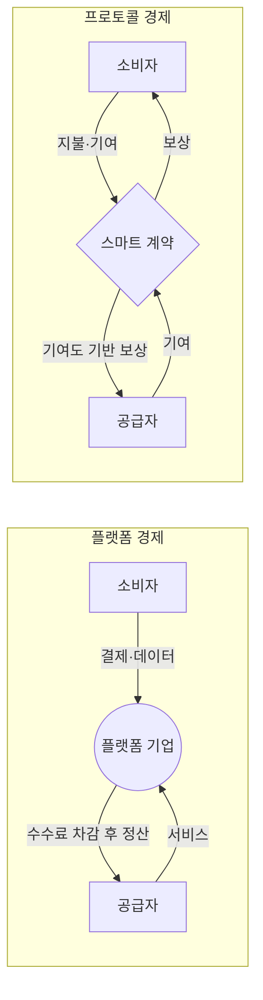

# 프로토콜 경제 (Protocol Economy)

---

## I. 플랫폼 대신 규칙이 중개하는, 프로토콜 경제의 개요

### 가. 정의

- 중앙 플랫폼 사업자 대신 **참여자가 합의한 규칙([[프로토콜]])이 거래를 중개하고, 기여도에 따라 가치를 분배**하는 경제 모델 (주로 [[블록체인]]·스마트 계약 기반)

### 나. 등장 배경 및 특징

| 구분 | 내용 |
| --- | --- |
| 배경 | 플랫폼의 데이터·수익 독점, 높은 수수료, 플랫폼 노동자 처우 문제 |
| 탈중앙화 | 중개자 없이 공개된 규칙으로 거래 |
| 투명성 | 규칙·거래 내역이 공개 원장에 기록 |
| 참여형 분배 | 기여자에게 토큰 등으로 보상, DAO로 의사결정 참여 |

---

## II. 프로토콜 경제의 구조 및 구성요소

### 가. 플랫폼 경제 vs 프로토콜 경제 구조

- 플랫폼 기업이 가져가던 중개 역할과 이익을 공개 규칙(스마트 계약)이 대신하고, 참여자에게 가치를 분배

### 나. 구성요소

| 구분 | 요소 | 설명 |
| --- | --- | --- |
| 기반 | 퍼블릭 블록체인 | 공개 분산 원장, 위변조 방지 |
| | [[합의 알고리즘]] | PoW·PoS 등으로 원장 상태 합의 |
| 실행 | 스마트 계약 | 조건 충족 시 거래·보상 자동 집행 |
| 보상 | 토크노믹스 | 토큰 발행·분배·소각 규칙으로 참여 유인 설계 |
| 지배 구조 | DAO | 거버넌스 토큰 보유자의 투표로 규칙 변경 |
| 데이터·신원 | IPFS, DID | 분산 저장, 자기주권 신원 |
| 자산 | [[NFT (Non Fungible Token)\|NFT]], DeFi | 디지털 소유권 증명, 탈중앙 금융 |

---

## III. 플랫폼 경제 비교 및 동향

### 가. 플랫폼 경제 vs 프로토콜 경제

| 구분 | 플랫폼 경제 | 프로토콜 경제 |
| --- | --- | --- |
| 중개 주체 | 플랫폼 기업 | 공개 규칙 (스마트 계약) |
| 가치 분배 | 플랫폼 주주 중심 | 참여자 기여도 기반 |
| 데이터 | 플랫폼 서버에 집중 | 참여자 통제, 분산 저장 |
| 규칙 투명성 | 비공개 알고리즘 | 코드 공개 |
| 신뢰 기반 | 기업 신용·법적 책임 | 암호 기술·합의 규칙 |

### 나. 동향

- **한계 노출**: 블록체인 트릴레마(확장성·보안·탈중앙화), 토큰 가격 변동, P2E 등 토큰 보상 모델의 지속성 문제와 투기화
- **제도화 진행**: 가상자산이용자보호법(2024 시행), 미국 GENIUS Act(2025, 스테이블코인) 등으로 제도권 편입과 투자자 보호 강화
- **비블록체인 적용**: 국내에서는 플랫폼 수익을 참여자와 나누는 협동조합형 배달·택시 앱 등 공정 분배 모델로도 논의 (중소벤처기업부 2020년 정책 제시)

---

### 🔗 연관 토픽

- **소속 도메인**: [[00_경영전략_MOC|📈 경영전략]]
- **세부 분류**: `3. 비즈니스 프로세스 혁신 & 디지털 전환 (DX)`
- **핵심 연관 토픽**:
  - [[블록체인|블록체인 (Block Chain)]]
  - [[Web 3.0]]
  - [[공유경제|공유경제 (Sharing Economy)]]
  - [[NFT (Non Fungible Token)]]
  - [[합의 알고리즘|합의 알고리즘 (Consensus Algorithm)]]
