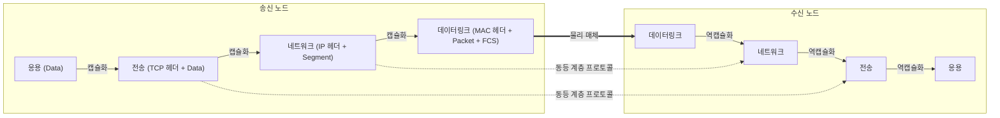

# 프로토콜 (Protocol)

---

## I. 통신을 위한 공통 약속, 프로토콜의 개요

### 가. 정의

- 이기종 시스템이 데이터를 교환하기 위해 **사전에 합의한 형식·절차·규칙의 집합** (구문·의미·타이밍)

### 나. 특징

| 구분 | 내용 |
| --- | --- |
| 등장 배경 | 하드웨어·OS가 다른 시스템 간 통신 불일치 해소, 상호 운용성 확보 |
| 3요소 | 구문(Syntax, 형식), 의미(Semantics, 제어 정보), 타이밍(Timing, 속도·순서) |
| 계층화 | 기능을 계층으로 분리해 프로토콜 스택 구성 (OSI 7계층, [[TCP]]/IP) |
| 표준화 | IETF(RFC), IEEE, ITU-T, ISO 등에서 제정 |
| 상세 노트 | 계층별 프로토콜 진화는 [[네트워크 프로토콜]] 참고 |

---

## II. 동작 구조 및 기능

### 가. 캡슐화와 동등 계층 통신

- 송신측은 계층마다 헤더(일부는 트레일러)를 붙이고 수신측은 같은 계층에서 이를 해석·제거

### 나. 주요 기능

| 구분 | 요소 | 설명 |
| --- | --- | --- |
| 3요소 | 구문 | 데이터 형식, 부호화, 신호 레벨 |
| | 의미 | 제어 정보의 해석, 오류 처리 방법 |
| | 타이밍 | 속도 일치, 순서 |
| 기능 | 캡슐화 | SDU에 제어 정보(PCI)를 붙여 PDU 생성 |
| | [[단편화]] · 재조립 | MTU에 맞게 분할 후 재조립 |
| | 연결 제어 | 연결 설정·유지·해제 |
| | 흐름 제어 | 수신 능력에 맞춰 송신량 조절 (슬라이딩 윈도우) |
| | 오류 제어 | 검출([[CRC]]) 후 재전송(ARQ) 또는 정정(FEC) |
| | 순서 제어 · 동기화 | 순서 번호, 송수신 타이밍 맞춤 |
| | 주소 지정 · [[다중화]] | 송수신자 식별, 하나의 연결·링크를 여러 흐름이 공유 |

---

## III. 비교 및 동향

### 가. OSI 7계층 vs TCP/IP 4계층

| 비교 항목 | OSI 7계층 | TCP/IP 4계층 |
| --- | --- | --- |
| 제정 | ISO (ISO/IEC 7498) | 미 국방성 ARPANET에서 발전, IETF 표준 |
| 성격 | 참조 모델, 개념 기준 | 인터넷의 사실상 표준 |
| 계층 | 응용·표현·세션·전송·네트워크·데이터링크·물리 | 응용·전송·인터넷·네트워크 접근 |
| 설계 순서 | 모델 먼저, 프로토콜 나중 | 프로토콜 먼저, 모델은 사후 정리 |
| 신뢰성 | 네트워크 계층에서 연결형 서비스도 정의 | 신뢰성은 [[전송 계층]](TCP)이 [[End-to-End]]로 담당 |

### 나. 동향

- **QUIC·[[HTTP 3|HTTP/3]]**: UDP 위에서 연결 설정 지연과 TCP HOL Blocking 해소
- **IoT 경량 프로토콜**: Pub/Sub 기반 [[MQTT (Message Queuing Telemetry Transport)|MQTT]], REST형 [[CoAP]] 확산
- **기본 암호화**: TLS 1.3, 암호화 DNS 등 평문 프로토콜 대체

---

### 🔗 연관 토픽

- **소속 도메인**: [[00_네트워크_MOC|🌐 네트워크]]
- **세부 분류**: `1. OSI 7계층 & 데이터링크 계층 (L1/L2)`
- **핵심 연관 토픽**:
  - [[네트워크 프로토콜|네트워크 프로토콜 (Network Protocol)]]
  - [[OSI 7 Layer|OSI 7 Layer (ISO 7498)]]
  - [[서비스 프리미티브]]
  - [[전송 계층|전송 계층 (Transport Layer)]]
  - [[TCP]]
