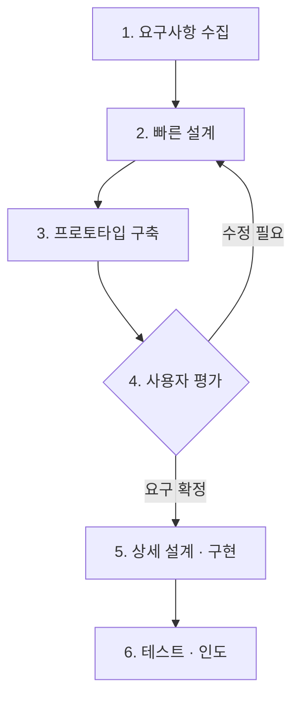

# 프로토타이핑 모델 (Prototyping Model)

---

## I. 보여 주며 요구를 확정, 프로토타이핑 모델의 개요

### 가. 정의

- 핵심 기능을 담은 **시제품(Prototype)을 조기에 만들어 사용자 평가와 피드백으로 요구사항을 정제·확정**하는 [[SDLC]] 모델

### 나. 특징

| 구분 | 내용 |
| --- | --- |
| 등장 배경 | [[워터폴\|폭포수]]의 요구사항 도출 한계, 후반 설계 변경에 따른 재작업 비용 |
| 사용자 참여 | 동작하는 시제품을 보며 숨은 요구사항 발굴 |
| 위험 조기 식별 | 빠른 설계·구축·평가 반복으로 오해와 실패 위험 축소 |
| 한계 | 시제품을 완성품으로 오인, 폐기 비용, 문서화 소홀 |

---

## II. 수행 절차 및 유형

### 가. 수행 절차

- 요구가 확정될 때까지 빠른 설계-구축-평가 루프를 반복한 뒤, 확정된 요구로 본 개발 수행

### 나. 유형 및 지원 도구

| 구분 | 요소 | 설명 |
| --- | --- | --- |
| 활용 방식 | 폐기형 (Throw-away) | 요구 검증 후 버리고 본 시스템은 새로 개발 |
| | 진화형 (Evolutionary) | 시제품을 계속 보완해 최종 시스템으로 발전 ([[진화형 개발 모델]]) |
| | 점진형 (Incremental) | 시스템을 여러 시제품 모듈로 나눠 차례로 구축·결합 |
| 구현 범위 | 수평적 (Horizontal) | UI 등 표면 기능을 넓게 구현해 화면 흐름 검증 |
| | 수직적 (Vertical) | 특정 기능을 화면부터 DB까지 깊게 구현해 핵심 [[알고리즘]]·성능 검증 |
| 지원 도구 | 와이어프레임 · 목업 | 화면 배치와 흐름을 빠르게 스케치 (Figma 등) |
| | 로우코드 · 노코드 | 드래그 앤 드롭으로 동작하는 시제품 신속 구축 |

---

## III. 비교 및 동향

### 가. 폭포수 vs 프로토타이핑

| 비교 항목 | [[워터폴\|폭포수]] | 프로토타이핑 |
| --- | --- | --- |
| 핵심 사상 | 순차, 문서 중심 | 시제품·피드백 중심 |
| 요구 변경 | 초기 확정 후 엄격 통제 | 초기 단계에서 유연하게 수용 |
| 사용자 참여 | 분석·[[인수 테스트]] 시점에 집중 | 요구 확정 과정 전반에 참여 |
| 위험 | 후반부 결함 발견 시 비용 큼 | 초기 피드백으로 조기 해소 |
| 적합 분야 | 요구가 명확한 유사 경험 사업 | 요구가 불명확하고 UI/UX 비중이 큰 사업 |

### 나. 동향

- [[Agile]]·[[린 방법론|Lean]] UX에서 [[01_IT Tech/MVP|MVP]]로 시장 반응을 빠르게 검증하는 형태로 정착
- Figma·ProtoPie 등 협업형 도구와 생성형 AI가 디자인 시안을 프론트엔드 코드로 변환하는 Design-to-Code 확산

---

### 🔗 연관 토픽

- **소속 도메인**: [[00_소프트웨어공학_MOC|🏗️ 소프트웨어공학]]
- **세부 분류**: `1. 소프트웨어 개발 생명주기(SDLC) & 방법론`
- **핵심 연관 토픽**:
  - [[SDLC]]
  - [[워터폴|폭포수 모델]]
  - [[진화형 개발 모델]]
  - [[요구 공학]]
  - [[린 방법론|린 (Lean) 방법론]]
