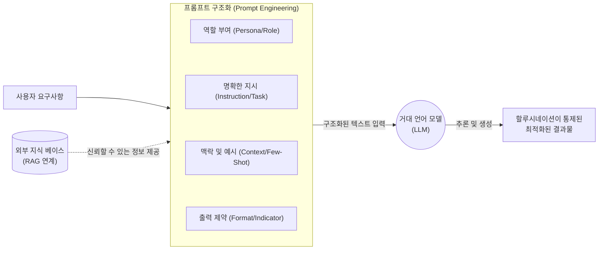

# 프롬프트 엔지니어링 (Prompt Engineering)

---

## I. 거대 언어 모델(LLM)의 성능 극대화를 위한 최적의 대화 설계 기법, 프롬프트 엔지니어링의 개요

### 가. 프롬프트 엔지니어링(Prompt Engineering)의 정의
- 생성형 AI([[초거대 언어 모델|LLM]])가 사용자의 의도를 정확히 파악하고 고품질의 결과물을 생성하도록, 입력 텍스트(프롬프트)의 구조와 맥락을 최적화하는 설계 기술 및 [[프로세스]]이다.

### 나. 프롬프트 엔지니어링의 주요 특징 및 핵심 역할
| 특징 및 요소 | 상세 설명 |
| :--- | :--- |
| **In-Context Learning** | 모델 파라미터 업데이트 없이 입력 문맥(Context) 내의 지시와 예시만으로 적응 유도 |
| **비용 및 시간 효율성** | 대규모 GPU 재학습([[Fine-Tuning]]) 없이 비즈니스 요구사항과 도메인 규칙을 즉각 반영 |
| **환각(Hallucination) 통제** | 역할(Persona), 제약조건, 출력 포맷을 엄격히 지정하여 생성 오류와 편향 억제 |
| **에이전틱 워크플로우 기반** | ReAct 프레임워크와 결합하여 자율 에이전트의 사고(Reason)와 도구 실행(Act) 제어 |

---

## II. 프롬프트 엔지니어링의 개념도 및 핵심 기술 요소

### 가. 프롬프트 엔지니어링의 구성도 및 동작 원리

* 사용자의 모호한 요구사항을 역할, 지시, 맥락, 출력 형식의 4가지 프레임워크로 구조화하고, 필요시 외부 지식(RAG)을 결합하여 LLM의 추론 성능을 극대화함

### 나. 프롬프트 엔지니어링의 핵심 기술 요소

| 구분 | 요소기술(기법) | 세부 설명 |
| :--- | :--- | :--- |
| **기본 샷(Shot) 기법** | Zero-Shot Prompting | 예시 제공 없이 지시사항만으로 모델의 사전 학습된 지식을 활용하여 답변을 유도 |
| **기본 샷(Shot) 기법** | Few-Shot Prompting | 1개 또는 소수의 입출력 예제쌍을 문맥에 제공하여 모델이 출력 패턴을 모방하도록 유도 |
| **추론 강화 기법** | [[COT|CoT]] (Chain of Thought) | "차근차근 생각해 보자(Think step-by-step)" 등의 지시를 통해 중간 논리 과정을 전개하도록 유도 |
| **추론 강화 기법** | [[ToT]] (Tree of Thoughts) | CoT를 확장하여 여러 추론 경로(Tree)를 동시에 탐색하고 자체 평가하여 최적의 해답을 도출 |
| **행동 연계 기법** | ReAct (Reason + Act) | LLM이 추론(Reasoning)을 수행하고 필요한 정보를 외부 도구(API, 검색 등)에서 가져오는 행동(Action)을 결합 |
| **구조화 기법** | Role Prompting | LLM에 특정 [[페르소나]](예: "당신은 20년 차 IT 기술사입니다")를 부여하여 전문적이고 일관된 톤의 답변 유도 |
| **흐름 제어 기법** | Prompt Chaining | 복잡한 단일 작업을 여러 개의 단순한 프롬프트 단계로 분할하고, 앞의 출력을 다음의 입력으로 파이프라인화 |
| **자동화 기법** | DSPy / Prompt Search | 프롬프트를 수동으로 작성하지 않고, 머신러닝 최적화 기법을 사용하여 시스템이 프롬프트를 자동 최적화 |

---

## III. LLM 성능 향상 기법 비교 및 프롬프트 엔지니어링의 향후 전망

### 가. 프롬프트 엔지니어링과 파인튜닝(Fine-Tuning) 비교

| 비교 항목 | 프롬프트 엔지니어링 (Prompt Engineering) | 파인튜닝 (Fine-Tuning) |
| :--- | :--- | :--- |
| **핵심 원리** | 입력되는 문맥(Context)의 최적화 | 모델의 내부 파라미터(가중치)를 자체를 업데이트 |
| **필요 자원/비용** | 매우 낮음 (별도의 컴퓨팅 인프라 불필요) | 높음 ([[GPU]] 등 대규모 컴퓨팅 자원 및 고품질 데이터 셋 필요) |
| **모델 변경 여부** | 변경 없음 (Frozen Model) | [[모델 구조]] 및 가중치 변경됨 |
| **데이터 요구량** | 데이터 불필요 또는 극소량 (Few-shot) | 수백~수만 건의 정제된 도메인 특화 데이터 필수 |
| **적용 시기** | 지시사항 변경이 잦거나 빠른 프로토타이핑 시 | 특정 도메인의 뉘앙스, 어조, 전문 지식의 영구적 내재화 필요 시 |

### 나. 프롬프트 엔지니어링의 최신 동향 및 전망

- **RAG 및 벡터 DB 결합의 엔터프라이즈 표준화**: 기업의 프라이빗 정형/비정형 데이터를 안전하게 주입하기 위해 동적 리트리벌과 프롬프트 템플릿을 결합하는 RAG 아키텍처가 엔터프라이즈 AI 표준으로 정착됨.
- **프로그래밍 방식의 프롬프트 최적화(DSPy) 확산**: 수작업 휴리스틱 프롬프팅에서 벗어나 파이프라인의 입출력 평가 메트릭에 기반해 프롬프트를 알고리즘적으로 자동 컴파일·최적화하는 프레임워크가 보편화됨.
- **자율형 멀티 에이전트 오케스트레이션 코어**: 단일 질의응답을 넘어 기획(Planning)-도구호출(Tool Calling)-반성(Reflection)을 자율 수행하는 에이전틱 워크플로우의 핵심 제어 계층으로 진화함.

---

### 🔗 연관 토픽

- **소속 도메인**: [[00_인공지능_MOC|🤖 인공지능]]
- **세부 분류**: `4. 거대언어모델 (LLM) & 생성형 AI`
- **핵심 연관 토픽**:
  - [[COT|COT(Chain of Thought)]]
  - [[Fine-Tuning]]
  - [[LLMOps]]
  - [[ToT|tot Tree of thought]]
  - [[프롬프트 튜닝|프롬프트 튜닝(Prompt Tuning)]]
