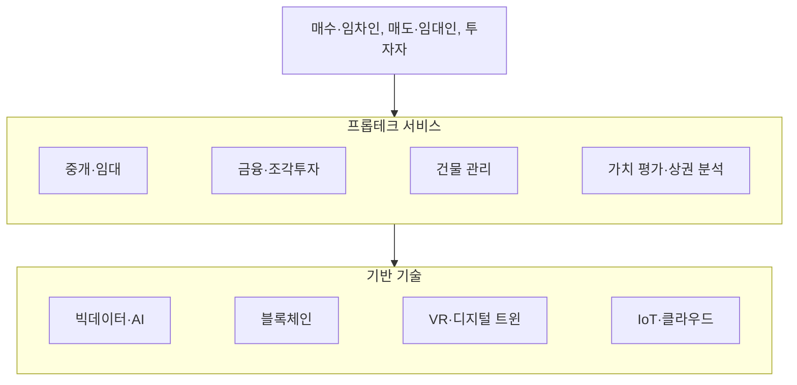

# 프롭테크 (PropTech)

---

## I. 부동산과 기술의 결합, 프롭테크의 개요

### 가. 정의

- **부동산(Property)과 기술(Technology)** 의 합성어로, AI·빅데이터·블록체인·VR 등을 부동산 중개·금융·관리·개발에 적용하는 서비스와 산업

### 나. 필요성 및 특징

| 구분 | 내용 |
| --- | --- |
| 정보 비대칭 해소 | 허위 매물·불투명한 시세 문제를 데이터로 완화 |
| 비대면 거래 | 온라인 탐색·3D 투어·전자계약으로 거래 절차 간소화 |
| 데이터 기반 평가 | 실거래가·공공데이터를 학습한 자동가치산정(AVM) |
| 산업 융합 | [[핀테크]]·건설(ConTech)·스마트시티와 결합 |

---

## II. 프롭테크의 구조 및 구성요소

### 가. 서비스 구조

- 중개·금융·관리·평가 서비스가 데이터·AI·블록체인 등 기반 기술 위에서 이해관계자를 연결

### 나. 구성요소

| 구분 | 요소 | 설명 |
| --- | --- | --- |
| 데이터·AI | AVM (자동가치산정모형) | [[공공데이터]](실거래가 등)·민간 데이터로 시세 자동 산정 |
| | GIS 상권 분석 | 유동 인구·접근성 등 입지 분석 |
| 실감 기술 | VR·AR 3D 투어 | 현장 방문 없이 매물 내부 확인 |
| | [[디지털 트윈]] | 건물 가상 모델로 에너지·설비·안전 시뮬레이션 |
| 블록체인 | 스마트 계약 | 계약 조건 충족 시 대금·권리 이전 자동 처리 (법적 등기와는 별개) |
| | 토큰증권 (STO) | 부동산 수익권을 토큰화해 소액 조각 투자 |
| 관리 | 스마트 빌딩 (IoT) | 냉난방·조명·출입·에너지 실시간 관리 |
| 사업 모델 | iBuyer | AVM으로 즉시 매입 후 재판매 (Opendoor 등) |

---

## III. 발전 단계 비교 및 동향

### 가. 프롭테크 1.0 ~ 3.0 (A. Baum, Oxford 2017 구분)

| 구분 | 프롭테크 1.0 | 프롭테크 2.0 | 프롭테크 3.0 |
| --- | --- | --- | --- |
| 시기 | 1980~2000년대 | 2000년대~ | 2010년대 후반~ |
| 핵심 기술 | PC, 스프레드시트, 웹 | 모바일, 클라우드, 플랫폼 | 블록체인, 스마트 계약, AI |
| 주요 서비스 | 정보 전산화 | 온라인 매물 플랫폼 (예: 직방, 다방) | 거래·소유권·금융의 디지털화 |

### 나. 동향

- **iBuyer 모델의 한계**: AVM 오차와 시장 변동으로 Zillow가 2021년 iBuyer 사업(Zillow Offers)을 철수, 가치 평가 모델 위험 사례
- **토큰증권 제도화**: 국내에서 부동산 수익증권 조각투자가 혁신금융서비스로 운영되고, 토큰증권 발행·유통 법제화가 추진됨
- **ESG·에너지 관리**: 건물 탄소 배출 관리, 디지털 트윈 기반 에너지 최적화 등 친환경 건물 운영 수요 증가

---

### 🔗 연관 토픽

- **소속 도메인**: [[00_경영전략_MOC|📈 경영전략]]
- **세부 분류**: `2. IT 거버넌스 & 엔터프라이즈 아키텍처 (EA/ISP)`
- **핵심 연관 토픽**:
  - [[핀테크|핀테크 (FinTech)]]
  - [[디지털 트윈|디지털 트윈 (Digital Twin)]]
  - [[블록체인]]
  - [[딥테크|딥테크 (Deep Tech)]]
  - [[공공데이터]]
