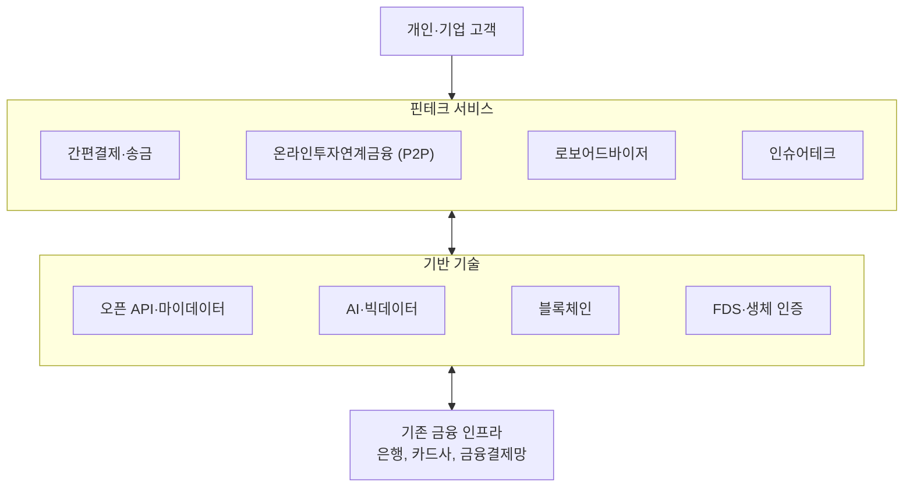

# 핀테크 (FinTech)

---

## I. 기술로 금융 서비스를 재구성하는, 핀테크의 개요

### 가. 정의

- **금융(Finance)과 기술(Technology)** 의 합성어로, 모바일·AI·빅데이터·클라우드·[[블록체인]] 등을 활용해 금융 서비스를 혁신하거나 새로운 금융 사업 모델을 만드는 산업·기술

### 나. 필요성 및 특징

| 구분 | 내용 |
| --- | --- |
| 소비자 변화 | 모바일 비대면 금융, 간편한 UX 요구 |
| 빅블러 | 금융·비금융 경계 약화, 빅테크의 금융 진출 |
| 탈중개화 | 기존 금융기관 중개 단계 축소로 비용 절감 |
| 데이터 기반 | [[마이데이터]]·대안 데이터로 개인화·신용평가 고도화 |

---

## II. 핀테크의 구조 및 구성요소

### 가. 핀테크 생태계

- 핀테크 서비스가 오픈 API·마이데이터로 기존 금융망과 연결되고, AI·보안 기술로 개인화와 안전성을 확보

### 나. 구성요소

| 구분 | 요소 | 설명 |
| --- | --- | --- |
| 서비스 | 간편결제·송금 | [[NFC]], MST(마그네틱 보안 전송), QR 결제 (예: 삼성페이, 토스) |
| | 온라인투자연계금융 (P2P) | 플랫폼이 대출자와 투자자 연결 (국내 온투법, 2020 시행) |
| | 로보어드바이저 | 알고리즘 기반 자산 배분·운용 자문 |
| | 인슈어테크 | 텔레매틱스·웨어러블 데이터 기반 보험 설계·보상 |
| 기술 | 오픈 API·마이데이터 | 금융기관 데이터를 표준 API로 제공, 고객 동의 기반 통합 조회 |
| | 대안 신용평가 | 통신비·쇼핑 등 비금융 데이터로 금융 이력 부족자(씬파일러) 평가 |
| | 블록체인 | 송금·결제 정산, 토큰화 자산 |
| 보안 | FDS (이상거래탐지) | 기기·위치·거래 패턴 분석으로 부정 거래 차단 |

---

## III. 테크핀 비교 및 동향

### 가. 핀테크 vs 테크핀

| 구분 | 핀테크 (FinTech) | 테크핀 (TechFin) |
| --- | --- | --- |
| 주도 주체 | 금융회사·핀테크 스타트업 | 빅테크·플랫폼 기업 |
| 출발점 | 금융 서비스에 기술 적용 | 플랫폼 이용자 기반에 금융 결합 |
| 경쟁 우위 | 금융 라이선스, 자본, 리스크 관리 | 대규모 이용자, 비금융 데이터, UX |
| 목적 | 금융 상품·채널 혁신 | 자사 생태계 강화, 결제 고착 효과 |

### 나. 동향

- **임베디드 금융·BaaS**: 쇼핑·모빌리티 앱 안에 결제·대출·보험을 API로 내장
- **디지털 화폐·스테이블코인**: 한국은행 예금 토큰 실거래 테스트(프로젝트 한강, 2025), 미국 GENIUS Act(2025) 등 디지털 지급수단 제도화 ([[CBDC]])
- **AI 금융 규제**: 신용평가·투자 자문 AI의 설명 가능성과 공정성 요구, 망분리 규제 완화로 금융권 클라우드·생성형 AI 활용 확대

---

### 🔗 연관 토픽

- **소속 도메인**: [[00_경영전략_MOC|📈 경영전략]]
- **세부 분류**: `3. 비즈니스 프로세스 혁신 & 디지털 전환 (DX)`
- **핵심 연관 토픽**:
  - [[마이데이터]]
  - [[CBDC]]
  - [[프로토콜 경제|프로토콜 경제(Protocol Economy)]]
  - [[프롭테크|프롭테크 (PropTech)]]
  - [[NFC]]
