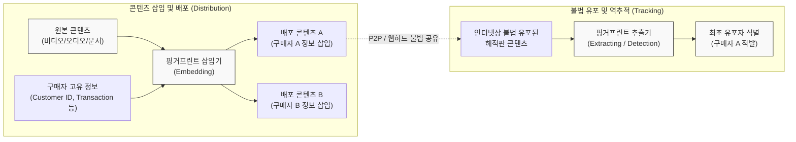

# 핑거프린팅 (Fingerprinting)

---

## I. 불법 유포자 식별 및 추적을 위한, 핑거프린팅의 개요

### 가. 정의

- 디지털 콘텐츠에 저작권자 정보뿐만 아니라 구매자(사용자)의 고유 식별 정보(ID, 구매 트랜잭션 등)를 은닉 삽입하여, 불법 복제 및 유포 발생 시 최초 유포자를 역추적할 수 있는 저작권 보호 기술

### 나. 주요 특징

| 구분 | 주요 내용 |
| --- | --- |
| 구매자별 고유성 | 동일한 원본 콘텐츠라도 각 구매자에게 제공되는 파일마다 서로 다른 핑거프린트가 삽입되어 배포 |
| 비가시성 및 강인성 | 원본 품질 저하가 없어야 하며(비가시성), 압축·필터링·크로핑 등 악의적 변형 공격에도 데이터 유지 |
| 공모 공격 위협 | 복수의 구매자가 콘텐츠를 대조하여 차이점을 찾아 제거·변조하는 공모 공격(Collusion Attack)에 노출 |
| 공모 방지 코드 적용 | 공격자가 공모하여 코드를 조작하더라도 최소 1명 이상의 가담자를 식별할 수 있는 공모 방지 코드(ACC) 탑재 |

## II. 핑거프린팅의 개념도 및 핵심 기술 요소

### 가. 핑거프린팅의 배포 및 추적 동작 개념도

* 정상적인 배포 과정에서는 사용자별 맞춤형 식별자를 은닉하여 제공하며, 불법 유포된 파일이 발견되면 추출기를 통해 해당 콘텐츠를 최초로 유출한 구매자를 찾아냄

### 나. 핑거프린팅의 핵심 기술 및 구성 요소

| 구분 | 요소기술(키워드) | 세부 설명 |
| --- | --- | --- |
| **핵심 요구사항** | 비가시성 (Invisibility) | 삽입된 구매자 정보가 인간의 시각/청각으로 인지되지 않아 원본 품질을 저하시키지 않아야 함 |
| **핵심 요구사항** | 강인성 (Robustness) | 압축(JPEG, MP3), 필터링, 포맷 변환 등 의도적 또는 비의도적 변형 공격에도 정보가 소실되지 않아야 함 |
| **주요 위협/공격** | 공모 공격 (Collusion Attack) | 동일 콘텐츠를 구매한 다수의 사용자가 핑거프린트를 상호 비교하여 차이점을 찾아 제거하거나 조작하는 공격 |
| **위협 방어 기술** | 공모 방지 코드 (ACC) | 공모 공격이 발생하더라도 생성된 코드를 기반으로 공모자 중 최소 1명 이상을 역추적할 수 있도록 설계된 부호(Code) 체계 |
| **위협 방어 기술** | 비대칭 핑거프린팅 | 판매자도 구매자의 핑거프린트 원문을 알 수 없도록 공개키(PKI) [[암호화]] 프로토콜을 적용하여 판매자의 악의적 조작 방지 |
| **삽입 [[알고리즘]]** | 공간 영역 삽입 (LSB) | 이미지 픽셀의 최하위 비트(Least Significant Bit)를 조작하여 데이터를 삽입 (구현이 단순하나 압축 공격에 취약) |
| **삽입 알고리즘** | 주파수 영역 삽입 | 영상을 주파수 대역으로 변환(DCT, DWT, FFT)한 후, 시각적으로 덜 민감한 중/저주파수 대역에 데이터를 삽입하여 강인성 확보 |
| **보안 응용 영역** | 브라우저 핑거프린팅 | 콘텐츠 보안을 넘어, 웹 환경에서 [[쿠키]](Cookie) 없이 접속 기기의 해상도, 폰트, OS 속성 등을 조합해 사용자를 특정하는 식별 기술 |

---

## III. 핑거프린팅과 워터마킹의 비교 및 최근 기술 동향

### 가. 핑거프린팅과 워터마킹(Watermarking) 비교

| 비교 항목 | 디지털 핑거프린팅 (Digital Fingerprinting) | [[디지털 워터마킹]] (Digital Watermarking) |
| --- | --- | --- |
| **적용 목적** | 불법 복제 방지 및 **최초 유포자 추적** | 콘텐츠 **저작권자(소유자) 증명** 및 보호 |
| **삽입되는 정보** | **구매자(사용자)** 고유 식별 정보 | **저작권자(창작자 또는 배포사)** 정보 |
| **콘텐츠의 형태** | 배포되는 **구매자마다 미세하게 다른** 형태 | 모든 구매자에게 **동일한** 형태 |
| **가장 치명적 공격** | 여러 버전 비교를 통한 **공모 공격(Collusion)** | 데이터 훼손을 위한 **변형 공격(압축, 자르기 등)** |
| **주요 적용 사례** | 사내 기밀문서 추적, 극장판 시사용 영화 배포 | 상업용 이미지 소유권 표기, 지폐/신분증 위조 방지 |

### 나. 핑거프린팅의 최근 기술 동향 및 향후 전망

- **딥러닝 기반 워터마크/핑거프린트 강인성 혁신**: 전통적 DCT/DWT 주파수 변환을 넘어 [[CNN]] 및 [[GAN (Generative Adversarial Network)|GAN]]을 활용하여 극단적 비디오 압축 및 스트리밍 환경에서도 소실되지 않는 신경망 핑거프린팅 상용화
- **쿠키리스(Cookie-less) 시대의 브라우저 핑거프린팅 확산**: 서드파티 쿠키 제한에 따라 캔버스(Canvas) 렌더링, 폰트, 오디오 컨텍스트 등 단말기 하드웨어 특성을 조합하여 사용자를 비식별 식별하는 브라우저 핑거프린팅 보편화
- **프라이버시 침해 논란 및 안티 핑거프린팅 대두**: 디바이스 핑거프린팅을 통한 무단 추적에 대응하여 브라우저 수준의 노이즈 주입(Brave, Safari 등) 및 차분 프라이버시 기반 추적 차단 기술 간 기술적 공방 격화

---

### 🔗 연관 토픽

- **소속 도메인**: [[00_보안_MOC|🛡️ 보안]]
- **세부 분류**: `6. 개인정보보호 & 프라이버시 강화 기술`
- **핵심 연관 토픽**:
  - [[디지털 워터마킹|디지털 워터마킹(Digital Watermarking)]]
  - [[DRM(Digital Right Management)]]
  - [[암호화|암호화 (Encryption)]]
  - [[딥러닝]]
  - [[비식별화]]
