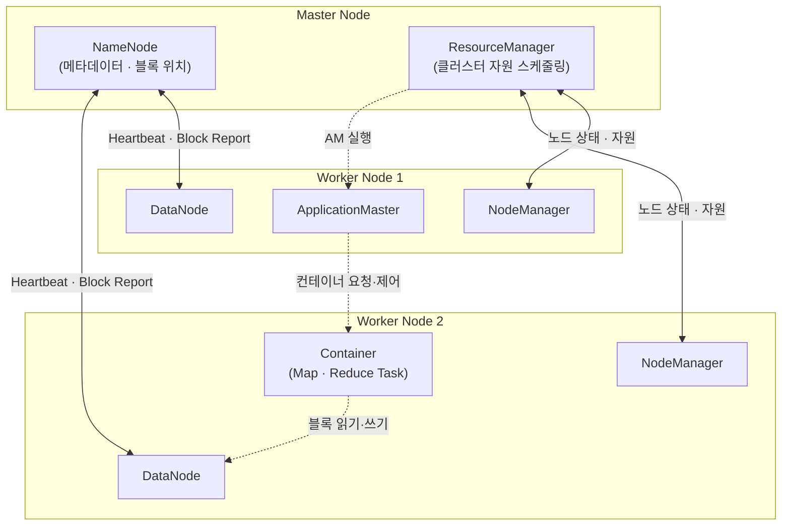

# 하둡 (Hadoop)

---

## I. 범용 서버로 빅데이터 처리, 하둡의 개요

### 가. 정의

- 범용 서버 클러스터에서 **대용량 데이터를 HDFS로 분산 저장하고 MapReduce 등으로 병렬 처리**하는 Apache 오픈소스 [[프레임워크]] (Google GFS·MapReduce 논문 기반, 2006년 Doug Cutting 개발)

### 나. 특징

| 구분 | 내용 |
| --- | --- |
| 등장 배경 | RDBMS·Scale-up 방식의 비용·용량 한계, 웹 규모 데이터 증가 |
| Scale-out | 저가 x86 서버를 추가해 수평 확장 |
| 내결함성 | 블록 복제(기본 3개)로 노드 장애 시에도 데이터 보존, 실패 태스크 재실행 |
| 데이터 [[지역성]] | 데이터가 있는 노드로 연산을 보내 네트워크 전송 최소화 |
| 자원 관리 분리 | Hadoop 2의 YARN으로 MapReduce 외 Spark 등 다양한 엔진 수용 |

---

## II. 구조 및 구성요소

### 가. 클러스터 구조 (HDFS + YARN)

- 마스터(NameNode·ResourceManager)가 메타데이터와 자원을 관리하고, 워커(DataNode·NodeManager)가 블록 저장과 컨테이너 연산 수행

### 나. 구성요소

| 구분 | 요소 | 설명 |
| --- | --- | --- |
| 분산 저장 ([[HDFS]]) | NameNode | 네임스페이스·블록 매핑 메타데이터를 메모리에 유지, Standby NameNode로 HA |
| | DataNode | 블록(기본 128MB) 저장, 주기적 하트비트·블록 리포트 |
| 자원 관리 (YARN) | ResourceManager | 클러스터 [[CPU]]·메모리 전역 스케줄링 |
| | NodeManager | 노드별 [[컨테이너]] 실행·자원 모니터링 |
| | ApplicationMaster | 애플리케이션 단위 자원 협상·태스크 관리·장애 복구 |
| 분산 처리 | MapReduce | Map(키-값 변환) → Shuffle·Sort → Reduce(집계) |
| 조정 | ZooKeeper | 분산 코디네이션, NameNode 자동 장애 조치 |
| 생태계 | Hive · HBase · Spark | SQL 질의 / 컬럼형 NoSQL / 인메모리 처리 엔진 |

---

## III. 비교 및 동향

### 가. Hadoop MapReduce vs Spark

| 비교 항목 | Hadoop MapReduce | Apache Spark |
| --- | --- | --- |
| 처리 기반 | 디스크 I/O | 인메모리 (부족 시 디스크 사용) |
| 중간 결과 | 단계마다 HDFS에 기록 | RDD·DataFrame을 메모리에 캐싱해 [[재사용]] |
| 속도 | 상대적으로 느림 | 반복 연산에서 크게 빠름 (공식 자료 최대 100배) |
| 처리 방식 | 배치 | 배치, 스트리밍, [[SQL(Structured Query Language)\|SQL]], ML 통합 |
| 적합 작업 | 대용량 단순 배치 집계 | 반복 [[알고리즘]](머신러닝), 대화형 분석 |

### 나. 동향

- **스토리지-컴퓨팅 분리**: HDFS 대신 객체 스토리지(S3·GCS)에 데이터를 두고 필요 시 클러스터를 생성하는 관리형 서비스(AWS EMR, Dataproc) 확산
- **레이크하우스 전환**: Apache Iceberg·Delta Lake 등 오픈 테이블 포맷과 Spark·Trino 엔진 조합이 하둡 기반 데이터 레이크를 대체하는 추세
- **Hadoop 3**: Erasure Coding으로 복제 대비 저장 공간 절감, 다중 Standby NameNode 지원

---

### 🔗 연관 토픽

- **소속 도메인**: [[00_디지털서비스_MOC|🚀 디지털서비스]]
- **세부 분류**: `4. 데이터 플랫폼 & 개방형 API 생태계`
- **핵심 연관 토픽**:
  - [[HDFS]]
  - [[지역성|지역성(Locality)]]
  - [[분산 데이터베이스]]
  - [[클라우드 컴퓨팅|클라우드 컴퓨팅 (Cloud Computing)]]
  - [[컨테이너|컨테이너 (Container)]]
