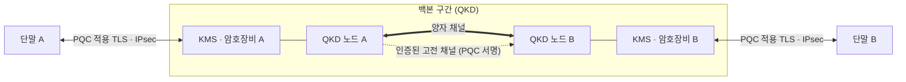

# 하이브리드 양자암호통신

---

## I. QKD와 PQC의 결합, 하이브리드 양자암호통신의 개요

### 가. 정의

- 물리 원리 기반의 **양자키분배(QKD)와 수학 난제 기반의 [[양자내성암호]](PQC)를 구간·기능별로 결합**하여 양자 컴퓨터 시대의 통신을 보호하는 암호 통신 체계

### 나. 필요성 및 특징

| 구분 | 내용 |
| --- | --- |
| 양자 위협 | Shor 알고리즘으로 [[RSA (Rivest Shamir Adleman)\|RSA]]·[[ECC]] 기반 키 교환 무력화 |
| QKD 한계 | 전용 광 채널·장비, 거리 제한, 자체 인증 기능 없음 |
| PQC 한계 | 새 수학 난제의 장기 안전성에 대한 불확실성 |
| 상호 보완 | QKD는 키 분배, PQC는 인증·서명과 넓은 구간 적용 |
| 심층 방어 | 한쪽 기술이 깨져도 다른 쪽으로 보호 유지 |

---

## II. 구성 구조 및 구성요소

### 가. 구간별 적용 구조

- 백본은 QKD로 키를 분배하고 고전 채널 인증은 PQC 서명으로 보완하며, 단말 접속 구간은 PQC로 보호

### 나. 구성요소

| 구분 | 요소 | 설명 |
| --- | --- | --- |
| QKD | 양자 채널 | 단일 광자 전송, 도청 시 오류율 증가로 탐지 |
| | 신뢰 노드 | 장거리 구간 키 중계 |
| PQC | ML-KEM | 격자 기반 키 캡슐화 (FIPS 203) |
| | ML-DSA·SLH-DSA | 고전 채널·장비 인증용 서명 |
| 키 관리 | KMS·KME | QKD 키와 PQC 키를 결합(예: KDF로 혼합)해 암호장비에 공급 |
| | ETSI GS QKD 014 | QKD 키를 애플리케이션에 전달하는 표준 API |
| 네트워크 | QKDN | 여러 QKD 노드를 관리·라우팅하는 키 분배망 (ITU-T Y.3800 계열) |
| 적용 장비 | 암호화 라우터·스위치 | 분배된 키로 IPsec·MACsec 암호화 |

---

## III. 비교 및 동향

### 가. QKD vs PQC vs 하이브리드

| 비교 항목 | QKD | PQC | 하이브리드 |
| --- | --- | --- | --- |
| 안전성 근거 | 양자역학 | 수학적 난제 | 둘 다 |
| 제공 기능 | 키 분배 | 키 교환·서명 | 키 분배 + 인증 |
| 인프라 | 전용 장비·광섬유 | 소프트웨어 | 백본은 장비, 접속은 소프트웨어 |
| 거리·비용 | 제한·고비용 | 제한 없음·저비용 | 구간별 최적화 |
| 적용 | 백본, 데이터센터 연결 | 단말, 인터넷 서비스 | 국가·금융 핵심망 |

### 나. 동향

- **국내 상용화**: 국내 통신사들이 QKD+PQC 하이브리드 방식의 공공·금융 전용회선 서비스 제공
- **표준화**: ITU-T QKDN 시리즈와 ETSI QKD 표준, IETF의 하이브리드 키 교환 규격 정비
- **정책 논쟁**: 미국·영국은 PQC 우선, 한국·EU·중국은 QKD 인프라와 PQC 병행 투자

---

### 🔗 연관 토픽

- **소속 도메인**: [[00_보안_MOC|🛡️ 보안]]
- **세부 분류**: `2. 현대 암호학 & 키 관리 · 전자서명`
- **핵심 연관 토픽**:
  - [[양자 암호|양자 암호(Quantum Cryptography)]]
  - [[양자내성암호]]
  - [[쇼어 & 그루버 알고리즘]]
  - [[KMS]]
  - [[IP Sec]]
