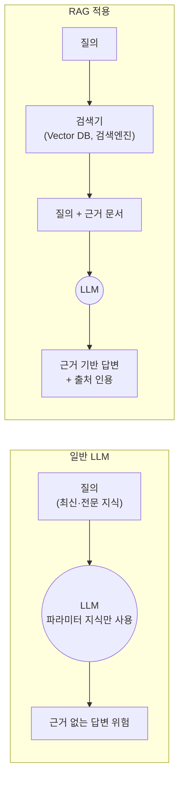

# 할루시네이션 (Hallucination)

---

## I. 그럴듯한 거짓을 만드는, 할루시네이션의 개요

### 가. 정의

- 생성형 AI가 **입력·근거 자료나 사실과 맞지 않는 내용을 그럴듯하게 생성**하는 현상

### 나. 발생 원인 및 특징

| 구분 | 내용 |
| --- | --- |
| 모델 특성 | 다음 토큰 확률을 예측하는 생성 모델로, 사실 검증 기능이 내장되어 있지 않음 |
| 데이터 결함 | 오래된 지식, 오류·편향 데이터, 희소한 지식(롱테일) |
| 학습 목표 | 추측해서라도 답하는 쪽이 평가·보상에서 유리, RLHF로 유창성·동조 성향 강화 |
| 디코딩 | 높은 Temperature·샘플링에서 근거 없는 토큰 선택 증가 |
| 위험 | 확신에 찬 말투로 오답 제시, 의료·법률·금융 적용의 주요 장애 |

---

## II. 발생 구조 및 완화 기술

### 가. 개념도

- 모델 내부 지식에만 의존하면 공백을 추측으로 채우므로, 외부 근거를 주입하고 출처를 제시하도록 제어

### 나. 완화 기술

| 구분 | 요소 | 설명 |
| --- | --- | --- |
| 데이터 | 데이터 정제 | 중복·오류 제거, 신뢰 출처 위주 큐레이션 |
| | [[지식그래프]] | 개체-관계 트리플로 사실 검증 기준 제공 ([[GraphRAG (Graph Retrieval-Augmented Generation)\|GraphRAG]]) |
| 학습 | 정렬 학습 | 정직성·불확실성 표현("모른다")에 보상, 사실성 기반 선호 데이터 |
| 추론 시 근거 | [[RAG (Retrieval Augmented Generation) 검색 증강 생성 AI\|RAG]] | 외부 문서 검색 결과를 컨텍스트로 제공 |
| | 도구 사용 | 검색·계산기·API 호출로 사실 확인 |
| 프롬프트 | [[COT\|CoT]] | 단계별 추론으로 논리 비약 감소 (단, 추론 과정 자체도 틀릴 수 있음) |
| | 자기 일관성 | 여러 추론 경로를 샘플링해 다수결 답 선택 |
| 검증 | 사후 검증 | 생성 후 주장별 근거 확인(Chain-of-Verification), 다중 응답 불일치 검사 |
| | 가드레일 | 입력·출력 필터로 근거 없는 답변·민감 정보 차단 (NeMo Guardrails 등) |

---

## III. 비교 및 동향

### 가. 내재적 vs 외재적 할루시네이션

| 비교 항목 | 내재적 (Intrinsic) | 외재적 (Extrinsic) |
| --- | --- | --- |
| 개념 | 주어진 원문과 모순되는 내용 생성 | 원문으로 확인할 수 없는 내용 추가 |
| 예 | (원문: A는 50세) → "A는 30세" | (원문: A 경력 요약) → "A는 B대학 졸업" |
| 원인 | 독해·추론 오류 | 지식 공백을 추측으로 채움 |
| 완화 | 원문 대조 검증, 추론 강화 | RAG, "근거에 없으면 모른다고 답하라" 지시, 출처 인용 |

### 나. 동향

- **검증형 에이전트 워크플로**: 답변 생성 후 검색·코드 실행으로 스스로 검증·수정하는 흐름 확산 ([[에이전틱 AI]])
- **출처 인용과 평가**: 문장별 근거 링크 제공, 사실성 벤치마크·근거 일치도(Faithfulness) 평가로 서비스 품질 관리 ([[AI 시스템 테스트]])
- **완전 제거는 어려움**: 확률적 생성의 특성상 0%는 어려워, 고위험 업무는 사람 검토(Human-in-the-loop) 병행

---

### 🔗 연관 토픽

- **소속 도메인**: [[00_인공지능_MOC|🤖 인공지능]]
- **세부 분류**: `1. 수학 · 통계학 & 데이터 전처리`
- **핵심 연관 토픽**:
  - [[RAG (Retrieval Augmented Generation) 검색 증강 생성 AI]]
  - [[초거대 언어 모델|초거대 언어 모델(Large Language Model)]]
  - [[AI 시스템 테스트]]
  - [[AI 레드팀(Red team) 테스트]]
  - [[COT|COT(Chain of Thought)]]
