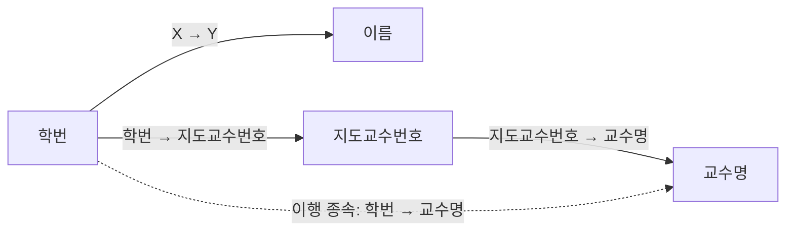

# 함수적 종속성 (Functional Dependency)

---

## I. 정규화의 이론적 기준, 함수적 종속성의 개요

### 가. 정의

- 릴레이션에서 **속성 집합 X의 값이 속성 집합 Y의 값을 유일하게 결정**할 때 Y는 X에 함수적으로 종속된다고 하며 X → Y로 표기 (X: 결정자, Y: 종속자)

### 나. 특징

| 구분 | 내용 |
| --- | --- |
| 의미 기반 | 현재 데이터가 아닌 속성의 의미·업무 규칙으로 판단 |
| 정규화 기준 | 부분·이행 종속 제거가 2NF·3NF의 조건 |
| 이상현상 원인 | 잘못된 종속이 한 릴레이션에 섞이면 [[Anomaly(이상현상)\|이상현상]] 발생 |
| 추론 | [[암스트롱 공리]]로 숨은 종속을 유도 |

---

## II. 종속 유형

### 가. 종속 관계 예시

- 학번이 지도교수번호를, 지도교수번호가 교수명을 결정하면 학번 → 교수명은 이행 종속

### 나. 종속 유형

| 구분 | 요소 | 설명 |
| --- | --- | --- |
| 기본 | 완전 함수 종속 | Y가 X 전체에 종속, X의 진부분집합에는 종속하지 않음 |
| | 부분 함수 종속 | 복합키 X의 일부만으로 Y가 결정됨 → 2NF 위반 |
| | 이행 함수 종속 | X → Y, Y → Z (Y ↛ X)일 때 X → Z → 3NF 위반 |
| | 자명한 종속 | Y ⊆ X 이면 X → Y |
| 확장 | 다치 종속 (MVD) | X가 Y 값의 집합을 결정, X ↠ Y → 4NF에서 제거 |
| | 조인 종속 (JD) | 릴레이션이 여러 투영의 조인으로 무손실 복원 → 5NF에서 다룸 |
| 분해 조건 | 무손실 조인 | 분해된 두 릴레이션의 공통 속성이 어느 한쪽의 슈퍼키 |
| | 종속성 보존 | 분해 후에도 원래 종속을 각 릴레이션에서 검사 가능 |

---

## III. 비교 및 동향

### 가. 정규형별 제거 대상

| 비교 항목 | 제거 대상 | 결과 |
| --- | --- | --- |
| 1NF → 2NF | 부분 함수 종속 | 비주요 속성이 기본키에 완전 종속 |
| 2NF → 3NF | 이행 함수 종속 | 비주요 속성 간 종속 제거 |
| 3NF → [[BCNF]] | 후보키가 아닌 결정자 | 모든 결정자가 후보키 |
| BCNF → 4NF | 비자명 다치 종속 | 독립적인 다치 속성 분리 |

### 나. 동향

- **FD 자동 발견**: [[데이터 프로파일링]] 도구가 데이터에서 함수 종속 후보를 탐색해 품질 규칙으로 활용
- **의도적 위반**: DW·[[NoSQL (CAP 이론 BASE 속성)|NoSQL]]은 조회 성능을 위해 종속 위반(중복)을 허용하고 동기화로 관리 ([[데이터베이스 반정규화]])

---

### 🔗 연관 토픽

- **소속 도메인**: [[00_데이터베이스_MOC|🗄️ 데이터베이스]]
- **세부 분류**: `1. 데이터 모델링 & 관계형 DB 설계`
- **핵심 연관 토픽**:
  - [[암스트롱 공리]]
  - [[데이터베이스 정규화|데이터베이스 정규화(Normalization)]]
  - [[BCNF|BCNF (Boyce-Codd Normal Form 3.5NF)]]
  - [[Anomaly(이상현상)]]
  - [[릴레이션 키]]
