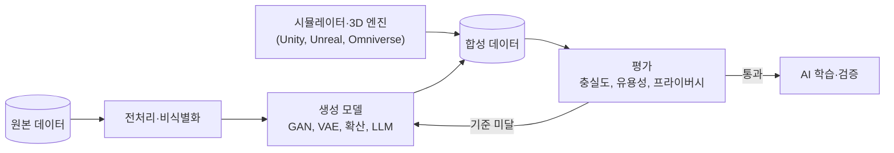

# 합성 데이터 (Synthetic Data)

---

## I. 실제를 닮게 만든 가상 데이터, 합성 데이터의 개요

### 가. 정의

- 실제 데이터의 **통계적 특성을 모사하도록 생성 모델·시뮬레이션·규칙으로 인위적으로 만든 데이터**

### 나. 필요성 및 특징

| 구분 | 내용 |
| --- | --- |
| 개인정보 보호 | GDPR, [[데이터 3법]] 등 규제 아래 원본 대신 활용, 재식별 위험을 낮춤 (위험이 0은 아님) |
| 레이블링 비용 | 시뮬레이터 생성 시 정답(바운딩 박스·분할 마스크)이 자동 생성 ([[데이터 라벨링과 어노테이션]]) |
| 희소 사례 | 사고·악천후·희귀 질환 등 수집이 어렵거나 위험한 롱테일 사례 생성 |
| 불균형 보완 | 소수 클래스 데이터 증강 ([[클래스 불균형]]) |

---

## II. 생성 구조 및 핵심 기술

### 가. 생성 파이프라인

- 원본 분포를 학습한 생성 모델 또는 물리 시뮬레이션으로 데이터를 만들고 품질·프라이버시 평가 후 학습에 투입

### 나. 핵심 기술

| 구분 | 요소 | 설명 |
| --- | --- | --- |
| 생성 모델 | [[GAN (Generative Adversarial Network)\|GAN]] | 생성자·판별자 경쟁 학습, 정형 데이터용 CTGAN |
| | [[Diffusion 모델]] | 노이즈 제거 과정을 학습해 고품질 이미지·영상 생성 |
| | [[VAE]] | 잠재 분포에서 샘플링해 생성 |
| | [[초거대 언어 모델\|LLM]] | 프롬프트·스키마로 텍스트·대화·정형 데이터 생성, 모델 학습용 지시 데이터 생성 |
| 시뮬레이션 | 3D 렌더링·디지털 트윈 | 자율주행·로봇 비전용 장면 생성, 도메인 랜덤화 |
| 프라이버시 | 차등 프라이버시 (DP) | 학습에 노이즈를 넣어 개인 정보 유출 위험을 수학적으로 제한 |
| 품질 평가 | 충실도 (Fidelity) | 분포·상관관계가 원본과 얼마나 비슷한지 |
| | 유용성 (Utility) | 합성 데이터로 학습한 모델 성능이 원본 학습과 비슷한지 (TSTR) |
| | 프라이버시 위험 | 원본 레코드 근접도, 멤버십 추론 공격 위험 평가 |

---

## III. 비교 및 동향

### 가. 원본 데이터 vs 합성 데이터

| 비교 항목 | 원본 데이터 | 합성 데이터 |
| --- | --- | --- |
| 획득 | 실제 수집 | 생성 모델·시뮬레이터 |
| 프라이버시 | 비식별 처리 필수 | 위험 낮으나 과적합 생성 모델은 원본을 기억·노출 가능 |
| 레이블 비용 | 수작업으로 큼 | 시뮬레이션 방식은 자동 생성 |
| 분포 제어 | 수집 환경에 종속 | 원하는 분포로 조정 가능 |
| 한계 | 희소 사례 부족 | 현실과의 격차(Sim-to-Real Gap), 원본 편향 복제 |

### 나. 동향

- **활용 확대 전망**: 가트너는 2030년까지 AI 학습에서 합성 데이터가 실제 데이터 사용을 넘어설 것으로 전망(2021)
- **LLM 학습 데이터 생성**: 대형 모델로 지시·추론 데이터를 만들어 소형 모델을 학습(증류)하는 방식 확산, 반복 학습 시 품질 저하(Model Collapse) 주의
- **품질 관리 가이드**: 합성 데이터의 충실도·편향 검증 기준이 데이터 품질 관리 지침에 반영 ([[생성형AI 데이터 품질관리 가이드 v2.0]])

---

### 🔗 연관 토픽

- **소속 도메인**: [[00_인공지능_MOC|🤖 인공지능]]
- **세부 분류**: `1. 수학 · 통계학 & 데이터 전처리`
- **핵심 연관 토픽**:
  - [[GAN (Generative Adversarial Network)]]
  - [[Diffusion 모델]]
  - [[VAE|VAE(Variational Autoencoder)]]
  - [[데이터 라벨링과 어노테이션]]
  - [[클래스 불균형|클래스 불균형(Class Imbalance)]]
