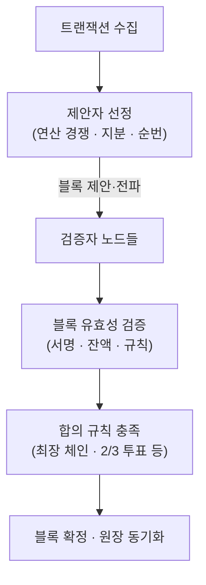

# 합의 알고리즘 (Consensus Algorithm)

---

## I. 분산 노드가 하나의 원장에 이르는 규칙, 합의 알고리즘의 개요

### 가. 정의

- 신뢰할 수 있는 중앙 기관(TTP) 없이 **분산 노드들이 다음 블록(상태)에 대해 동일한 결정에 도달하도록 하는 규칙**으로, 일부 노드의 고장·악의적 행동에도 원장의 일관성 보장

### 나. 필요성 및 특징

| 구분 | 내용 |
| --- | --- |
| 비잔틴 장군 문제 | 악의적·고장 노드가 섞여 있어도 정상 노드가 같은 결정에 도달해야 함 (Byzantine Generals Problem) |
| 이중 지불 방지 | 같은 디지털 자산을 두 번 사용하는 것을 차단 |
| 탈중앙화 | 단일 장애점 없이 노드 간 권한 분산 |
| 최종성 (Finality) | 확정된 블록이 번복되지 않는 성질, 확률적/결정적으로 구분 |
| 암호경제학 | 퍼블릭 체인은 보상(블록 보상·수수료)과 벌칙(Slashing)으로 정직한 참여 유도 |

---

## II. 동작 구조 및 유형

### 가. 동작 구조

- 제안자를 선정하는 방식(연산·지분·투표)과 확정 조건(최장 체인, 정족수 투표)에 따라 알고리즘이 구분

### 나. 유형

| 구분 | 요소 | 설명 |
| --- | --- | --- |
| 증명 기반 (퍼블릭) | PoW (작업 증명) | 목표값 이하 해시를 찾는 연산 경쟁, 최장 체인 채택 (Bitcoin) |
| | PoS (지분 증명) | 예치(Stake)한 지분에 비례해 검증자 선정, 부정 시 지분 몰수 (Ethereum, 2022 The Merge 이후) |
| | DPoS (위임 지분 증명) | 토큰 보유자가 투표로 소수 대표 노드 선출, 대표만 블록 생성 (EOS) |
| | PoA (권위 증명) | 신원이 확인된 소수 검증자가 블록 승인, 컨소시엄 체인에 적용 |
| 투표 기반 (BFT) | PBFT | Pre-prepare → Prepare → Commit 3단계 투표, n ≥ 3f+1 노드에서 f개 비잔틴 장애 허용 |
| | Tendermint 계열 BFT | PoS와 BFT 투표 결합, 2/3 이상 서명 시 즉시 확정 (Cosmos) |
| 장애 허용 (CFT) | Raft / Paxos | 악의적 노드는 없다고 가정, 리더 기반으로 2f+1 노드에서 f개 crash 장애 허용 |

---

## III. 비교 및 동향

### 가. PoW vs PoS vs PBFT

| 비교 항목 | PoW | PoS | PBFT |
| --- | --- | --- | --- |
| 적용 | 퍼블릭 | 퍼블릭 | 프라이빗·컨소시엄 |
| 결정 기준 | 연산력 (해시파워) | 예치 지분 | 노드 간 투표 |
| 에너지 | 매우 많이 소모 | 적음 | 적음 |
| 최종성 | 확률적 (블록이 쌓일수록 확정) | 체크포인트 기반 결정적 최종성 (Ethereum: 약 2 epoch) | 결정적 (즉시 확정) |
| 확장성 | 노드 수 제약 없음, 처리량 낮음 | 처리량 중간 | 메시지 O(n²)로 노드 수 확장 어려움 |
| 공격 비용 | 연산력 51% | 지분 다수 (1/3 이상이면 최종성 지연 가능) | 노드 1/3 이상 담합 |

### 나. 동향

- **PoS 전환**: 이더리움 The Merge(2022.9)로 PoW → PoS 전환, 에너지 사용 대폭 감소
- **BFT 고도화**: HotStuff 계열(선형 메시지 복잡도) 등 PBFT 확장성 한계 개선 알고리즘이 신규 체인에 적용
- **트릴레마 대응**: 합의 계층과 실행 계층을 분리하는 모듈러 구조, Rollup으로 확장성 보완 ([[01_IT Tech/블록체인|블록체인]])

---

### 🔗 연관 토픽

- **소속 도메인**: [[00_디지털서비스_MOC|🚀 디지털서비스]]
- **세부 분류**: `2. 블록체인 & 분산원장 · Web3`
- **핵심 연관 토픽**:
  - [[01_IT Tech/블록체인|블록체인 (Block Chain)]]
  - [[블록체인 플랫폼|블록체인 (Block Chain) 플랫폼]]
  - [[분산 데이터베이스]]
  - [[CBDC]]
  - [[프로토콜 경제|프로토콜 경제(Protocol Economy)]]
