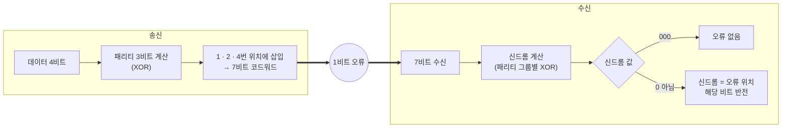

# 해밍코드 (Hamming Code)

---

## I. 오류 위치를 스스로 찾는, 해밍코드의 개요

### 가. 정의

- 2의 거듭제곱 위치에 패리티 비트를 두어 **수신측이 신드롬으로 1비트 오류의 위치를 찾아 정정**하는 선형 블록 FEC 부호 (R. Hamming, 1950)

### 나. 특징

| 구분 | 내용 |
| --- | --- |
| 자체 정정 | 재전송(ARQ) 없이 수신측에서 정정, 지연 감소 |
| 패리티 수 | $2^p \ge d + p + 1$ 을 만족하는 최소 p (예: d=4 → p=3, Hamming(7,4)) |
| 최소 해밍 거리 3 | 1비트 정정(SEC) 또는 2비트 검출 중 하나 |
| SEC-DED 확장 | 전체 패리티 1비트 추가로 최소 거리 4, 1비트 정정 + 2비트 검출 |
| 적용 | 메모리 [[ECC]] (소프트 에러 대응) |

---

## II. 동작 원리 및 구성요소

### 가. 부호화·복호화 흐름

- 신드롬을 이진수로 읽은 값이 오류 비트 위치 (예: 011 → 3번째 비트 반전)

### 나. 구성요소

| 구분 | 요소 | 설명 |
| --- | --- | --- |
| 설계 | 패리티 수 산정식 | $2^p \ge d + p + 1$ |
| | 패리티 위치 | 1, 2, 4, 8 … $2^n$ 번째 위치 |
| | 패리티 그룹 | 패리티 $P_k$는 위치 번호의 k번째 비트가 1인 위치들을 검사 |
| 연산 | 짝수 패리티 · XOR | 그룹 내 1의 개수를 짝수로 맞춤 |
| 검출 | 신드롬 (Syndrome) | 각 그룹 검사 결과를 이은 값, 0이면 무오류, 아니면 오류 위치 |
| 정정 | 비트 반전 | 신드롬이 가리키는 비트를 반전 |
| 확장 | SEC-DED | 전체 패리티 추가, 서버 메모리 ECC의 기본 방식 |
| 이론 | 해밍 거리 | 두 코드워드 간 다른 비트 수, 최소 거리 $d_{min}$ ≥ 2t+1이면 t비트 정정 |

---

## III. 비교 및 동향

### 가. 해밍코드 vs CRC

| 비교 항목 | 해밍코드 | [[CRC]] |
| --- | --- | --- |
| 오류 제어 | 전진 오류 정정 (FEC) | 검출 후 재전송 ([[FEC(Forward Error Correction) BEC(Backward Error Correction)\|BEC]], ARQ) |
| 목적 | 1비트 정정 | 다중 비트·버스트 오류 검출 |
| 연산 | 패리티 그룹 XOR | 생성 다항식 Modulo-2 나눗셈 |
| 능력 | SEC 또는 SEC-DED | 생성 다항식 차수 이하 버스트 오류 전부 검출 |
| 적용 | ECC 메모리, [[캐시 메모리]] | 이더넷 FCS, 저장장치, 압축 파일 |

### 나. 동향

- **On-Die ECC**: DDR5·LPDDR5·[[HBM]]3 메모리 칩 내부에 SEC 기반 ECC 내장해 미세 공정의 셀 오류 보정
- **고속 인터커넥트**: PCIe 6.0·[[CXL]] 3.x는 PAM4 오류율 대응을 위해 경량 FEC + CRC + 재전송을 결합 (해밍 단독이 아닌 인터리브 부호 사용)

---

### 🔗 연관 토픽

- **소속 도메인**: [[00_네트워크_MOC|🌐 네트워크]]
- **세부 분류**: `1. OSI 7계층 & 데이터링크 계층 (L1/L2)`
- **핵심 연관 토픽**:
  - [[CRC|CRC(Cyclic Redundancy Check)]]
  - [[FEC(Forward Error Correction) BEC(Backward Error Correction)|FEC / BEC]]
  - [[ECC]]
  - [[전송부호화]]
  - [[데이터 링크 계층|데이터 링크 계층 (Data Link Layer)]]
