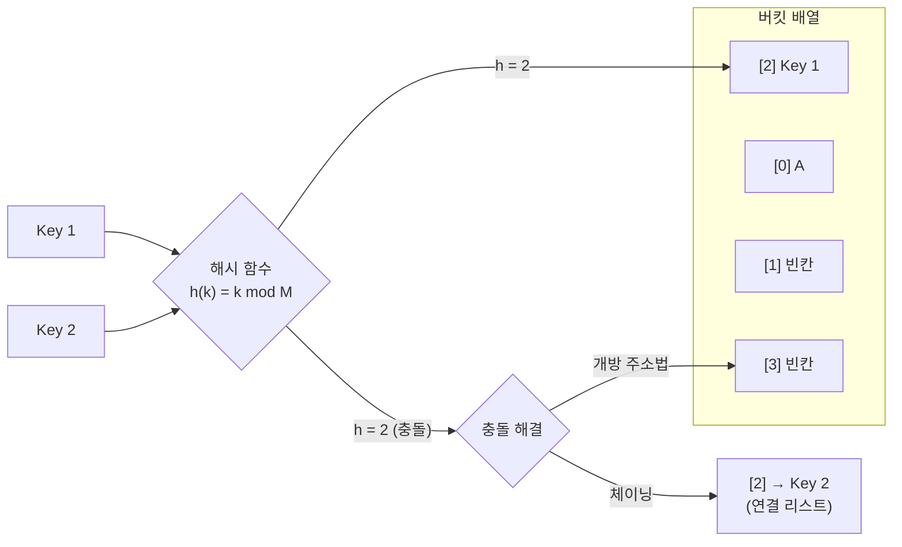

# 해시 테이블 (Hash Table)과 충돌 해결 방법

---

## I. 평균 O(1) 탐색을 위한 자료구조, 해시 테이블의 개요

### 가. 정의

- 키(Key)를 **해시 함수로 변환한 값을 배열 인덱스로 사용**하여 데이터를 평균 $O(1)$에 저장·검색하는 자료구조

### 나. 특징

| 구분 | 내용 |
| --- | --- |
| 빠른 탐색 | 순차 탐색 $O(N)$, [[이진 탐색 트리]] $O(\log N)$보다 빠른 평균 $O(1)$ |
| 시간-공간 Trade-off | 빈 버킷을 감수하고 속도 확보 |
| 충돌 필연성 | 비둘기집 원리: 큰 키 공간을 작은 버킷 배열에 매핑하므로 서로 다른 키가 같은 인덱스를 가짐 |
| 최악 성능 | 충돌이 몰리면 $O(N)$, 좋은 해시 함수와 충돌 해결 기법이 필수 |
| 순서 없음 | 범위 검색·정렬 순회에는 부적합 |

---

## II. 동작 원리 및 충돌 해결

### 가. 해싱과 충돌 해결

- 체이닝은 같은 버킷에 리스트로 이어 붙이고, 개방 주소법은 테이블 안에서 규칙에 따라 다른 빈 버킷을 찾음

### 나. 구성 요소 및 충돌 해결 기법

| 구분 | 요소 | 설명 |
| --- | --- | --- |
| 해시 함수 | 제산법 | $h(k)=k \bmod M$, M은 2의 거듭제곱에서 먼 소수 권장 |
| | 승산법 · 폴딩 · 중간 제곱법 | 키를 곱하거나 분할·제곱해 고르게 분산 |
| 저장 공간 | 버킷 · 슬롯 | 버킷은 배열 칸, 한 버킷에 여러 슬롯 가능 |
| 폐쇄 주소법 | 체이닝 (Separate Chaining) | 충돌 키를 버킷의 연결 리스트(또는 트리)에 추가 |
| 개방 주소법 | 선형 탐사 | $h(k)+i$ 순으로 탐색, 1차 군집화 발생 |
| | 제곱 탐사 | $h(k)+i^2$ 순으로 탐색, 2차 군집화 발생 |
| | 이중 해싱 | $h_1(k)+i \cdot h_2(k)$, 두 번째 해시로 보폭을 정해 군집화 최소화 |
| 성능 지표 | 적재율 (Load Factor) | $\alpha = N/M$, 개방 주소법은 $\alpha<1$이며 보통 0.7~0.75 초과 시 성능 급락 |
| 공간 제어 | 재해싱 (Rehashing) | 적재율 임계치 초과 시 테이블을 약 2배로 키우고 전체 재배치 |
| 동시성 | 락 스트라이핑 · CAS | 버킷 구간별 잠금 또는 무잠금으로 멀티스레드 병목 완화 |

---

## III. 비교 및 동향

### 가. 체이닝 vs 개방 주소법

| 비교 항목 | 체이닝 | 개방 주소법 |
| --- | --- | --- |
| 충돌 데이터 위치 | 테이블 외부 (포인터 연결) | 테이블 내부 빈칸 |
| 추가 메모리 | 포인터 오버헤드 | 없음 |
| 캐시 효율 | 낮음 (포인터 추적) | 높음 (연속 메모리, [[지역성]]) |
| 적재율 | 1 초과 가능 | 1 미만 필수 |
| 삭제 | 노드 제거로 간단 | 탐색 연속성 위해 Tombstone 표시 필요 |
| 사례 | Java `HashMap` | Python `dict`, Swiss Table |

### 나. 동향

- **트리 병용 체이닝**: Java 8 `HashMap`은 한 버킷의 노드가 8개 이상이면 연결 리스트를 레드-블랙 트리로 바꿔 최악 탐색을 $O(\log N)$으로 개선
- **Swiss Table**: Google Abseil이 제안한 개방 주소법 구현으로 1바이트 컨트롤 메타데이터와 SIMD로 16개 슬롯을 한 번에 비교, Rust `HashMap`과 Go 1.24 `map`에 채택
- **해시 플러딩 방어**: 의도적 충돌 공격을 막기 위해 SipHash 등 키가 있는 해시 함수와 실행마다 바뀌는 시드 사용

---

### 🔗 연관 토픽

- **소속 도메인**: [[00_컴퓨터구조_MOC|💻 컴퓨터구조]]
- **세부 분류**: `2. 캐시 & 메모리 계층 구조 · 스토리지`
- **핵심 연관 토픽**:
  - [[O-Notation (O-표기법)]]
  - [[이진 탐색 트리|이진 탐색 트리(Binary Search Tree)]]
  - [[지역성|지역성(Locality)]]
  - [[선형 자료구조와 비선형 자료구조]]
  - [[CPU]]
