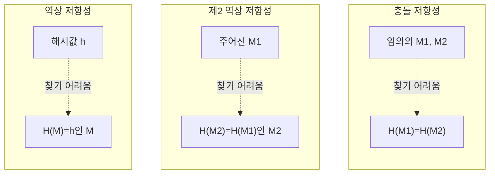

# 해시 함수의 안전성

---

## I. 역상과 충돌에 대한 저항, 해시 함수 안전성의 개요

### 가. 정의

- 암호학적 해시 함수가 **역상 저항성·제2 역상 저항성·충돌 저항성을 갖추어, 해시값을 이용한 [[무결성]] 검증과 서명이 위조되지 않도록 보장**하는 성질

### 나. 필요성 및 특징

| 구분 | 내용 |
| --- | --- |
| 서명의 기반 | 전자서명은 해시값에 서명하므로 충돌이 생기면 서명 위조 가능 |
| 패스워드 저장 | 역상 저항성이 없으면 저장 해시로 원문 복원 |
| 블록체인 | 블록 연결·머클 트리·PoW의 안전성 근거 |
| 일반 한계 | 생일 역설로 n비트 해시의 충돌 강도는 $2^{n/2}$ |

---

## II. 안전성 요건 및 평가 요소

### 가. 3대 안전성 요건

- 공격자가 고를 수 있는 자유도가 클수록 요건이 강해지며, 충돌 저항성이 가장 강한 요건

### 나. 평가 요소

| 구분 | 요소 | 설명 |
| --- | --- | --- |
| 기본 요건 | [[제1 역상 저항성\|역상 저항성]] | 일방향성, 일반 공격 비용 $2^n$ |
| | [[제2 역상 저항성]] | 약한 충돌 저항성, 일반 공격 비용 $2^n$ |
| | 충돌 저항성 | 강한 충돌 저항성, 생일 공격 비용 $2^{n/2}$ |
| 품질 | 눈사태 효과 | 입력 1비트 변화에 출력 약 50% 변화 |
| 구조적 공격 | 길이 확장 공격 | MD 구조에서 $H(M)$만으로 $H(M \parallel pad \parallel X)$ 계산 → HMAC·SHA-3로 방어 |
| | 차분 공격 | MD5·SHA-1 충돌 발견에 사용된 기법 |
| 응용 | 솔트·키 스트레칭 | 패스워드 해시의 사전·레인보우 테이블 공격 방어 |
| 양자 | Grover | 역상 공격 비용 $2^n$ → $2^{n/2}$ |

---

## III. 비교 및 동향

### 가. 주요 해시 알고리즘 안전성

| 비교 항목 | SHA-1 | SHA-2 | SHA-3 |
| --- | --- | --- | --- |
| 구조 | Merkle-Damgård | Merkle-Damgård | 스펀지 (Keccak) |
| 출력 길이 | 160비트 | 224·256·384·512비트 | 224·256·384·512비트, SHAKE 가변 |
| 충돌 | 2017년 실제 충돌 공개 (SHAttered) | 실용적 공격 없음 | 실용적 공격 없음 |
| 길이 확장 | 취약 | SHA-256·512 취약 (SHA-384·절단형 제외) | 구조적으로 안전 |
| 현황 | 서명 용도 사용 중단 | 범용 표준 | 대안 표준 (FIPS 202) |

### 나. 동향

- **SHA-1 퇴출**: NIST는 2030년까지 SHA-1 사용 완전 중단 계획 발표(2022)
- **양자 대비**: 장기 보호에는 SHA-384 이상, 해시 기반 서명 SLH-DSA(FIPS 205)를 PQC 표준으로 채택
- **ZK 친화 해시**: 영지식 증명 회로용 Poseidon 등 산술 친화 해시 활용 확대

---

### 🔗 연관 토픽

- **소속 도메인**: [[00_보안_MOC|🛡️ 보안]]
- **세부 분류**: `1. 정보보안 원칙 & 거버넌스 · 인증`
- **핵심 연관 토픽**:
  - [[해시함수|해시함수(알고리즘 측면)]]
  - [[제1 역상 저항성]]
  - [[제2 역상 저항성]]
  - [[해시 솔트와 키 스트레칭|해시 솔트(Salt)와 키 스트레칭(Key Stretching)]]
  - [[무결성]]
