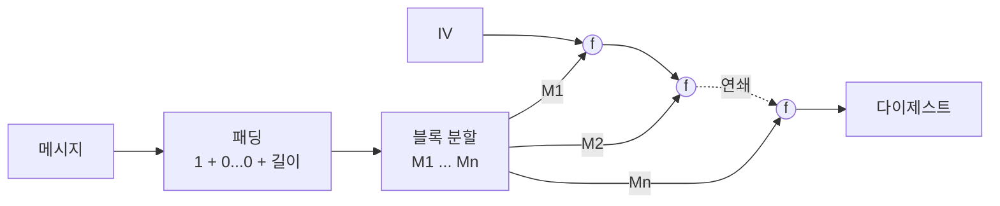

# 해시함수 (알고리즘 측면)

---

## I. 임의 길이를 고정 길이로, 해시함수의 개요

### 가. 정의

- 임의 길이 입력을 **패딩·블록 분할 후 압축 함수(또는 순열 함수)를 반복 적용하여 고정 길이 다이제스트로 변환**하는 일방향 암호 알고리즘

### 나. 특징

| 구분 | 내용 |
| --- | --- |
| 압축성 | 임의 길이 입력 → 고정 길이 출력 (SHA-256: 256비트) |
| 결정성 | 같은 입력은 항상 같은 출력 |
| 일방향성 | 출력으로부터 입력 계산이 어려움 |
| 눈사태 효과 | 입력 1비트 변화에 출력 약 절반 변화 |
| 고속 | 블록 암호보다 빠른 소프트웨어 연산 |

---

## II. 설계 구조 및 알고리즘

### 가. Merkle-Damgård 구조

- 길이 정보를 포함해 패딩한 뒤 블록 단위로 나누고, 이전 결과(연쇄값)와 현재 블록을 압축 함수 f로 반복 처리

### 나. 주요 알고리즘

| 구분 | 요소 | 설명 |
| --- | --- | --- |
| 폐기 | MD5 | 128비트, 충돌 실증으로 보안 용도 사용 금지 |
| | SHA-1 | 160비트, 2017년 SHAttered 충돌 공개 |
| 표준 | SHA-2 | NSA 설계 (FIPS 180-4), SHA-224/256/384/512, MD 구조 |
| | SHA-3 | Keccak, NIST 공모 선정(2012)·FIPS 202(2015), 스펀지 구조, SHAKE128/256(XOF) |
| 국내 | LSH | KISA·국보연 개발, SIMD 활용 고속 해시 (KS 표준) |
| 패스워드 전용 | Argon2, bcrypt, scrypt | 솔트·반복·메모리 비용으로 대입 공격 지연 |
| 키 결합 | [[HMAC]] | 비밀키와 해시로 메시지 인증 |

---

## III. 비교 및 동향

### 가. Merkle-Damgård vs 스펀지

| 비교 항목 | Merkle-Damgård (SHA-2) | 스펀지 (SHA-3) |
| --- | --- | --- |
| 핵심 연산 | 압축 함수 | 순열 함수 (Keccak-f[1600]) |
| 상태 | 연쇄값 = 출력 크기 | 상태 = 비트율(r) + 용량(c) |
| 처리 | 블록 연쇄 | 흡수(Absorb) 후 짜내기(Squeeze) |
| 길이 확장 공격 | 취약 | 용량 영역이 노출되지 않아 안전 |
| 출력 길이 | 고정 | 고정 + 가변(XOF) |

### 나. 동향

- **ZK 친화 해시**: 영지식 증명 회로 비용을 줄인 Poseidon 등 산술화 친화 해시 확산 ([[영지식증명]])
- **양자 대비**: Grover로 역상 강도가 절반이 되므로 장기 보호용은 SHA-384 이상 권고
- **해시 기반 서명**: SLH-DSA(FIPS 205), LMS·XMSS가 PQC 서명으로 활용

---

### 🔗 연관 토픽

- **소속 도메인**: [[00_보안_MOC|🛡️ 보안]]
- **세부 분류**: `1. 정보보안 원칙 & 거버넌스 · 인증`
- **핵심 연관 토픽**:
  - [[해시 함수의 안전성]]
  - [[일방향 암호화 방식]]
  - [[HMAC|HMAC (Hash-based Message Authentication Code)]]
  - [[MDC]]
  - [[해시 테이블]]
