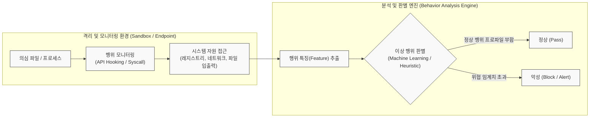

# 행위기반 탐지기법 (Behavior-based Detection)

---

## I. 알려지지 않은 위협(Zero-day) 대응의 핵심, 행위기반 탐지기법의 개요

### 가. 정의

- 악성코드나 사이버 공격의 고유 시그니처(Signature) 일치 여부를 비교하지 않고, 프로그램이나 네트워크 트래픽의 실행 중 동적 '행위(Behavior)' 패턴을 분석하여 이상 및 악의적 활동을 식별하는 보안 탐지 기법

### 나. 주요 특징

| 구분 | 주요 내용 |
| --- | --- |
| 미지 위협 대응 | 파일 해시나 패턴 DB 갱신 없이도 신종·변종 및 제로데이(Zero-Day) 공격을 선제적으로 탐지 |
| 런타임 동적 추적 | 파일 실행 시점에 발생하는 [[프로세스]], API 호출, 메모리 인젝션, 레지스트리 조작을 실시간 추적 |
| 격리 분석 활용 | 감염 피해를 차단하기 위해 가상화 기반 [[샌드박스\|샌드박스 (Sandbox)]] 환경에서 의심 파일 사전 실행 |
| 오탐 관리 필수 | 정상적인 관리 도구나 프로그램의 특이 행위를 악성으로 오인할 위험이 있어 ML 기반 행위 프로파일링 병행 |

## II. 행위기반 탐지기법의 개념도 및 핵심 기술 요소

### 가. 행위기반 탐지기법의 동작 메커니즘 개념도

* 의심 파일을 가상 격리 환경에서 실행시키고 API 후킹을 통해 파일 시스템, 네트워크, 레지스트리 등의 자원 접근 행위를 수집한 뒤, 머신러닝 엔진이 이상 여부를 최종 판별함

### 나. 행위기반 탐지기법의 핵심 기술 요소

| 구분 | 요소기술(키워드) | 세부 설명 |
| --- | --- | --- |
| **수집 및 감시** | API 후킹 (API Hooking) | [[OS(운영체제)\|운영체제]](OS)가 응용 프로그램에 제공하는 함수 호출(API)을 중간에서 가로채어 어떤 자원에 접근하는지 모니터링 |
| **수집 및 감시** | 시스템 콜 트레이싱 (Syscall Tracing) | [[커널]] 모드에서 발생하는 시스템 호출을 추적하여 파일 생성/삭제, 프로세스 인젝션 등의 저수준(Low-level) 행위 감시 |
| **분석 환경** | [[샌드박스\|샌드박스 (Sandbox)]] | 실제 시스템에 피해를 주지 않도록 논리적으로 완전히 분리된 가상 환경에서 의심 파일을 강제 실행시키는 기술 |
| **탐지 [[알고리즘]]** | 휴리스틱 분석 (Heuristic) | 사전에 정의된 '악성 행위 규칙(Rule)'(예: system32 폴더 내 실행파일 자가 복제 등)을 기반으로 점수를 부여하여 탐지 |
| **탐지 알고리즘** | 이상 탐지 ([[Anomaly(이상현상)\|Anomaly]] Detection) | 머신러닝(ML)을 활용하여 시스템의 정상(Normal) 상태 프로파일을 학습한 후, 이를 벗어나는 통계적 이상치를 탐지 |
| **협력 대응** | 위협 인텔리전스 ([[CTI]]) 연동 | 글로벌 위협 정보(IoC: 침해 지표)를 실시간으로 참조하여 판별 엔진의 정확도(Accuracy)를 향상 |
| **플랫폼 융합** | [[EDR(Endpoint Detection and Response)\|EDR]] (엔드포인트 탐지 및 대응) | 단말기(PC, 서버) 레벨에서 발생하는 모든 행위 가시성을 확보하고, 실시간 행위 분석과 침해 대응을 통합 수행 |

---

## III. 탐지 기법 비교 및 최신 동향

### 가. 행위기반 탐지(이상 탐지)와 시그니처 기반 탐지(오용 탐지) 비교

| 비교 항목 | 행위기반 탐지 (Behavior-based) | 시그니처 기반 탐지 (Signature-based) |
| --- | --- | --- |
| **검사 기준** | 런타임 시의 **동작 패턴 및 행위** 이상 | 파일의 고유 **해시(Hash), 바이트 패턴** 일치 여부 |
| **탐지 대상** | 신종, 변종 악성코드 및 **제로데이(Zero-day)** 위협 | **이미 알려진(Known)** 악성코드 |
| **시스템 오버헤드** | 동적 분석 및 실행 모니터링으로 **부하 높음** | 단순 패턴 매칭으로 **부하 낮음(빠름)** |
| **오탐/미탐 특성** | 오탐율(False Positive) **상대적 높음**, 미탐율 낮음 | 오탐율 **매우 낮음**, 변종에 대한 미탐율(False Negative) 높음 |
| **대표 솔루션** | EDR, 샌드박스 기반 APT 대응 솔루션 | 전통적 안티바이러스(백신), 레거시 IDS/IPS |

### 나. 행위기반 탐지기법의 최신 동향 및 향후 전망

- **AI 및 딥러닝 결합 XDR 플랫폼 진화**: 엔드포인트([[EDR(Endpoint Detection and Response)|EDR]]) 행위 분석을 넘어 네트워크(NDR), 클라우드 로그를 통합 수집하고 그래프 신경망으로 상관분석하는 [[XDR|XDR]] 아키텍처로 확장
- **안티 분석(Anti-Evasion) 공격 대응 강화**: 샌드박스 가상 환경 감지 시 실행을 중단하거나 의도적 수면(Sleep)을 취하는 회피형 악성코드에 대응하여 커널 레벨 투명 모니터링 및 하이퍼바이저 기반 은닉 추적 기술 고도화
- **MITRE ATT&CK 기반 행위 매핑 표준화**: 탐지된 프로세스 행위를 MITRE ATT&CK 전술·기술(TTPs)로 표준화 매핑하여 공격 단계별 침해 상황을 신속히 시각화하고 [[SOAR (Security Orchestration, Automation and Response)|SOAR]]를 통한 자동 격리 연동 가속화

---

### 🔗 연관 토픽

- **소속 도메인**: [[00_보안_MOC|🛡️ 보안]]
- **세부 분류**: `3. 네트워크 & 엔드포인트 · 인프라 보안`
- **핵심 연관 토픽**:
  - [[EDR(Endpoint Detection and Response)]]
  - [[샌드박스|샌드박스 (Sandbox)]]
  - [[랜섬웨어]]
  - [[XDR|XDR(eXtended Detection Response)]]
  - [[CTI]]
