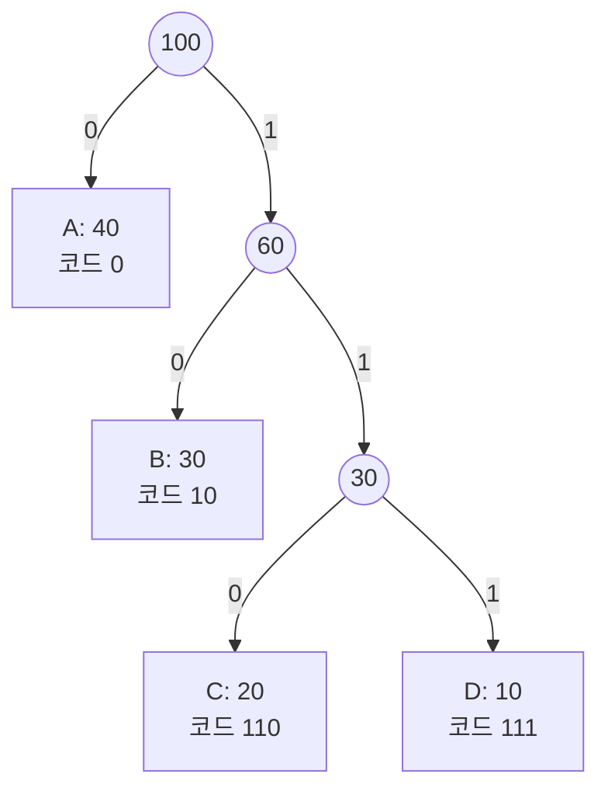

# 허프만 코딩 (Huffman Coding)

---

## I. 자주 나오는 기호에 짧은 코드를, 허프만 코딩의 개요

### 가. 정의

- 기호의 **출현 빈도가 높을수록 짧은 이진 코드를 할당하는 접두어 코드 기반 무손실 압축** [[알고리즘]] (D. Huffman, 1952)

### 나. 특징

| 구분 | 내용 |
| --- | --- |
| 가변 길이 | 빈도에 따라 코드 길이를 달리해 평균 비트 수 감소 |
| 접두어 코드 | 어떤 코드도 다른 코드의 앞부분이 아니어서 구분자 없이 복호 가능 |
| 최적성 | 기호 단위 접두어 코드 중 평균 길이가 최소, 엔트로피 H ≤ 평균 길이 < H + 1 |
| 탐욕 기법 | 빈도가 가장 작은 두 노드를 반복 병합 ([[그리디 알고리즘\|그리디]]) |

---

## II. 동작 및 구성요소

### 가. 허프만 트리 (빈도 A=40, B=30, C=20, D=10)

- D·C 병합(30) → B와 병합(60) → A와 병합(100), 평균 길이 1.9비트로 고정 2비트보다 짧음

### 나. 구성요소

| 구분 | 요소 | 설명 |
| --- | --- | --- |
| 자료구조 | 허프만 트리 | 리프는 기호, 내부 노드는 자식 빈도의 합, 모든 내부 노드가 자식 2개인 정 이진 트리 |
| | 우선순위 큐 ([[힙]]) | 최소 빈도 두 노드를 O(log n)에 추출, 전체 O(n log n) |
| 코드 | 가변 길이 부호 (VLC) | 고정 길이(ASCII 8비트) 대신 빈도에 따른 길이 |
| | 접두어 코드 | 트리 경로로 코드가 정해져 순차 복호 가능 |
| 절차 | 빈도 계산 | 입력을 스캔해 기호별 빈도 집계 (정적 허프만) |
| | 코드 테이블 전송 | 복호를 위해 트리·코드 길이 정보를 함께 저장 |
| 변형 | 적응형 허프만 | 부호화하면서 빈도와 트리를 갱신, 사전 스캔 불필요 |
| | 정규 허프만 (Canonical) | 코드 길이만 저장해 테이블 크기 축소 (Deflate 사용) |

---

## III. 비교 및 동향

### 가. 허프만 vs 산술 부호화 vs LZW

| 비교 항목 | 허프만 | 산술 부호화 | LZW |
| --- | --- | --- | --- |
| 원리 | 통계적, 기호마다 정수 비트 코드 | 통계적, 메시지 전체를 하나의 구간 값으로 | 사전식, 반복 문자열을 사전 번호로 |
| 효율 | 기호당 최소 1비트 한계 | 엔트로피에 더 근접 | 반복 패턴이 많을수록 유리 |
| 사전·모델 | 빈도 테이블 | 확률 모델(적응형 가능) | 부호화 중 사전 동적 생성 (LZ78 계열) |
| 활용 | JPEG(기본), MP3, Deflate(ZIP·gzip·PNG) | H.264·HEVC·VVC의 CABAC, JPEG 2000 | GIF, TIFF, 초기 PDF |

### 나. 동향

- **하이브리드 압축의 마지막 단계**: Deflate는 LZ77로 반복을 제거한 뒤 허프만으로 부호화, Zstandard·Brotli는 허프만과 ANS(비대칭 수 체계) 계열 엔트로피 부호 결합
- **모델 압축**: Deep Compression처럼 가지치기·양자화 후 가중치를 허프만 부호화해 [[딥러닝]] 모델 저장 크기 축소

---

### 🔗 연관 토픽

- **소속 도메인**: [[00_컴퓨터구조_MOC|💻 컴퓨터구조]]
- **세부 분류**: `3. 고성능 AI 가속기 & 입출력 시스템`
- **핵심 연관 토픽**:
  - [[그리디 알고리즘|그리디 (탐욕) 알고리즘]]
  - [[런랭스 코딩|런랭스 (Run Length) 코딩]]
  - [[힙|힙 (Heap)]]
  - [[트리 순회|트리 순회 (Tree Traversal)]]
  - [[알고리즘]]
