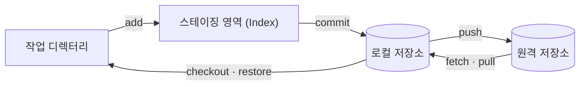

# 형상 관리 도구 (Configuration Management Tool)

---

## I. 변경 이력의 자동 기록, 형상 관리 도구의 개요

### 가. 정의

- 소스 코드·문서·인프라 설정 등 **산출물의 변경 이력을 버전 단위로 저장하고 브랜치·병합으로 병행 개발을 지원**하는 [[형상 관리]] 자동화 도구 (VCS)

### 나. 특징

| 구분 | 내용 |
| --- | --- |
| 이력 관리 | 누가·언제·무엇을·왜 바꿨는지 커밋 단위 기록 |
| 병행 개발 | 브랜치로 기능별 독립 작업 후 병합 |
| 복구 | 특정 버전으로 즉시 되돌림 |
| 자동화 연계 | 커밋·푸시 이벤트로 CI/CD 파이프라인 기동 |

---

## II. Git 동작 구조 및 구성요소

### 가. Git 동작 구조

- 작업 디렉터리에서 수정한 파일을 스테이징 영역에 올려 로컬 저장소에 커밋하고, 원격 저장소와 push·pull로 동기화

### 나. 구성요소

| 구분 | 요소 | 설명 |
| --- | --- | --- |
| 저장 | 저장소 (Repository) | 파일과 전체 변경 이력을 보관 (로컬·원격) |
| | 스테이징 영역 | 다음 커밋에 포함할 변경을 준비하는 영역 |
| 버전 제어 | Commit · Checkout | 변경을 버전으로 확정, 특정 버전 상태로 전환 |
| 병행 개발 | Branch | 메인 코드와 분리된 독립 작업 흐름 |
| | Merge · Rebase | 브랜치 결과를 통합 (Fast-forward, 3-way 병합) |
| | 충돌 해결 | 같은 위치를 수정한 변경의 충돌을 식별·해결 |
| 추적 | Blame · Log | 라인별 최종 수정자·커밋 추적으로 결함 원인 파악 |
| 협업 | Pull Request | 코드 리뷰·자동 검증 후 병합하는 변경 승인 절차 |
| 자동화 | Webhook | 이벤트 발생 시 Jenkins·GitHub Actions 등 CI 기동 |

---

## III. 비교 및 동향

### 가. 중앙 집중형(CVCS) vs 분산형(DVCS)

| 비교 항목 | 중앙 집중형 (CVCS) | 분산형 (DVCS) |
| --- | --- | --- |
| 구조 | 단일 중앙 서버 | 중앙 저장소 + 개별 로컬 저장소(전체 이력 복제) |
| 대표 도구 | SVN, CVS | Git, Mercurial |
| 네트워크 | 커밋 시 서버 연결 필요 | 오프라인 커밋·이력 조회 가능 |
| 저장 방식 | 파일별 변경분(Delta) | 커밋별 스냅샷 |
| 브랜치 | 디렉터리 복사 방식, 무거움 | 포인터 방식, 생성·병합이 가벼움 |
| 장애 영향 | 중앙 서버가 단일 장애점 | 로컬 복제본으로 복구 가능 |

### 나. 동향

- GitHub·GitLab이 저장소에 CI/CD·이슈·보안 스캔을 통합한 개발 플랫폼으로 확장
- Git 저장소를 배포 상태의 기준으로 삼는 GitOps 확산
- GitHub Copilot·GitLab Duo 등 LLM이 커밋 메시지 생성, PR 요약, 충돌 해결을 보조

---

### 🔗 연관 토픽

- **소속 도메인**: [[00_소프트웨어공학_MOC|🏗️ 소프트웨어공학]]
- **세부 분류**: `1. 소프트웨어 개발 생명주기(SDLC) & 방법론`
- **핵심 연관 토픽**:
  - [[형상 관리]]
  - [[CI, CD (Continuous Integration, Continuous Delivery)]]
  - [[DevOps|데브옵스 (DevOps)]]
  - [[무결성]]
  - [[릴리즈 엔지니어링]]
