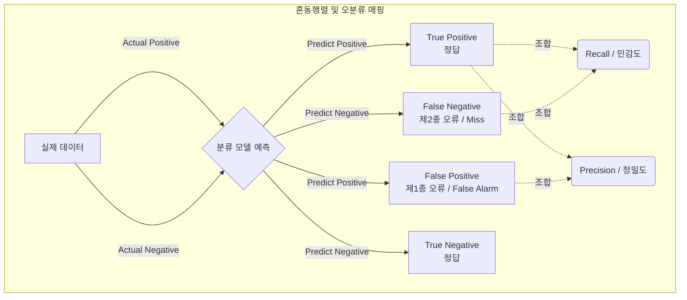

# 혼동행렬 (Confusion Matrix)

---

## I. 분류 모델 성능 평가의 핵심, 혼동행렬의 개요

### 가. 혼동행렬(Confusion Matrix)의 정의
- 머신러닝 분류(Classification) 모델의 예측 성능을 실제 정답 클래스와 모델 예측 클래스 간의 일치 여부를 교차 집계하여 행렬(2x2 또는 NxN) 형태로 나타낸 평가 지표이다.

### 나. 혼동행렬의 주요 특징 및 필요성
| 구분 | 내용 |
| :--- | :--- |
| **정확도 역설(Accuracy Paradox) 극복** | 클래스 불균형(Imbalance) 환경에서 단순 정확도 수치가 유발하는 착시 현상 방지 |
| **제1종·제2종 오류 가시화** | 거짓 긍정(FP, False Alarm)과 거짓 부정(FN, Miss)을 명확히 구분하여 위험 분석 제공 |
| **파생 평가지표 산출 기반** | 정밀도(Precision), 재현율(Recall), F1-Score 등 복합 평가 지표 도출의 기초 행렬 |
| **비용 민감형 학습(Cost-sensitive) 지원** | 오분류 비용에 따라 분류 임계값(Threshold)을 동적으로 튜닝할 수 있는 의사결정 기준 제공 |

---

## II. 혼동행렬의 개념도 및 핵심 구성 요소

### 가. 혼동행렬의 개념도 및 동작 원리

* 분류 모델의 예측 결과와 실제 정답을 교차 비교하여 4가지 기본 지표(TP, TN, FP, FN)로 분류 및 파생 지표(정밀도, 재현율 등) 산출

### 나. 혼동행렬의 핵심 구성 요소

| 구분 | 요소기술(키워드) | 세부 설명 |
| :--- | :--- | :--- |
| **기본 지표** | True Positive (TP) | 실제 Positive를 Positive로 정확하게 예측한 건수 (정상 탐지) |
| **기본 지표** | True Negative (TN) | 실제 Negative를 Negative로 정확하게 예측한 건수 (정상 거부) |
| **오류 지표** | False Positive (FP) | 실제 Negative를 Positive로 잘못 예측 (제1종 오류, False Alarm) |
| **오류 지표** | False Negative (FN) | 실제 Positive를 Negative로 잘못 예측 (제2종 오류, Miss) |
| **파생 지표** | 정밀도 (Precision) | Positive 예측 중 실제 Positive인 비율 ($TP / (TP + FP)$), FP 최소화 시 중요 |
| **파생 지표** | 재현율 (Recall) | 실제 Positive 중 Positive로 예측한 비율 ($TP / (TP + FN)$), FN 최소화 시 중요 |
| **파생 지표** | 정확도 (Accuracy) | 전체 데이터 중 올바르게 예측한 비율 ($(TP + TN) / Total$), 클래스 균일 시 유효 |
| **파생 지표** | F1 Score | 정밀도와 재현율의 조화평균 ($2 \times \frac{Precision \times Recall}{Precision + Recall}$), 불균형 시 필수 |

---

## III. 혼동행렬과 ROC/AUC의 비교 및 실무 활용 전략

### 가. 분류 성능 평가 지표 간 비교 (혼동행렬 vs ROC/AUC)

| 비교 항목 | 혼동행렬 (Confusion Matrix) | ROC Curve / AUC |
| :--- | :--- | :--- |
| **평가 기준** | 단일 임계값(Threshold) 기반의 절대적 예측 결과 | 임계값 변화에 따른 FPR과 TPR의 연속적 관계 |
| **시각화 형태** | 2x2 (또는 NxN) 행렬 (표 형태) | 2차원 그래프 (X축: FPR, Y축: TPR) |
| **주요 목적** | 오류 유형(1종, 2종)의 상세 파악 및 오분류 내역 확인 | 임계값에 독립적인 모델의 전반적 분류 성능 평가 |
| **활용 환경** | 클래스별 오분류 비용이 다를 때 임계값 튜닝 후 결과 확인 | 다양한 분류 모델 간의 성능을 직관적으로 비교할 때 |

### 나. 도메인 특성에 따른 혼동행렬 기반 임계값(Threshold) 튜닝 전략

- **FN(제2종 오류) 최소화 도메인 전략**: 암 진단, 보안 관제 침입 탐지, 자율주행 장애물 감지 등 미탐의 위험이 치명적인 분야에서는 임계값을 낮추어 재현율(Recall)을 극대화함.
- **FP(제1종 오류) 최소화 도메인 전략**: 스팸 메일 필터링, 사법 무죄 추정, 금융 고위험 차단 등 오탐으로 인한 사용자 불편이나 사회적 비용이 큰 분야에서는 임계값을 높여 정밀도(Precision)를 우선시함.
- **PR-AUC 기반 극단적 불균형 모델 평가**: 이상 거래 탐지(FDS)나 희귀 질병 선별 등 양성 샘플이 0.1% 미만인 환경에서는 ROC Curve의 낙관적 왜곡을 배제하기 위해 정밀도-재현율 곡선(PR Curve)과 혼동행렬을 결합 평가함.

---

### 🔗 연관 토픽

- **소속 도메인**: [[00_인공지능_MOC|🤖 인공지능]]
- **세부 분류**: `2. 머신러닝 기초 & 핵심 알고리즘`
- **핵심 연관 토픽**:
  - [[클래스]]
  - [[지도학습]]
  - [[랜덤 포레스트|랜덤 포레스트 (Random Forest)]]
  - [[앙상블 학습|앙상블 학습(Ensemble Learning)]]
  - [[이미지넷]]
