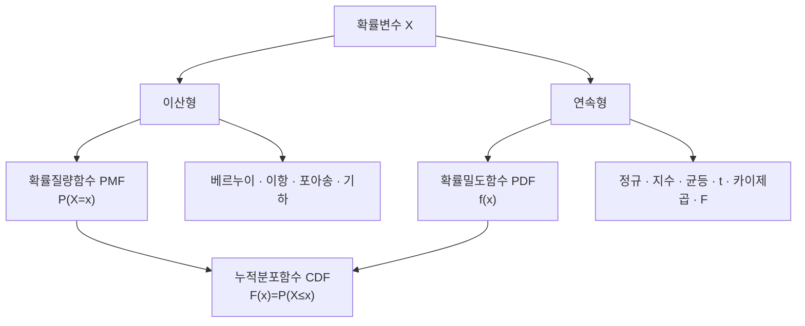

# 확률분포 (Probability Distribution)와 확률밀도함수 (PDF)

---

## I. 불확실성의 수학적 모델, 확률분포의 개요

### 가. 정의

- **확률분포**: 확률변수가 취할 수 있는 값과 각 값(또는 구간)이 나타날 확률의 대응 관계
- **확률밀도함수 (PDF)**: 연속 확률변수에서 구간의 확률을 **곡선 아래 면적(적분)** 으로 주는 함수

### 나. 특징

| 구분 | 내용 |
| --- | --- |
| 이원 분류 | 셀 수 있는 값의 이산형(PMF), 실수 구간의 연속형(PDF) |
| 모수 표현 | 평균·분산 등 모수(Parameter)로 분포의 모양 결정 |
| 공통 연결 | 누적분포함수(CDF) $F(x)=P(X \le x)$로 이산·연속을 통일적으로 표현 |
| 활용 | 통계적 추정, [[가설 검정]], 머신러닝 모델의 가정과 손실 함수 설계 |

---

## II. 확률분포 체계 및 구성요소

### 가. 확률변수와 확률함수의 관계

### 나. 핵심 요소

| 구분 | 요소 | 설명 |
| --- | --- | --- |
| 확률함수 | PMF | 이산 확률변수가 특정 값을 가질 확률, $\sum_x P(X=x)=1$ |
| | PDF | $P(a \le X \le b)=\int_a^b f(x)\,dx$, $\int_{-\infty}^{\infty} f(x)\,dx=1$ |
| | CDF | $F(x)=P(X \le x)$, 연속형은 $f(x)=F'(x)$ |
| 이산 분포 | [[베르누이 분포]] | 성공·실패 1회 시행 |
| | 이항 분포 | 독립 베르누이 시행 $n$번의 성공 횟수, $B(n,p)$ |
| | [[포아송 분포]] | 단위 시간·공간에서 드물게 발생하는 사건 수, 평균 = 분산 = $\lambda$ |
| 연속 분포 | [[정규분포]] | 평균 $\mu$·분산 $\sigma^2$의 종 모양 대칭 분포, [[중심극한정리]]의 극한 분포 |
| | 지수 분포 | 사건 간 대기 시간, 무기억성(Memoryless) |
| | t · 카이제곱 · F 분포 | 표본 통계량의 분포, 검정·구간 추정에 사용 |
| 추정 | 최대우도추정 (MLE) | 관측 데이터의 우도를 최대화하는 모수 추정 |

---

## III. 비교 및 AI 활용

### 가. PMF vs PDF

| 비교 항목 | PMF | PDF |
| --- | --- | --- |
| 대상 | 이산 확률변수 | 연속 확률변수 |
| 함수값 의미 | 그 값의 **확률 자체** | **확률 밀도** (확률 아님, 1을 넘을 수 있음) |
| 한 점의 확률 | $P(X=x)$ | 항상 0 |
| 정규화 조건 | $\sum P(X=x)=1$ | $\int f(x)\,dx=1$ |
| 대표 분포 | 베르누이, 이항, 포아송 | 정규, 지수, t |

### 나. AI 활용

- **생성 모델**: [[VAE|VAE(Variational Autoencoder)]]·확산 모델은 잠재 공간을 정규분포로 가정하고 데이터의 밀도를 근사해 새 샘플 생성
- **손실 함수**: 분류 모델의 Softmax 출력(범주형 분포)과 정답 분포의 차이를 크로스 엔트로피·KL Divergence로 측정
- **이상 탐지**: 정상 데이터의 분포(다변량 정규 등)를 학습한 뒤 밀도가 낮은 관측치를 [[Anomaly(이상현상)|이상]]으로 판정

---

### 🔗 연관 토픽

- **소속 도메인**: [[00_인공지능_MOC|🤖 인공지능]]
- **세부 분류**: `1. 수학 · 통계학 & 데이터 전처리`
- **핵심 연관 토픽**:
  - [[정규분포|정규분포(Normal Distribution)]]
  - [[중심극한정리|중심극한정리 (Central Limit Theorem)]]
  - [[가설 검정]]
  - [[포아송 분포]]
  - [[VAE|VAE(Variational Autoencoder)]]
