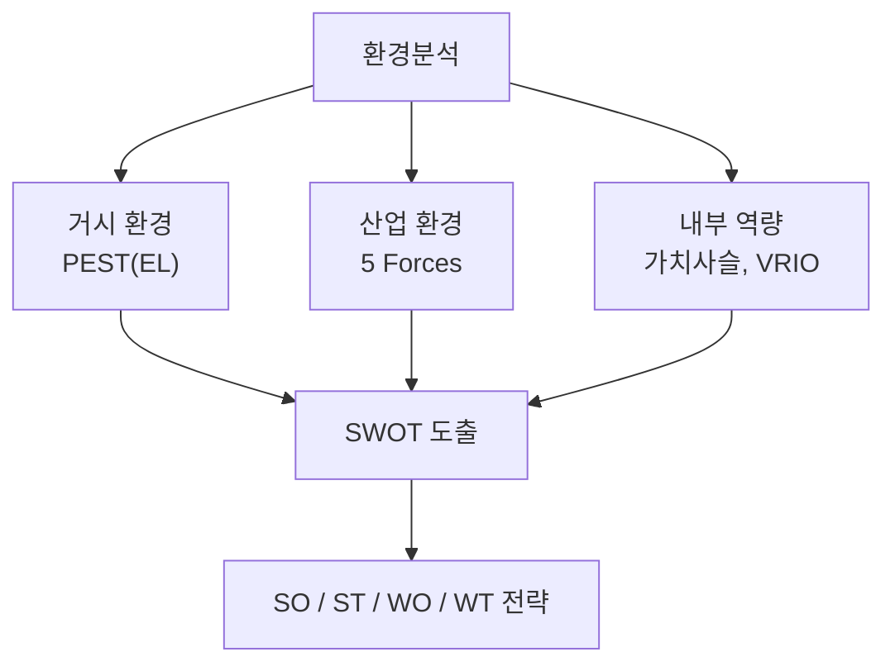

# 환경분석 (Environmental Analysis)

---

## I. 전략 수립의 출발점, 환경분석의 개요

### 가. 정의

- 조직을 둘러싼 **거시·산업 환경(외부)과 내부 역량**을 체계적으로 분석해 기회·위협, 강점·약점을 도출하는 전략 수립 기법

### 나. 필요성 및 특징

| 구분 | 내용 |
| --- | --- |
| 필요성 | 기술·시장 변화 속에서 투자 방향과 리스크를 사전에 판단 |
| 내·외부 통합 | 외부(기회·위협)와 내부(강점·약점)를 함께 보고 SWOT로 종합 |
| 계층적 분석 | 거시 환경 → 산업 환경 → 내부 역량 순으로 범위를 좁혀 분석 |
| IT 전략 연계 | [[ISP (Information Strategy Plan)\|ISP]]·[[ISMP]]의 현황 분석 단계 기초 자료 |

---

## II. 환경분석의 체계 및 분석 기법

### 가. 환경분석 체계

- 거시 환경·산업 구도·내부 역량을 각각 분석한 뒤 SWOT로 교차 결합해 전략 방향 도출

### 나. 분석 기법

| 구분 | 요소 | 설명 |
| --- | --- | --- |
| 외부 (거시) | [[PEST 분석\|PEST/PESTEL]] | 정치·경제·사회·기술 (+환경·법률) 요인 |
| 외부 (산업) | 5 Forces (M. Porter) | 기존 경쟁, 신규 진입, 대체재, 구매자·공급자 교섭력 |
| | [[3C 4C 분석\|3C 분석]] | 고객·경쟁사·자사 관점의 시장 분석 |
| 내부 | [[가치사슬]] | 활동별 원가·가치 기여 분석 |
| | VRIO (J. Barney) | 자원의 가치·희소성·모방 불가능성·조직화 평가 |
| 종합 | [[SWOT분석]] | 내·외부 요인 교차로 전략 대안 도출 |
| 기술 환경 | 기술 동향·[[TRL]] | 신기술 성숙도와 도입 시점 판단 |

---

## III. 전통적·디지털 환경분석 비교 및 동향

### 가. 비교

| 구분 | 전통적 환경분석 | 디지털 환경분석 |
| --- | --- | --- |
| 주기 | 연 단위 보고서, 단발성 | 상시 모니터링 |
| 데이터 | 통계, 설문, 전문가 인터뷰 | 소셜 데이터, 검색 트렌드, 로그 등 비정형 데이터 |
| 도구 | SWOT·PEST 정적 매트릭스 | 빅데이터·AI 기반 시장 센싱 |
| 대응 | 중장기 계획 위주 | 짧은 주기로 전략 수정 |

### 나. 동향

- **AI 기반 시장 센싱**: 뉴스·특허·SNS를 생성형 AI로 요약·분류해 경쟁사·기술 동향을 상시 추적
- **시나리오 플래닝 결합**: 불확실성이 큰 요인은 복수 시나리오와 [[Backcasting|백캐스팅]]으로 보완
- **ISP/ISMP 연계**: 환경분석 결과를 정보화 과제·EA 목표 아키텍처로 연결해 실행력 확보

---

### 🔗 연관 토픽

- **소속 도메인**: [[00_경영전략_MOC|📈 경영전략]]
- **세부 분류**: `1. 경영 환경 분석 & 전략 수립 프레임워크`
- **핵심 연관 토픽**:
  - [[SWOT분석]]
  - [[PEST 분석]]
  - [[3C 4C 분석|3C/4C 분석]]
  - [[ISP (Information Strategy Plan)]]
  - [[가치사슬|가치사슬(Value Chain)]]
