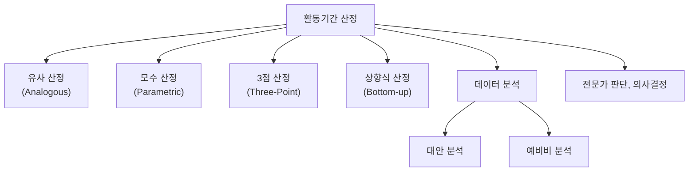

# 활동기간 산정기법 (Activity Duration Estimating Techniques)

---

## I. 일정 모델의 기초, 활동기간 산정기법의 개요

### 가. 정의

- 산정된 자원으로 각 **활동을 완료하는 데 필요한 작업 기간 수**를 추정하는 기법 (PMBOK 6판 6.4 활동기간 산정)

### 나. 특징

| 구분 | 내용 |
| --- | --- |
| 입력 | 활동 목록·속성, 자원 요구사항·캘린더, 위험 등록부, 교훈 정보 |
| 노력 vs 기간 | 노력(Effort, 인·일)과 기간(Duration)을 구분, 자원 투입량에 따라 기간 변동 |
| 수확 체감 | 자원을 늘려도 기간이 비례해서 줄지 않음 |
| 점진적 구체화 | 정보가 늘수록 유사 → 모수 → 상향식으로 정확도 향상 |
| 불확실성 반영 | 범위 추정치·예비비로 위험 반영 |

---

## II. 기법 분류와 구성요소

### 가. 분류 체계

- 가용 정보 수준에 따라 과거 사례, 통계 모수, 확률 분포, 세부 합산 방식을 골라 적용

### 나. 구성요소

| 구분 | 요소 | 설명 |
| --- | --- | --- |
| 경험 기반 | 유사 산정 | 과거 유사 활동의 실제 기간 활용, 빠르지만 정확도 낮음 (하향식) |
| 통계 기반 | 모수 산정 | 과거 데이터와 변수의 통계 관계 적용 (예: 작업량 ÷ 단위 생산성) |
| 확률 기반 | [[3점 산정]] | 낙관치(O)·최빈치(M)·비관치(P), 삼각분포 (O+M+P)/3, 베타분포(PERT) (O+4M+P)/6 |
| 상세 기반 | 상향식 산정 | 활동을 세분해 산정 후 합산, 정확하지만 시간 소요 |
| 데이터 분석 | 대안 분석 | 자원 수준·기술·자체 개발 vs 구매 등 대안별 기간 비교 |
| | 예비비 분석 | 식별된 위험에 대한 우발사태 예비비(Contingency Reserve) 반영 |
| 의사결정 | 투표 (Fist of Five 등) | 팀 참여로 추정치 합의, 전문가 의견 수렴에는 델파이 활용 |

---

## III. 비교 및 동향

### 가. 예측형 산정 vs 애자일 추정

| 비교 항목 | 예측형 (PMBOK) | 애자일 ([[Agile]], [[SCRUM\|Scrum]]) |
| --- | --- | --- |
| 대상 | WBS 기반 활동 | 사용자 스토리, 백로그 항목 |
| 단위 | 절대 시간 (일·주) | 상대 크기 (스토리 포인트), Velocity |
| 시점 | 초기 계획 시 산정 후 갱신 | 매 스프린트 계획·백로그 정제 시 반복 |
| 기법 | 유사, 모수, 3점, 상향식 | 플래닝 포커, 티셔츠 사이징, 친화도 추정 |
| 한계 | 초기 불확실성 클 때 오차 | 장기 총 기간 예측이 어려움 |

### 나. 동향

- **확률적 일정**: 3점 추정치를 [[몬테카를로 시뮬레이션]]에 넣어 완료 확률별 일정 제시
- **데이터 기반 산정**: 이슈 트래커에 축적된 실적(사이클 타임)으로 모수·유사 산정 보정
- **하이브리드**: 마스터 일정은 상향식, 세부 구현은 스토리 포인트로 병행

---

### 🔗 연관 토픽

- **소속 도메인**: [[00_프로젝트관리_MOC|📋 프로젝트관리]]
- **세부 분류**: `1. PMBOK 표준 & 프로젝트 거버넌스`
- **핵심 연관 토픽**:
  - [[3점 산정]]
  - [[프로젝트 일정관리]]
  - [[CPM|CPM (Critical Path Method)]]
  - [[몬테카를로 시뮬레이션]]
  - [[SCRUM]]
