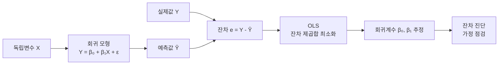

# 회귀분석 (Regression Analysis)

---

## I. 변수 간 관계를 식으로 세우는, 회귀분석의 개요

### 가. 정의

- 독립변수가 종속변수에 미치는 영향을 **함수식(회귀식)으로 추정해 관계를 설명하고 값을 예측**하는 통계 기법

### 나. 특징

| 구분 | 내용 |
| --- | --- |
| 목적 | 영향 크기 추정(설명)과 예측 |
| 추정 | 최소제곱법(OLS)으로 잔차 제곱합 최소화 |
| 검정 | 계수 t-검정, 모형 F-검정, [[유의확률\|p-value]] |
| 인과 한계 | 회귀계수는 연관을 나타내며, 인과 해석에는 실험 설계·인과 추론 기법 필요 |
| 가정 | 선형성, 오차 독립성, [[등분산성]], 오차 정규성(검정용), 독립변수 간 [[다중공선성]] 없음 |

---

## II. 모형 구조 및 구성요소

### 가. 개념도

- 잔차 제곱합을 최소화하는 계수를 구한 뒤 잔차 분석으로 모형 가정을 확인

### 나. 구성요소

| 구분 | 요소 | 설명 |
| --- | --- | --- |
| 유형 | 단순 선형 회귀 | 독립변수 1개, $Y = \beta_0 + \beta_1 X + \varepsilon$ |
| | 다중 선형 회귀 | 독립변수 여러 개, 다른 변수 통제 시 개별 효과 추정 |
| | 다항 회귀 | $X^2, X^3$ 등 항 추가로 곡선 관계 표현 (계수에 대해선 선형) |
| | [[로지스틱회귀분석\|로지스틱 회귀]] | 범주형 종속변수, 로짓 링크 (일반화 선형 모형) |
| 추정 | OLS | $\hat{\beta} = (X^TX)^{-1}X^Ty$ |
| 평가 | 결정계수 $R^2$ | 종속변수 변동 중 모형이 설명하는 비율, 변수 추가 시 수정 $R^2$ 사용 |
| | RMSE·MAE | 예측 오차 크기 |
| 규제 | Ridge·Lasso | L2·L1 패널티로 과적합·다중공선성 완화 ([[정규화, 규제화, 표준화]]) |
| 진단 | 잔차 분석 | 잔차 산점도·Q-Q plot으로 등분산·정규성·독립성 점검 |

---

## III. 비교 및 동향

### 가. 선형 회귀 vs 로지스틱 회귀

| 비교 항목 | 선형 회귀 | 로지스틱 회귀 |
| --- | --- | --- |
| 종속변수 | 연속형 | 범주형 (이진·다항) |
| 출력 | $(-\infty, \infty)$ 실수 | 0~1 확률 |
| 링크 함수 | 항등 | 로짓 (시그모이드 역함수) |
| 추정 | OLS | 최대우도추정 |
| 활용 | 집값·매출·기온 예측 | 스팸 분류, 이탈 예측, 질병 판정 |

### 나. 동향

- **비선형 회귀 모델**: XGBoost, LightGBM, 신경망 회귀로 비선형·고차원 관계 예측
- **인과 추론 결합**: 도구변수, 성향점수 매칭, 이중차분(DiD)과 결합해 정책·마케팅 효과를 인과적으로 추정
- **해석 도구**: SHAP·부분의존도(PDP)로 비선형 회귀 모델의 변수 영향 설명 ([[XAI]])

---

### 🔗 연관 토픽

- **소속 도메인**: [[00_인공지능_MOC|🤖 인공지능]]
- **세부 분류**: `1. 수학 · 통계학 & 데이터 전처리`
- **핵심 연관 토픽**:
  - [[로지스틱회귀분석]]
  - [[다중공선성|다중공선성 (Multicolinearity)]]
  - [[등분산성|등분산성 (Homoscedasticity)]]
  - [[상관 관계 분석|상관 관계 분석 (Correlation Analysis)]]
  - [[손실함수]]
