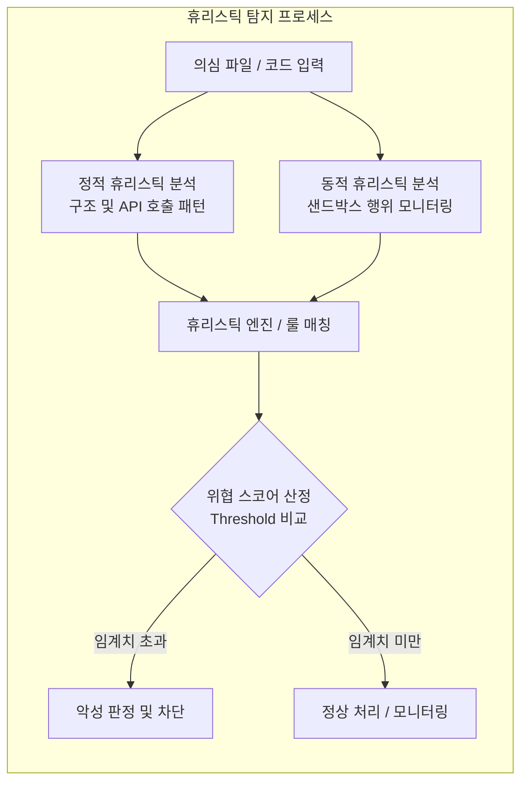

# 휴리스틱 탐지기법 (Heuristic Detection)

---

## I. 지능형 위협 선제 대응을 위한, 휴리스틱 탐지기법의 개요

### 가. 정의

- 알려진 고유 서명(시그니처)에만 의존하지 않고, 프로그램의 구조, 내부 코드 패턴, 잠재적 명령어 호출 및 실행 행위를 종합 분석하여 미지의 신종·변종 악성코드를 확률 및 규칙 기반으로 판별하는 보안 분석 기법

### 나. 주요 특징

| 구분 | 주요 내용 |
| --- | --- |
| 미지 변종 탐지 | 시그니처가 존재하지 않는 [[다형성]](Polymorphic) 악성코드와 제로데이(Zero-Day) 위협을 선제 탐지 |
| 정적·동적 병행 | 파일 미실행 정적 패턴 분석(API 호출 등)과 [[샌드박스]] 내 가상 에뮬레이션 동적 분석 동시 수행 |
| 스코어링 시스템 | 발견된 위험 행위와 코드 특징별로 가중치를 부여하고 누적 점수가 임계치 초과 시 악성으로 판정 |
| 오탐 관리 필수 | 정상적인 소프트웨어의 특이 패턴을 악성으로 오인하는 오탐(False Positive) 방지를 위해 화이트리스트 병행 |

---

## II. 휴리스틱 탐지기법의 개념도 및 핵심 기술 요소

### 가. 휴리스틱 탐지 프로세스 개념도

* 입력된 파일이나 코드에 대해 정적/동적 분석을 수행하고, 정의된 위협 룰과 행위 가중치를 종합하여 임계치를 초과할 경우 악성 위협으로 최종 판정함

### 나. 휴리스틱 탐지의 핵심 기술 요소

| 구분 | 요소기술(키워드) | 세부 설명 |
| --- | --- | --- |
| 분석 방식 | **정적 휴리스틱 (Static)** | 파일을 실행하지 않고 구조, 임포트 함수, 의심스러운 명령어 패턴을 분석 |
| 분석 방식 | **동적 휴리스틱 (Dynamic)** | 격리된 가상 환경(Sandbox)에서 코드를 직접 실행하며 시스템 콜, 레지스트리 변조 등 행위 모니터링 |
| 핵심 도구 | **에뮬레이션 (Emulation)** | 가상 [[CPU]] 환경을 제공하여 압축/난독화된 코드를 복호화하고 내부 루틴을 분석 |
| 평가 방식 | **스코어링 시스템 (Scoring)** | 발견된 의심 행위별로 가중치를 부여하고, 누적 점수가 기준치를 넘으면 위협으로 판단 |
| 룰 정의 | **위협 룰 엔진 (YARA 등)** | 악성코드 고유의 문자열 패턴이나 바이트 시퀀스를 정의한 룰셋을 활용해 매칭 |
| 안정성 | **오탐 관리 (False Positive)** | 과도한 탐지로 인한 업무 마비를 방지하기 위해 화이트리스트 및 예외 처리 로직 적용 |

---

## III. 시그니처 기반 탐지와 휴리스틱 탐지 비교 및 최신 동향

### 가. 시그니처 기반 탐지와 휴리스틱 탐지 비교

| 비교 항목 | 시그니처 기반 탐지 (Signature-based) | 휴리스틱 탐지 (Heuristic-based) |
| --- | --- | --- |
| **탐지 대상** | 이미 알려진 고유 패턴(Hash, String)과 일치하는 위협 | 알려지지 않은 변종, 제로데이 및 의심 행위 |
| **탐지 속도** | 매우 빠름 (단순 문자열/해시 비교) | 상대적 느림 (패턴 분석 및 [[샌드박스]] 구동 필요) |
| **오탐률** | 매우 낮음 (명확한 일치 여부 판정) | 상대적으로 높음 (유사성에 따른 오탐 가능성) |
| **핵심 한계** | 시그니처가 등록되지 않은 신종 공격 무력화 | 과도한 탐지(False Positive) 및 우회 기법 존재 |

### 나. 휴리스틱 탐지의 최신 트렌드 및 실무 활용 전략

- **AI 및 머신러닝 기반 차세대 휴리스틱 고도화**: 단순 정적 룰셋의 한계를 극복하기 위해 [[딥러닝]] 모델을 결합하여 실행 파일의 바이트 엔트로피 분포와 제어 흐름 그래프(CFG)를 분석하는 지능형 휴리스틱 도입
- **EDR 및 XDR 연동 통합 보안 체계 구축**: 단말 단독의 휴리스틱 탐지 부하를 줄이기 위해 클라우드 기반 샌드박스와 [[EDR(Endpoint Detection and Response)|EDR]]/[[XDR]] 플랫폼을 실시간 연동하여 전사적 위협 가시성 확보
- **YARA 규칙 및 위협 인텔리전스 자동 튜닝**: 최신 공격 기법(IoC)을 반영한 YARA 룰을 자동으로 업데이트하고 기계학습 기반 임계치 동적 조정을 통해 오탐률(False Positive)을 최소화하는 방어 체계 확립

---

### 🔗 연관 토픽

- **소속 도메인**: [[00_보안_MOC|🛡️ 보안]]
- **세부 분류**: `3. 네트워크 & 엔드포인트 · 인프라 보안`
- **핵심 연관 토픽**:
  - [[샌드박스|샌드박스 (Sandbox)]]
  - [[EDR(Endpoint Detection and Response)]]
  - [[XDR|XDR(eXtended Detection Response)]]
  - [[행위기반 탐지기법|행위기반 탐지기법 (Behavior-based Detection)]]
  - [[CPU]]
