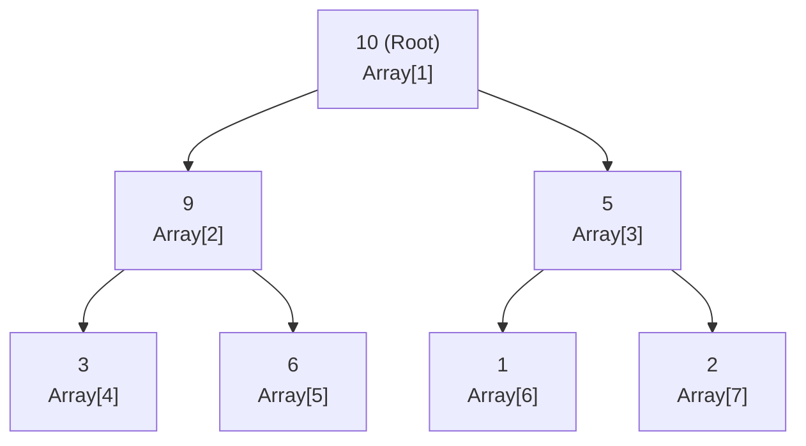

# 힙 (Heap)

---

## I. 최댓값과 최솟값의 신속한 조회를 위한 완전 이진 트리, 힙의 개요

### 가. 정의

- 완전 이진 트리(Complete Binary Tree) 구조를 기반으로 **부모 노드와 자식 노드 간의 일관된 대소 관계(최대 또는 최소)를 유지하여 최댓값 또는 최솟값을 $O(1)$에 조회하는 자료구조**

### 나. 특징 및 필요성

| 구분 | 내용 |
| --- | --- |
| 완전 이진 트리 | 마지막 레벨을 제외한 모든 레벨이 채워져 있고, 마지막 레벨은 왼쪽부터 빈틈없이 채워진 트리 |
| 반정렬 상태 | 형제 노드 간의 좌우 대소 관계는 제한이 없고, 부모-자식 간의 대소 관계만 유지 (Partial Ordering) |
| 배열 기반 구현 | 포인터 없이 1차원 배열 인덱스($2i, 2i+1, \lfloor i/2 \rfloor$)만으로 완전 이진 트리를 효율적 구현 |
| 우선순위 큐 기반 | 새로운 데이터 삽입과 루트 추출(삭제) 연산을 최악의 경우에도 $O(\log N)$ 시간에 보장 |

---

## II. 개념도 및 핵심 구성요소

### 가. 개념도 (최대 힙 구조)

- 부모 노드가 자식 노드보다 항상 크거나 같은(Max-Heap) 조건을 만족하며, 배열의 1번 인덱스를 루트로 삼아 부모와 자식 간 인덱스 연산으로 트리 순회

### 나. 핵심 구성요소 및 연산 메커니즘

| 구분 | 요소 | 설명 |
| --- | --- | --- |
| 힙 유형 | 최대 힙 (Max Heap) | 부모 노드 키 $\ge$ 자식 노드 키. 루트에 전체 트리 최댓값이 위치 |
| | 최소 힙 (Min Heap) | 부모 노드 키 $\le$ 자식 노드 키. 루트에 전체 트리 최솟값이 위치 |
| 배열 인덱스 | 부모 노드 | $\lfloor i / 2 \rfloor$ (1-based index 기준) |
| | 좌/우 자식 | 왼쪽 자식 $2i$, 오른쪽 자식 $2i + 1$ |
| 주요 연산 | 삽입 (Up-Heap / Push) | 배열의 맨 끝에 새 노드를 추가한 후 부모 노드와 비교·교환하며 위로 승격 ($O(\log N)$) |
| | 삭제 (Down-Heap / Pop) | 루트를 추출하고 마지막 노드를 루트로 이동한 후 자식과 비교·교환하며 하강 ($O(\log N)$) |
| 응용 | 우선순위 큐 (Priority Queue) | 입력 순서와 무관하게 가장 높은 우선순위를 갖는 항목을 신속하게 처리 |
| | 힙 정렬 (Heap Sort) | 힙을 구축한 후 루트를 순차 추출하여 정렬 ($O(N \log N)$ 제자리 정렬) |
| | 다익스트라 최단 경로 | 최단 거리 정점을 $O(\log V)$에 추출하여 전체 복잡도를 $O(E \log V)$로 단축 |

---

## III. 자료구조 비교 및 동향

### 가. 힙 vs 이진 탐색 트리(BST)

| 비교 항목 | 힙 (Heap) | 이진 탐색 트리 (BST) |
| --- | --- | --- |
| 정렬 규칙 | 부모-자식 간 대소 관계만 성립 (느슨한 정렬) | 왼쪽 자식 < 부모 < 오른쪽 자식 (엄격한 정렬) |
| 중복 키 | 중복 키 값 허용 | 통상적으로 중복 키 불허 (Set 구조) |
| 구조적 형태 | 반드시 완전 이진 트리 유지 | 편향(Skewed) 가능 (자가 균형 BST 제외) |
| 최댓값/최솟값 조회 | $O(1)$ (루트 노드 즉시 접근) | $O(\log N)$ 또는 $O(H)$ (최좌단/최우단 탐색) |
| 전체 데이터 탐색 | $O(N)$ (전체 순회 필요, 임의 검색 부적합) | $O(\log N)$ (이진 분기 탐색) |
| 주 활용 분야 | 우선순위 큐, 작업 스케줄링, 힙 정렬 | 키-값 사전, 범위 검색, 데이터베이스 인덱스 |

### 나. 동향

- **자료구조 힙과 메모리 힙의 명확한 구분**: 트리 기반 우선순위 제어 알고리즘인 자료구조 힙(Heap)과 OS 프로세스에서 동적 메모리(`malloc`/`new`)를 할당받는 런타임 메모리 힙 영역의 용어 혼동 방지 주의
- **대규모 데이터 스트리밍 탑-K(Top-K) 쿼리**: 수억 건의 실시간 데이터 스트림에서 가장 빈번하거나 점수가 높은 상위 $K$개 요소를 유지하기 위해 크기가 $K$로 제한된 최소 힙(Bounded Min-Heap)을 활용하여 메모리 효율화
- **고급 힙 자료구조 확장**: 네트워크 라우팅 및 그래프 알고리즘 최적화를 위해 간선 감소 연산(Decrease-Key)을 $O(1)$ 상각 시간에 수행하는 피보나치 힙(Fibonacci Heap) 활용 연구

---

### 🔗 연관 토픽

- **소속 도메인**: [[00_컴퓨터구조_MOC|💻 컴퓨터구조]]
- **세부 분류**: `4. 기본 자료구조 (Data Structures)`
- **핵심 연관 토픽**:
  - [[다익스트라 알고리즘|다익스트라 (Dijkstra) 알고리즘]]
  - [[Queue]]
  - [[이진 탐색 트리|이진 탐색 트리(Binary Search Tree)]]
  - [[트리 순회|트리 순회 (Tree Traversal)]]
  - [[알고리즘]]
