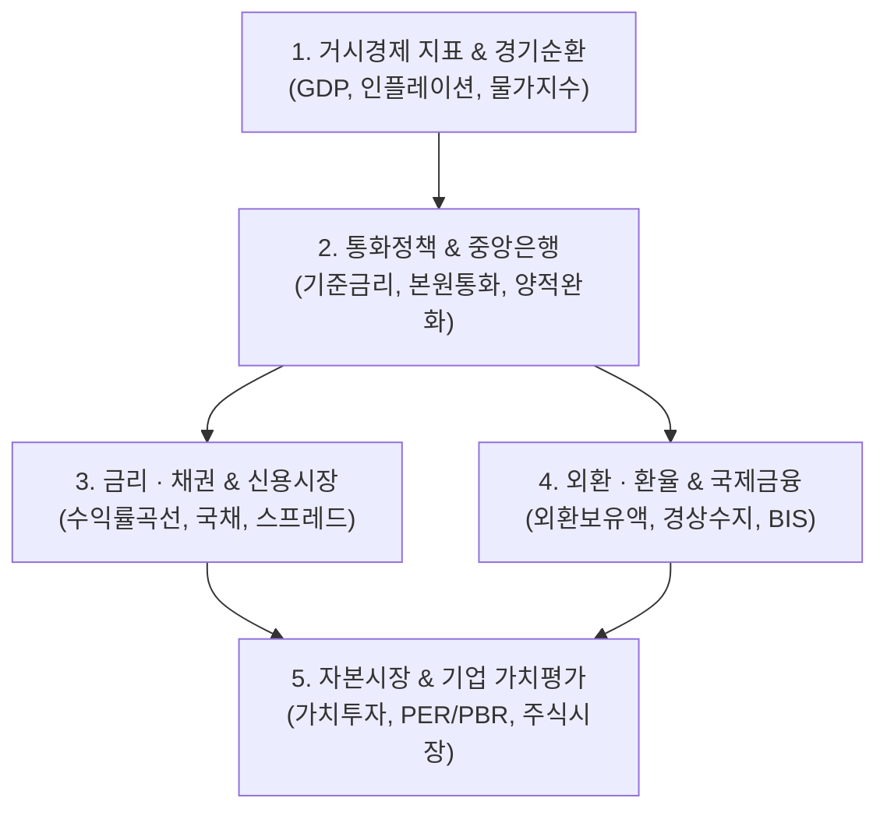

# 📈 경제 & 금융 마스터 MOC (Master Map of Content)

> **Welcome to Economics & Finance Knowledge Base**  
> 한국은행 경제금융용어와 거시경제 분석, 금리·환율 메커니즘, 가치투자 및 기업 분석을 아우르는 **829개** 경제·금융 지식 노트의 통합 인덱스입니다.

---

## 🗺️ 지식 도메인 체계

---

## 📑 핵심 분류 체계 및 주요 토픽

### 1. 거시경제 지표 & 경기 순환
* **경제 성장 및 산출**: [[02_Economics/GDP갭|GDP갭]], [[02_Economics/물가지수|물가지수]]
* **물가 및 인플레이션**: [[02_Economics/인플레이션|인플레이션]], [[02_Economics/디스인플레이션|디스인플레이션]], [[02_Economics/스태그플레이션|스태그플레이션]]

### 2. 통화 정책 & 중앙은행 시스템
* **중앙은행 정책**: [[02_Economics/한국은행|한국은행]], [[02_Economics/금융통화위원회|금융통화위원회]], [[02_Economics/통화정책|통화정책]], [[02_Economics/양적완화정책|양적완화정책]]
* **통화 지표 및 유동성**: [[02_Economics/본원통화|본원통화]], [[02_Economics/통화승수|통화승수]], [[02_Economics/관리통화제도|관리통화제도]]

### 3. 금리, 채권 & 신용 시장
* **금리 체계**: [[02_Economics/기준금리|기준금리]], [[02_Economics/가산금리|가산금리]], [[02_Economics/수익률곡선|수익률곡선]]
* **채권 및 파생상품**: [[02_Economics/국채|국채]], [[02_Economics/고정금리부채권(SB)|고정금리부채권(SB)]], [[02_Economics/금리스왑|금리스왑]], [[02_Economics/부실채권(NPL)|부실채권(NPL)]]

### 4. 외환, 환율 & 국제금융
* **환율 제도 및 지표**: [[02_Economics/기준환율|기준환율]], [[02_Economics/고정환율제도, 자유변동환율제도|고정환율 및 자유변동환율 제도]]
* **대외 건전성**: [[02_Economics/외환보유액|외환보유액]], [[02_Economics/경상수지|경상수지]], [[02_Economics/대외지급준비자산|대외지급준비자산]], [[02_Economics/BIS 자기자본비율|BIS 자기자본비율]]

### 5. 자본시장, 주식 & 기업 가치 평가
* **투자 철학**: [[02_Economics/가치투자|가치투자]], [[02_Economics/주식시장|주식시장]]
* **밸류에이션 지표**: [[02_Economics/PER|PER (주가수익비율)]], [[02_Economics/PBR|PBR (주가순자산비율)]], [[02_Economics/자기자본이익률(ROE)|ROE (자기자본이익률)]], [[02_Economics/배당금|배당금]]

---

## 🧭 빠른 이동 및 관련 도메인
- [[index|🏠 Supreme Note 디지털 가든 홈]]
- [[01_IT Tech/00_02_IT_Tech_MOC|🌐 IT & 테크 10대 도메인 마스터 MOC]]
- [[03_Management/00_03_Management_MOC|📋 경영 & 프로젝트 관리 MOC (PMBOK 7판)]]
